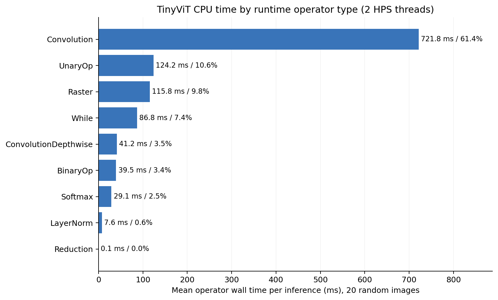
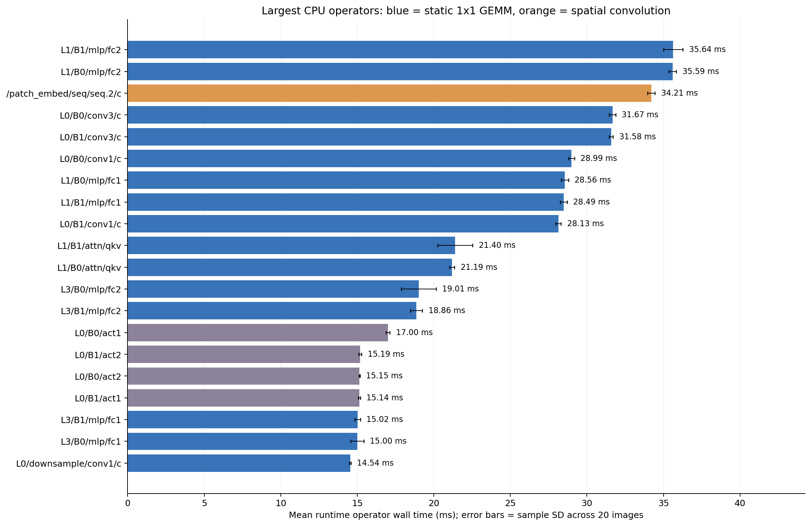

# TinyViT full-model HPS CPU operator profile

Measured **2026-11-11** on the connected DE1-SoC: **20 random images, two CPU
threads, 40 measured fresh-process inferences** (control/profile pairs), plus
two unmeasured fresh-process warmups. This implements the first strategy step:
find the CPU hotspots and record their matrix shapes before choosing the next
offload. **No additional operator was offloaded and no FPGA speedup is claimed.**

The main finding is that **51 static-weight 1x1 convolution operators account
for 678.026 ms (57.68% of profiled inference)**.
Many are exported linear/MLP projections, despite their runtime type being
`Convolution`. The previously selected first QK takes just
**4.703 ms (0.40%)**.
The largest individual matrix candidates are the two stage-1 MLP `fc2`
projections at about 35.6 ms each, followed by other 1x1 convolutions and `fc1`.

**Recommended first follow-up microbenchmark:**
`/layers.1/blocks.0/mlp/fc1/Add_output_0__matmul_converted`,
**784x128 times 128x512**, CPU **28.556 ms**.
It has static weights and H=W=1 activations. It needs fewer
reduction panels than `fc2`. The larger-saving `fc2` is also shortlisted, but
requires eight K panels with the current planner. These are benchmark targets,
not evidence that the current FPGA path already beats their CPU times.

The [2026-11-12 fc1 experiment](tinyvit-fc1-capacity-benchmark.md) now implements
this follow-up with capacity-aware tiles. It confirms that packed NC4HW4 still
requires tensor layout conversion when H=W=1. Archived candidate annotations
about possible dense views were hypotheses; logical strides did not prove them.
The original CPU timing evidence remains unchanged.



## Measurement quality and scope

| Metric | Result |
|---|---:|
| CPU control inference mean | 1167.791500 ms |
| CPU control median / SD | 1164.175000 / 10.348138 ms |
| Profiled inference mean | 1175.514917 ms |
| Sum of measured operator intervals | 1165.997697 ms |
| Outside operator intervals | 9.517221 ms |
| Operator coverage of profiled inference | 99.190% |
| Runtime command intervals per inference | 339 |
| Unique runtime names per inference | 339 |
| Timed command intervals over 20 profiles | 6780 |
| FPGA submissions | 0 |

Profile minus control inference averaged **+7.723 ms
(+0.661%)**, with paired-bootstrap 95% interval
**+1.047 to
+13.793 ms**. This comparison
includes profiler effects and run-to-run noise. Twenty thousand paired bootstrap
resamples use seed 20261111. Controls/profile order alternates, 10 of each first.
No samples were removed. Operator shares use the profiled inference denominator,
so they add consistently to the measured coverage. They are not exact uninstrumented
cycle counts and are not individual NEON-kernel times.

Input/output shape, layout, stride and datatype capture occurs outside each
operator interval. It remains included in total profiled inference. Other
outside-interval work can include MNN dispatch, input handling and commands
without callback information. Model metadata parsing and JSON serialization
occur after inference/output saving; they do not contribute to inference timing.
They do increase the profiling process wall time, which should not be used as
an ordinary application startup benchmark.

All 40 outputs contained 1,000 finite FP32 scores. Every control/profile score
file matched bit-for-bit, and every image's output also matched the corresponding
CPU result from the earlier random-input experiment. Operator metadata and
execution order were identical across the warmup and all 20 measured profiles.
All FPGA environment variables were removed, and no operation was selected
for offload. Each process used `--runs 1 --warmup 0`, avoiding the known
session-reuse output drift. No FPGA image, clock or driver was changed.

The same seeds 2026111101..2026111120 generated independent uniform uint8 RGB
224x224 images, normalized with mean 0.485,0.456,0.406 and std 0.229,0.224,0.225.
The Linux nominal CPU boot clock is 925 MHz; frequency telemetry/pinning was
unavailable. Durations use monotonic clocks, not the incorrect board RTC.
CPU control/profile processes ran under the same ordinary Ubuntu user.

| Provenance | Value |
|---|---|
| Runner SHA-256 | `f538aa09fdb9c8e53c103d64a49524cbfe0a5ec894473c97cf319f44241861bf` |
| Model SHA-256 | `f7aee628e2cef2d726979cc259529b3af0778b429c52ba8b76f3c609a2996de4` |
| Canonical operator catalog SHA-256 | `09b665c6e54f511bc3d3f9105c01b853e6488cf646d613c77d9b03cd1b6258d7` |
| Board result directory | `/home/ubuntu/tinyvit/benchmark-operator-profile-random-20` |

## Runtime types

| Runtime type | Commands/inference | Mean ms | Share of profiled inference |
|---|---:|---:|---:|
| Convolution | 53 | 721.778 | 61.40% |
| UnaryOp | 23 | 124.192 | 10.56% |
| Raster | 154 | 115.759 | 9.85% |
| While | 22 | 86.806 | 7.38% |
| ConvolutionDepthwise | 15 | 41.155 | 3.50% |
| BinaryOp | 40 | 39.504 | 3.36% |
| Softmax | 10 | 29.071 | 2.47% |
| LayerNorm | 21 | 7.590 | 0.65% |
| Reduction | 1 | 0.143 | 0.01% |

`Convolution` includes 51 static-weight 1x1 operations plus two spatial
convolutions. Depthwise convolution is reported separately. `Raster` is
MNN's tensor region/layout movement and materialization work, not a matrix
kernel. Attention MatMuls are lowered to runtime `While` commands; not every
`While` is necessarily a MatMul. The candidate classifier checks original
model metadata rather than treating all loop commands as matrix products.

These results explain why attention QK alone is a small target. Ordinary
convolution/projection operators consume 61.4% of inference, while layout work
and activations are also substantial. Arithmetic offload does not automatically
remove those surrounding costs.

## Twenty largest individual runtime operations

Names below are shortened for readability; [the complete CSV](benchmarks/cpu-operators-2026-11-11/operator-ranking.csv)
contains exact names, every one of the 339 runtime commands,
means, medians, SD, range, shapes and candidate notes. A convolution's listed
GEMM is a mathematical equivalent; it is not proof that MNN invokes a dense
MatMul kernel or that the existing FPGA hook intercepts it.

| Rank | Operator | Runtime type | Mean ms | SD ms | Share | Equivalent matrix dimensions |
|---:|---|---|---:|---:|---:|---|
| 1 | `/layers.1/blocks.1/mlp/fc2` | Convolution | 35.636 | 0.629 | 3.03% | 784x512 times 512x128 |
| 2 | `/layers.1/blocks.0/mlp/fc2` | Convolution | 35.593 | 0.249 | 3.03% | 784x512 times 512x128 |
| 3 | `/patch_embed/seq/seq.2/c` | Convolution | 34.207 | 0.244 | 2.91% | 3136x288 times 288x64 |
| 4 | `/layers.0/blocks.0/conv3/c` | Convolution | 31.672 | 0.212 | 2.69% | 3136x256 times 256x64 |
| 5 | `/layers.0/blocks.1/conv3/c` | Convolution | 31.585 | 0.127 | 2.69% | 3136x256 times 256x64 |
| 6 | `/layers.0/blocks.0/conv1/c` | Convolution | 28.995 | 0.197 | 2.47% | 3136x64 times 64x256 |
| 7 | `/layers.1/blocks.0/mlp/fc1` | Convolution | 28.556 | 0.240 | 2.43% | 784x128 times 128x512 |
| 8 | `/layers.1/blocks.1/mlp/fc1` | Convolution | 28.486 | 0.222 | 2.42% | 784x128 times 128x512 |
| 9 | `/layers.0/blocks.1/conv1/c` | Convolution | 28.132 | 0.175 | 2.39% | 3136x64 times 64x256 |
| 10 | `/layers.1/blocks.1/attn/qkv` | Convolution | 21.398 | 1.141 | 1.82% | 784x128 times 128x384 |
| 11 | `/layers.1/blocks.0/attn/qkv` | Convolution | 21.186 | 0.168 | 1.80% | 784x128 times 128x384 |
| 12 | `/layers.3/blocks.0/mlp/fc2` | Convolution | 19.015 | 1.141 | 1.62% | 49x1280 times 1280x320 |
| 13 | `/layers.3/blocks.1/mlp/fc2` | Convolution | 18.859 | 0.391 | 1.60% | 49x1280 times 1280x320 |
| 14 | `/layers.0/blocks.0/act1` | UnaryOp | 17.003 | 0.129 | 1.45% | - |
| 15 | `/layers.0/blocks.1/act2` | UnaryOp | 15.189 | 0.096 | 1.29% | - |
| 16 | `/layers.0/blocks.0/act2` | UnaryOp | 15.150 | 0.030 | 1.29% | - |
| 17 | `/layers.0/blocks.1/act1` | UnaryOp | 15.141 | 0.062 | 1.29% | - |
| 18 | `/layers.3/blocks.1/mlp/fc1` | Convolution | 15.019 | 0.180 | 1.28% | 49x320 times 320x1280 |
| 19 | `/layers.3/blocks.0/mlp/fc1` | Convolution | 15.000 | 0.433 | 1.28% | 49x320 times 320x1280 |
| 20 | `/layers.0/downsample/conv1/c` | Convolution | 14.538 | 0.049 | 1.24% | 3136x64 times 64x128 |



## Static-weight matrix shortlist

For a normal 1x1 convolution, equivalent GEMM dimensions are
`M = batch * output_height * output_width`, `K = input_channels`,
`N = output_channels`. Bias/fused activation remains part of the original
operator's behavior. For a spatial convolution, `K` also includes kernel area
and requires patch extraction/im2col or a native convolution datapath; it is
not a direct dense matrix view.

| Candidate | CPU mean ms | Equivalent GEMM | INT8 weights | Current planner K panels | Current planner jobs |
|---|---:|---|---:|---:|---:|
| `/layers.1/blocks.0/mlp/fc1` | 28.556 | 784x128 times 128x512 | 64 KiB | 2 | 16 |
| `/layers.1/blocks.1/mlp/fc1` | 28.486 | 784x128 times 128x512 | 64 KiB | 2 | 16 |
| `/layers.1/blocks.0/mlp/fc2` | 35.593 | 784x512 times 512x128 | 64 KiB | 8 | 32 |
| `/layers.1/blocks.1/mlp/fc2` | 35.636 | 784x512 times 512x128 | 64 KiB | 8 | 32 |
| `/layers.0/blocks.0/conv1/c` | 28.995 | 3136x64 times 64x256 | 16 KiB | 1 | 13 |
| `/layers.0/blocks.0/conv3/c` | 31.672 | 3136x256 times 256x64 | 16 KiB | 4 | 52 |
| `/layers.1/blocks.0/attn/qkv` | 21.186 | 784x128 times 128x384 | 48 KiB | 2 | 16 |

The job counts describe the **current software planner**, which chooses output
panels up to 256x256 and reduction panels up to 64. They are not optimal-tiling
proofs or an assertion that the RTL has an absolute K=64 limit. Different
rectangular tile shapes may trade fewer reduction panels for more row/column
panels, operand retransfers or descriptor overhead. Such changes require separate
hardware/accuracy validation and were not tested in this CPU profiling step.
The subsequent [shape/register review](matmul-soc-shape-and-abi-review.md)
confirms that the updated upstream core and register file match the 90 MHz
synthesis inputs and documents the actual bank-capacity constraints.

The full CSV records each runtime command's frequency (one call per inference)
and 20 timing samples. Repeated static GEMM shapes below can share a kernel
implementation, although their learned weight values differ between layers:

| Equivalent static GEMM family | Calls/inference | Combined CPU ms | Share |
|---|---:|---:|---:|
| 196x640 times 640x160 | 6 | 83.184 | 7.08% |
| 196x160 times 160x640 | 6 | 74.942 | 6.38% |
| 784x512 times 512x128 | 2 | 71.229 | 6.06% |
| 3136x256 times 256x64 | 2 | 63.256 | 5.38% |
| 3136x64 times 64x256 | 2 | 57.127 | 4.86% |
| 784x128 times 128x512 | 2 | 57.042 | 4.85% |
| 196x160 times 160x480 | 6 | 54.753 | 4.66% |
| 784x128 times 128x384 | 2 | 42.584 | 3.62% |


Why start with **stage-1 MLP fc1**:

- Its CPU budget is about 28.56 ms, approximately
  6.1 times the currently profiled first QK.
- Runtime input/output shapes are `[784,128,1,1]` and `[784,512,1,1]`.
  Follow-up implementation found that NC4HW4 interleaves channels across the
  batch even with H=W=1. Logical batch strides do not establish a dense view.
  The fc1 prototype uses explicit MNN tensor conversions in both directions
  and includes their cost in the selected-operation timer.
- Weights are embedded, static FP32 parameters. They can be transposed/packed
  and quantized once for an accelerator prototype rather than dynamically
  quantizing both operands every inference as QK does. Their INT8 form is 64 KiB;
  it exceeds a single 16 KiB operand buffer, so prequantized storage in DDR does
  not mean all weights are resident on chip at once.
- The current planner needs two K panels, versus eight for fc2. A prototype
  must include panel accumulation, result conversion, bias and all remaining
  transfers in its timing. It must not compare fabric-only execution with the
  whole CPU operation.

Why keep **fc2** as the largest-saving candidate:

- Its CPU budget is about 35.59 ms per block, with equivalent
  784x512 times 512x128 multiplication and similarly simple H=W=1 activation storage.
- Eight current K panels increase repeated result readback/host accumulation.
  Keeping partial sums on FPGA, or improving capacity-aware tile selection,
  is especially relevant. Faster fabric alone does not remove those costs.

The stage-0 expansion **conv1** is another useful comparison: K=64 needs just
one reduction panel and its INT8 weight matrix is 16 KiB. It has larger
spatial tensors, however, so MNN's layout must be transformed or consumed by
appropriate hardware. That additional work must be measured.

All these operators currently execute through **MNN Convolution**, not the
existing `CPUMatMul` hook. A follow-up prototype needs a convolution/linear
integration point or a deliberate graph rewrite. Merely changing `--fpga-op`
to one of their names will not activate the current MatMul accelerator path.

## Connected-region opportunities

Stage totals below are non-overlapping by name prefix. MLP regions are subsets
of their stages and must not be added again to stage totals.

| Stage | Mean ms | Share |
|---|---:|---:|
| `/layers.2` | 392.747 | 33.41% |
| `/layers.1` | 308.045 | 26.21% |
| `/layers.0` | 259.298 | 22.06% |
| `/layers.3` | 110.672 | 9.41% |

| Connected MLP region | Commands | Mean ms | Share |
|---|---:|---:|---:|
| `/layers.1/blocks.0/mlp` | 7 | 79.405 | 6.75% |
| `/layers.1/blocks.1/mlp` | 7 | 79.385 | 6.75% |
| `/layers.3/blocks.0/mlp` | 7 | 36.169 | 3.08% |
| `/layers.3/blocks.1/mlp` | 7 | 36.018 | 3.06% |
| `/layers.2/blocks.5/mlp` | 7 | 31.103 | 2.65% |
| `/layers.2/blocks.4/mlp` | 7 | 30.945 | 2.63% |
| `/layers.2/blocks.3/mlp` | 7 | 30.939 | 2.63% |
| `/layers.2/blocks.2/mlp` | 7 | 30.787 | 2.62% |
| `/layers.2/blocks.0/mlp` | 7 | 30.785 | 2.62% |
| `/layers.2/blocks.1/mlp` | 7 | 30.725 | 2.61% |

The two stage-1 MLP regions together consume **158.791 ms
(13.51%)**, including their associated activation/layout commands.
They offer a larger eventual optimization budget than one isolated QK.
An FPGA region covering projection, activation and projection could avoid
some intermediate transfers/conversions only if those operations and compatible
scales/layouts are supported. The figures are CPU budgets and optimistic
upper limits if work disappeared, **not predicted FPGA savings**.

## What this step establishes

The next engineering target should come from the static-weight projection
family. The recommended next experiment is a standalone, complete-path fc1
benchmark with prepared static weights, followed by fc2. Compare every cost
against the measured CPU operator budget, check numerical error and retain CPU
execution unless the complete accelerated path wins reliably. The current
unoptimized conversion/readback path has not been demonstrated to win on these
shapes; this profiling result is not a reason to enable more offloads immediately.

A quantized model file alone does not route these Convolution operators through
the existing hook. Likewise, the pure-fabric QK speed ratio must not be
extrapolated as a measured speedup for these larger matrices. Separate target
microbenchmarks, potentially better tiling/accumulation and integration work
remain the next step.

## Evidence and reproduction

[Complete runtime ranking CSV](benchmarks/cpu-operators-2026-11-11/operator-ranking.csv),
[full ranking JSON](benchmarks/cpu-operators-2026-11-11/operator-ranking.json), [candidate records](benchmarks/cpu-operators-2026-11-11/offload-candidates.json),
[statistics and type/region aggregates](benchmarks/cpu-operators-2026-11-11/summary.json),
[all 20 paired timing vectors and output hashes](benchmarks/cpu-operators-2026-11-11/results.json),
[runtime tensor and original-model catalog](benchmarks/cpu-operators-2026-11-11/operator-catalog.json),
[metadata](benchmarks/cpu-operators-2026-11-11/metadata.json), [checksums](benchmarks/cpu-operators-2026-11-11/SHA256SUMS).
Raw evidence: [logs, output scores and aggregate records](benchmarks/cpu-operators-2026-11-11/benchmark-operator-profile-random-20-core.tar.gz),
[profiles 1-5 and warmup](benchmarks/cpu-operators-2026-11-11/benchmark-operator-profile-random-20-raw-0.tar.gz),
[profiles 6-10](benchmarks/cpu-operators-2026-11-11/benchmark-operator-profile-random-20-raw-1.tar.gz),
[profiles 11-15](benchmarks/cpu-operators-2026-11-11/benchmark-operator-profile-random-20-raw-2.tar.gz),
[profiles 16-20](benchmarks/cpu-operators-2026-11-11/benchmark-operator-profile-random-20-raw-3.tar.gz).

All 40 score-file hashes and all 20 raw profile hashes/timing vectors were
verified after download. Images remain in the earlier random benchmark directory
and are reproducible from its seeds and byte hashes. No model weights are
included in these reports, only parameter counts and metadata.

Implementation: optional `--profile-ops FILE.json` in `mnn/app/tinyvit_run.cpp`,
with `operator_profile.cpp/.hpp` for callback timing and model metadata.
`benchmark_operator_profile.py` runs the board experiment;
`summarize_operator_profile.py` writes the ranking and derived GEMM shapes;
`plot_operator_profile.py` produces standalone PNG/SVG figures.

On the board, use a new result directory and the deployed static runner:

```sh
python3 benchmark_operator_profile.py \
  --runner tinyvit_operator_profile \
  --source-results /home/ubuntu/tinyvit/benchmark-qk-profile-90mhz-20 \
  --output-dir /home/ubuntu/tinyvit/NEW-operator-profile --inputs 20
```

For a single full-model CPU operator profile, remove FPGA environment variables
and run the runner with ordinary model/input options plus
`--profile-ops /path/to/profile.json`. Build the application against the same
pinned MNN source/library, including its generated schema and FlatBuffers headers.
The profiling binary is separate from the validated offload runners.

Checks: ARM build with application warnings as errors; one-image smoke test;
20 paired CPU runs; exact output hashes against the previous CPU baseline;
stable runtime catalog; positive non-overlapping timing intervals; timing
sum/coverage checks; model shape/channel consistency checks; verified serial
hashes and archived raw profile checks. No FPGA workload ran in this experiment.
