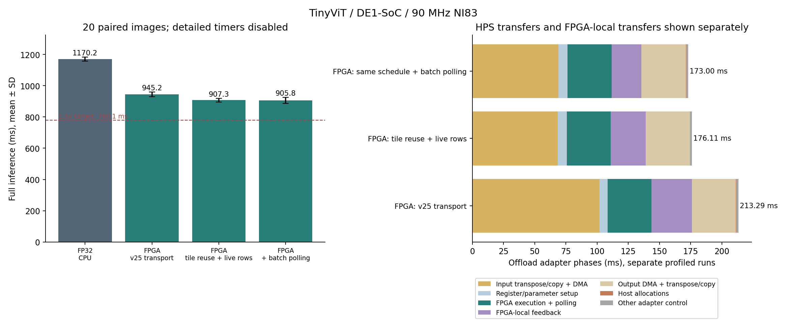

# Reducing TinyViT DMA and staging time

This follow-up uses the same 90 MHz NI83 accelerator, two Cortex-A9 threads,
and accuracy-qualified mixed model as the [previous latency experiment](tinyvit-latency-optimization.md).
The workload still executes 30 linear operations and four resident MLP pairs
on the FPGA. The driver changes how it delivers those operands and returns
their results.

## Final 20-image comparison

The selected driver averages **905.762 ms** per full inference, down from
**945.195 ms** for v25 in the same test. This saves **39.433 ms (4.17%)**
versus the previous FPGA pipeline and reaches **1.292×** versus the
matched **1170.188 ms** FP32 CPU baseline. The 1.5× target in this run is
780.125 ms, leaving a gap of 125.636 ms.

| Configuration | Full inference mean ± SD (ms) | Fresh-process wall mean (ms) |
|---|---:|---:|
| Original FP32 CPU | 1170.188 ± 12.769 | 2834.771 |
| v25 FPGA runner | 945.195 ± 15.431 | 2013.686 |
| v27 tile reuse and live rows | 907.312 ± 11.676 | 1907.813 |
| **v27 tile reuse, live rows and batch polling** | **905.762 ± 20.012** | **1799.533** |

The selected configuration was faster on 19 of 20 inputs versus v25 and
all 20 versus FP32. The 95% paired-bootstrap interval for the saving over
v25 is [30.363, 47.821] ms. The speedup interval versus FP32 is
[1.278, 1.303]×. Batch polling's additional mean saving was 1.551 ms,
with an interval of [−7.846, 10.420] ms. The package uses the fastest mean
from the final comparison. The polling difference alone is inconclusive.

Each configuration ran on the same 20 saved random RGB images with two
threads and a balanced order. Control timings measure the full forward
pass after model loading and session setup. The component timings below
come from separate profiled runs on the same inputs.
Fresh-process wall time includes startup, image preparation, and model I/O
with normal filesystem caching.



| Offload component (ms/image) | v25 | Selected v27 | Change |
|---|---:|---:|---:|
| Input upload, including staging and DMA | 101.843 | 69.033 | −32.810 |
| Local feedback between FC1 and FC2 | 32.360 | 23.936 | −8.424 |
| Output DMA and unpacking | 34.834 | 35.300 | +0.466 |
| FPGA completion wait, including polling | 34.819 | 34.811 | −0.008 |
| Configuration and launch | 6.879 | 7.756 | +0.877 |
| Other adapter work | 2.556 | 2.168 | −0.388 |
| **Complete FPGA adapter** | **213.291** | **173.003** | **−40.288** |

Within the upload timer, input packing and staging fell from 33.293 to
11.125 ms, a 66.6% reduction. Output staging remains about 25 ms.

| Full profiled inference component (ms/image) | Original FP32 CPU | v25 | Selected v27 |
|---|---:|---:|---:|
| Selected linear callbacks | 347.656 | 213.993 | 173.717 |
| Remaining CPU convolutions | 419.086 | 420.926 | 418.162 |
| QK/softmax/AV attention | 200.294 | 150.215 | 151.056 |
| Remaining GELU | 126.601 | 89.742 | 88.660 |
| Remaining activation casts | 0.000 | 24.410 | 23.575 |
| Remaining layout copies | 53.804 | 45.962 | 46.269 |
| Residual, normalization and other framework work | 32.465 | 34.658 | 34.863 |
| **Total instrumented inference** | **1179.906** | **979.906** | **936.303** |

The selected callback row includes the adapter and its integration overhead.
The separate wall-time controls are the primary performance comparison.
## What changed

The previous driver kept B, the weights, in FPGA SRAM during an output-column
tile and walked the input rows. With multiple column tiles, it transposed and
uploaded some of the same A, the input activation, several times. The new
driver estimates the cost of both traversal orders using input bytes, packed
weight bytes, and the cost of packing A at runtime. It keeps the cheaper
sequence of operands resident. At the end of each row or column of tiles it
reverses traversal direction so the last operand can also serve the next tile.
For the stage-3 FC1 with M=49, K=320 and N=1280, all 49 input rows fit in A.
The previous driver staged a 64-row padded operand for each of ten output
tiles, totaling 204,800 bytes. The new driver stages the 15,680 live input
bytes once and loads each weight tile against them.

In the resident FC2 path, the new traversal starts with the narrower output
tile, which can fit more rows in the fixed result scratch space. If A still
holds the requested hidden rows when the next column tile starts, FC2 reuses
the data already in SRAM. This saves a local DMA copy while preserving the
same accumulation and requantization.

The software does not change the DDR memory mapping. The validation still
requires Linux to exclude the reserved DMA window beginning at `0x30000000`.

The second change transfers only live rows. For example, a 49-row input
still launches with a 64-row padded shape. DMA transfers 49 rows, and the
application consumes the corresponding 49 output rows. Each output row
depends only on its own input row. The reduction dimension retains its
required zero padding. All DMA transfers remain 16-byte aligned and respect
the existing 2,048-byte HPS and 256-byte local descriptor limits.

## Transport experiments

The first eight-image pilot compared the original v25 FPGA path with each
change and their combination. Each mode used two threads, balanced run order,
and separate control and profile runs. All FPGA scores matched byte-for-byte.

| Initial pilot | Mean inference (ms) | Profiled input staging (ms) | Complete FPGA adapter (ms) |
|---|---:|---:|---:|
| Original v25 | 952.645 | 32.450 | 210.949 |
| Reuse A across column tiles | 909.379 | 11.716 | 184.945 |
| Transfer only live rows | 924.264 | 30.062 | 204.377 |
| Combined, v26 | 907.081 | 11.331 | 183.312 |

The second pilot compared the combined v26 result with v27 scheduling.
It also tested whether fewer clock reads in the DMA poll loop helped and
whether sending A or reading C directly over the FPGA aperture beat DDR DMA.

| Second pilot | Mean inference (ms) | Complete FPGA adapter (ms) |
|---|---:|---:|
| Combined v26 | 906.637 | 185.067 |
| v27 scheduling | 902.421 | 174.497 |
| v27 with batch polling | 960.650 | 170.122 |
| Batch polling and direct A writes | 910.521 | 180.779 |
| Batch polling and direct C reads | 923.198 | 195.973 |
| Batch polling and direct A/C | 929.950 | 203.340 |

Direct A raised the upload timer from 67.8 to 77.1 ms against the
same batch-polling configuration. Direct C raised the readback timer from
34.6 to 58.3 ms. The direct paths passed the numerical checks, but keeping
DDR DMA was faster. The batch-poll experiment computes a deadline per
buffer transfer and removes redundant barriers around status reads. It
reduced profiled local DMA cost and had more variable full-model timings,
including one 1323.5 ms sample in this pilot. All samples are included in the
means. The final timing comparison tests both polling modes again.

## Per-image transfer counts

These counts apply to the full model using DDR DMA. The input payload includes
the coefficient writes as well as A and B. Each descriptor count measures
CPU submissions to one of the three DMA engines.

| Counter | Original v25 | v27 scheduling | Reduction |
|---|---:|---:|---:|
| Input operand bytes | 8,049,920 | 6,810,304 | 1,239,616 |
| Output bytes | 2,465,280 | 2,352,000 | 113,280 |
| FPGA-local feedback bytes | 1,200,128 | 1,023,488 | 176,640 |
| Input DMA descriptors | 3,897 | 3,250 | 647 |
| Output DMA descriptors | 1,227 | 1,227 | 0 |
| Local DMA descriptors | 4,688 | 3,998 | 690 |
| **Total DMA descriptors** | **9,812** | **8,475** | **1,337** |
| FPGA matmul jobs | 296 | 296 | 0 |

Shorter output tails reduce bytes even when each tile still needs the same
number of descriptors after rounding up to a whole descriptor. Fabric
arithmetic and matmul job counts are the same in these experiments.

## Correctness checks

The host driver passed 55 matrix and pair cases. The physical oracle passed
13 cases with DMA and another 13 with the direct-access experiments. Those
cases cover signed INT8, nonaligned row counts, full K through 2048, a
64-KiB output tile, and resident MLPs up through 320→1280→320. The oracle
computes the integer accumulation and requantization independently.

Both FPGA variants matched the prior v25 output byte-for-byte on all 20
timing inputs across controls and profiles. The selected variant also
matched every saved FPGA score on the 200-image labeled Imagenette subset.
It classified 153/200 correctly, equal to FP32 CPU. Top-1 agreement was
198/200 and mean score cosine was 0.997517. These are the same labeled
inputs used to qualify v25. The accuracy check reused saved FP32 scores
after verifying the reference hashes and preprocessing.

The serial console became unresponsive during labeled validation. After a
successful filesystem sync and read-only remount, the HPS was warm rebooted
with the same programmed image and DMA memory reservation. The validation
resumed after verifying the first 120 completed output records. The cause
of the console stall was undetermined. All performance timings were
recorded before this interruption and the labeled run serves as a numeric
check only.

## Deployment and reproduction

Use the local `build/tinyvit-dma-optimized-90mhz-v27.tar.gz` package with the
90 MHz NI83 image already programmed. The board wrapper is in
`/home/ubuntu/tinyvit/tinyvit-dma-optimized-90mhz-v27`.

```sh
sudo ./run_inference.sh /absolute/path/image.png --output-dir result-01
```

The wrapper enables activation reuse, live-row transfers and batch polling.
It uses DDR DMA with the reserved staging region excluded from Linux RAM.
The package includes the static ARM runner, mixed model and file checksums.
The board currently reserves this region with the `mem=768M` boot argument.
The installed wrapper passed a three-inference smoke test with 888 FPGA
submissions and the same score file hash as input 01 of the timing run.

The [evidence directory](benchmarks/dma-optimization-2026-11-21/README.md)
contains configurations, raw samples, score hashes, per-image timing tables,
build and model identities, and the offline verification procedure.
