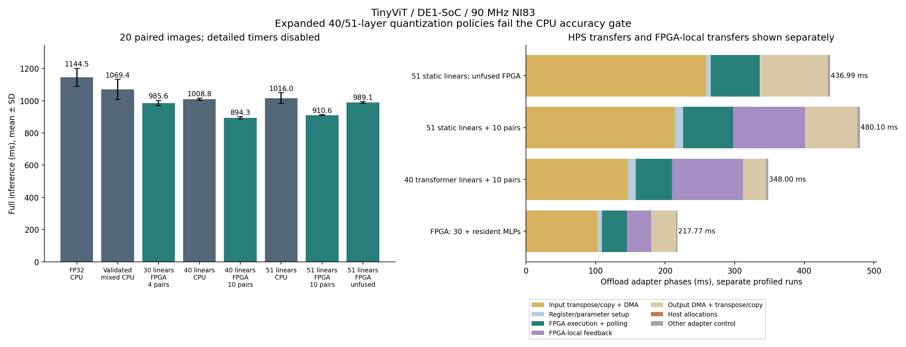

# Expanded TinyViT static-linear offload experiment

The expanded policies include all 10 fused QKV projections, all 10 attention
output projections, and all 10 FC1 / 10 FC2 MLP projections. A second policy
also includes the 10 spatial pointwise convolutions and classifier, giving
51 static-weight matrix operations. These are experimental models: both
failed the CPU accuracy gate before FPGA execution. The existing validated
mixed model is preserved.

On 20 random RGB images, the 40-linear FPGA configuration averages
**894.284 ms**, versus **1144.495 ms** for original FP32 CPU: **21.86% lower
inference latency (1.280x speedup)**. Offloading all 51 static linears averages
**910.554 ms**, a **20.44% reduction (1.257x)**. Both expanded models have severe
accuracy loss and are unsuitable replacements for the validated model.
Runs started November 17 and finished November 18, 2026.

## Quantization and accuracy

Both candidates use the original FP32 graph, the existing MNN KL-calibrated
W8A8 parameters and explicit conversion boundaries. Quantized operators use
INT8 weights and activations, INT32 accumulation and per-channel output
requantization. This does not make the whole model integer-only: attention
QK/AV products, softmax, normalization, residual operations and remaining
convolutions still execute on the CPU.

The original mixed policy has 37 quantized convolutions: 30 static linears
and seven depthwise convolutions. The transformer policy has 47: all 40
transformer linears plus those seven depthwise convolutions. The static policy
has 58: all 51 static linears plus those seven depthwise convolutions.
Depthwise convolutions remain on the CPU.

| CPU model / diagnostic ablation | Correct / 200 | Accuracy | Drop from FP32 | Same top-1 as FP32 |
|---|---:|---:|---:|---:|
| Original FP32 | 149 | 74.5% | — | 200 |
| Existing validated mixed policy | 148 | 74.0% | 0.5 percentage points | 193 |
| Existing mixed + three missing attention projections | 139 | 69.5% | 5.0 percentage points | 171 |
| Existing mixed + seven missing MLP projections | 58 | 29.0% | 45.5 percentage points | 69 |
| All 40 transformer linears | 43 | 21.5% | 53.0 percentage points | 51 |
| All 51 static linears | 29 | 14.5% | 60.0 percentage points | 35 |

These measurements use the same 200 natural holdout images excluded from the
128-image calibration set. This is a reused diagnostic holdout, not full
ImageNet validation. The two diagnostic ablations were tested on the host CPU.
The preserved mixed-policy result is from its
[existing 200-image validation](benchmarks/quantization-repair-2026-11-12/host-corrected-gate-200.json)
with the same model and image hashes.
The severe loss is present without FPGA execution; it cannot be attributed to
DMA or the systolic array. The MLP ablation identifies quantizing the missing
MLP layers as the dominant observed problem. Establishing whether better
calibration, selective scaling or quantization-aware training fixes it requires
a separate accuracy-repair experiment.

## Hardware and execution

The NI83 variant retains the 16x16 systolic array, 64-KiB B operand buffer and
64-KiB INT8 output buffer, and expands the A operand bank to 32 KiB. This
supports full reductions through K=2048, including stage-3 FC2 at K=1280.
Software chooses M/N tiles from actual buffer capacities; the fabric handles
16x16 internal tiles. Padding is removed when returning NC4-packed results.

For an unfused `A[M,K] × B[K,N]`, let `Kp=ceil(K/16)*16`. The planner chooses:

```text
tile_N = min(floor(65536 / Kp / 16)*16, 128, ceil(N/16)*16)
tile_M = min(floor(32768 / Kp / 16)*16,
             floor(65536 / tile_N / 16)*16)
```

The padded reduction is accumulated in INT32 before one requantization;
K is not split into independently rounded partial results.

| Example | M / K / N | Unfused tile M / K / N | Unfused jobs |
|---|---|---|---:|
| Stage-1 FC1 | 784 / 128 / 512 | 256 / 128 / 128 | 16 |
| Stage-3 FC2 | 49 / 1280 / 320 | 16 / 1280 / 48 | 28 |
| Large spatial pointwise | 3136 / 64 / 256 | 512 / 64 / 128 | 14 |
| Classifier | 1 / 320 / 1000 | 96 / 320 / 128 | 8 |

The final row band uses the remaining rows padded to 16, not necessarily the
maximum tile M. Thus the classifier still computes 16 padded rows for one
useful row. MNN selection also requires supported symmetric quantization,
pack4 channels, group-one 1x1 operators, K≤2048 and N≤4096; this is not a
claim that every arbitrary MNN convolution or quantization scheme is supported.

The new 90-MHz image passes all 88 reported timing checks. Worst core setup
slack is +1.002 ns; the minimum reported slack across check types/corners is
+0.039 ns. The fit uses 22,710/32,070 ALMs (71%), 368/397 RAM blocks (93%) and
35/87 DSP blocks. There are zero unconstrained clocks. The report retains
12 input and 13 output ports without external timing constraints, belonging
to HPS Ethernet/SD/UART and reserved JTAG interfaces; this is not a claim of
complete external-interface timing closure. No new timing exceptions were
added to obtain the core pass.

The programmed SOF SHA256 is
`f4b4803ba459ee33a496fe6e4def06919ac06d6dce4e6be2146bca37e3951447`.
The local deployment artifact is
`build/matmul-soc-deploy/matmul-soc-native-ni83-90mhz.sof`.
The board was booted with temporary `mem=768M`, keeping the reserved
16-MiB DMA/cache region beginning at physical `0x30000000` outside Linux.
The bootloader environment and SD boot image were not permanently changed.

NI83 is deliberately distinguishable from NI82: capability CSR `0x90` is
`0x4e493833`, format CSR `0xa0` is `0x03181080`, and B writes start at `0x9000`.
The C read window also starts at `0x9000`; separate read/write decoders make
this overlap intentional. Prepared weights are rejected if the ABI changes.

All ten FC1/activation/FC2 pairs can keep the quantized hidden tensor in FPGA
RAM. An exact lookup table implements the supported intervening activation
and quantization mapping. FPGA-local DMA feeds FC1 outputs back to FC2; only
the pair input and final output cross the HPS boundary. Weights are prepared
and cached in reserved HPS DDR, but still uploaded when needed. This is not
permanent on-chip storage of every model weight.

DMA remains synchronous, driven and polled by the HPS. DMA0/1 descriptors are
limited to 2048 bytes and FPGA-local descriptors to 256 bytes, matching the
generated masters' actual burst capacity. This change adds no CPU/FPGA
execution overlap.

## Validation method

Independent host driver and RTL tests cover large reductions, partial tiles,
spatial NC4 layout and resident MLP feedback. A physical smoke test checks the
programmed datapath against an independent INT64 arithmetic oracle.

| Check | Result |
|---|---|
| Host driver matrix/pair tests | 51 cases passed, including K through 2048 |
| RTL output/requantization CXXRTL | 162 cases, 128,538 checked values passed |
| Physical NI83 matrix/resident tests | 13 cases, 276,800 checked values exactly match integer oracle |

Physical cases include K=1280 and 2048, the full 64-KiB output canvas and a
135x320 → 1280 → 320 resident MLP. Reports and logs are retained in
[the evidence directory](benchmarks/expanded-static-2026-11-17/).

`--native-verify` runs each selected MNN CPU operator and mirrors that operator
on FPGA with a saved copy of the identical INT8 input. The FPGA result is
compared in NC4 layout while CPU graph outputs are preserved. The diagnostic
gate allows at most one INT8 output code of difference, accounting for fixed
point versus CPU floating-point requantization. This diagnostic mode is not a
performance measurement. Ordinary full-model offload runs separately measure
the effect of propagated arithmetic differences and resident fusion.

The performance harness uses the same 20 uniform-random RGB images as the
earlier experiments, two Cortex-A9 threads and separate fresh processes.
Unprofiled controls provide headline inference latency; profiled runs record
operator scopes and adapter phases. A separate natural-image experiment
measures predictions against labels and original FP32 outputs. Random-image
top-1 agreement is not classification accuracy.

## Twenty random inputs: measured performance

Each row has 20 unprofiled controls and 20 separate profiled runs, totaling
320 inferences. Two Cortex-A9 threads, 224x224 input, no all-zero images and
no inference warmup. The eight configurations rotate through Williams-design
orders; with 20 images, each order position occurs two or three times rather
than being perfectly balanced. No samples, including timing outliers, were
discarded. Filesystem caches were not flushed between fresh processes.

| Model / execution | Inference mean ± SD, ms | Fresh-process wall mean, ms | FPGA jobs / image |
|---|---:|---:|---:|
| Original FP32 CPU | 1144.495 ± 56.175 | 1822.244 | 0 |
| Validated mixed CPU | 1069.418 ± 62.867 | 1718.164 | 0 |
| Validated mixed: 30 FPGA linears, 4 resident pairs | 985.562 ± 16.128 | 1570.757 | 296 |
| All 40 transformer linears: CPU | 1008.754 ± 7.474 | 1588.187 | 0 |
| All 40 transformer linears: FPGA, 10 resident pairs | 894.284 ± 6.668 | 1508.174 | 496 |
| All 51 static linears: CPU | 1015.982 ± 33.419 | 1491.525 | 0 |
| All 51 static linears: FPGA, 10 resident pairs | 910.554 ± 3.144 | 1486.201 | 614 |
| All 51 static linears: FPGA, unfused | 989.123 ± 6.072 | 1624.967 | 498 |

Inference measures the graph execution only. Process wall also includes image
decoding/normalization, model loading, session creation, weight/LUT preparation,
output export and process teardown. These are fresh processes with normal OS
file caching, not disk-cold reboot measurements.

Compared with each expanded model's own CPU baseline, FPGA execution saves
**114.470 ms (11.35%)** for 40 transformer linears and **105.428 ms (10.38%)**
for 51 static linears. These comparisons isolate the incremental offload gain
after choosing the quantized graph; the larger FP32 comparison also includes
the effect of changing quantization policy.

All four FPGA-versus-CPU comparisons below improve inference on every one
of the 20 paired random inputs. Bootstrap intervals resample those paired
inputs; they describe this experiment, not every board or workload.

| Comparison | Mean saving, ms | 95% paired bootstrap interval for saving, ms |
|---|---:|---:|
| Transformer FPGA versus original FP32 CPU | 250.211 | 233.578–278.306 |
| All-static FPGA versus original FP32 CPU | 233.941 | 218.455–260.966 |
| Transformer FPGA versus its own CPU model | 114.470 | 110.206–119.021 |
| All-static FPGA versus its own CPU model | 105.428 | 92.796–121.637 |

Unprofiled medians are 1129.355 ms for FP32, 891.655 ms for transformer FPGA
and 909.519 ms for all-static FPGA. The FP32 maximum is 1379.990 ms; the
validated mixed-CPU maximum is 1329.310 ms. These outliers remain in the means.

Fresh-process speed relative to the same quantized CPU model is less certain.
Transformer offload saves a mean 80.013 ms, but the 95% interval is
−64.413 to +219.180 ms; it wins 7/20 cold processes. All-static offload saves
5.324 ms, interval −58.655 to +81.651 ms, and wins 5/20. The corresponding
paired median wall changes are **+28.681 ms** and **+73.306 ms**: typical cold
invocations are slower despite lower inference latency. Startup and file-cache
variation make inference speedup an unreliable promise of one-shot speedup.

Adding the other 11 static linears makes inference **16.270 ms (1.82%) slower**
than offloading the 40 transformer linears. All-static resident fusion saves
**78.570 ms (7.94%)** versus offloading those same 51 operators individually.
Fused and unfused outputs are byte-identical on all 20 random inputs. Residency
increases job count because the hidden canvas and FC2 scratch region impose
smaller row bands, but removes CPU intermediate conversions/activation work
and HPS hidden-tensor transfers.

On the new NI83 hardware, the existing validated mixed model's
30-linear / four-pair configuration is 13.89% faster than FP32 CPU in this
experiment. Its accuracy qualification is much stronger than either expanded
policy. Historical NI82 timings came from a different boot and runner artifact;
the table above supplies newly measured controls for this comparison.

## Transfers, computation and remaining CPU work

The following are mean host-wall measurements from the separate profiled
runs. Outer adapter phases are disjoint; DMA setup/wait/copy sub-timers are
nested inside them. Completion polling includes hardware execution and host
observation/scheduling latency. There is no fabric cycle counter separating
pure array computation from stalls or polling.

| Adapter phase, ms/image | 40 transformer, resident | 51 static, resident | 51 static, unfused |
|---|---:|---:|---:|
| Input layout/copy plus input/weight DMA | 146.585 | 213.943 | 258.890 |
| Registers, coefficients and LUT writes | 10.949 | 12.040 | 6.491 |
| Launch plus FPGA completion polling | 52.302 | 71.409 | 70.391 |
| FPGA-local hidden feedback | 102.149 | 103.705 | 0 |
| Output DMA and copy, including pending FC2 copy | 32.943 | 75.109 | 97.804 |
| Host allocations | 0.076 | 0.077 | 0 |
| Remaining adapter control | 2.995 | 3.817 | 3.413 |
| **Complete adapter** | **348.000** | **480.099** | **436.990** |

For all-static resident execution, upload includes 57.902 ms staging/copy,
30.096 ms DMA setup and 115.693 ms DMA completion polling. Download includes
51.655 ms staging/copy, 8.807 ms DMA setup and 10.336 ms DMA polling. Local
feedback includes 49.334 ms descriptor setup and 39.137 ms DMA polling. These
sub-timers do not include every outer-phase instruction and must not be added
to the outer totals again.

The 51 INT8 CPU linear scopes total **430.630 ms**. FPGA launch/completion
takes **71.409 ms**, a **6.03x phase ratio**; the complete adapter takes
**480.099 ms**. The sixfold figure therefore does not describe a sixfold
improvement for the complete offloaded section. Resident fusion also removes
intermediate CPU conversions/activation/layout work, which is outside the
CPU linear-kernel sum.

The adapter performs no runtime FP32-to-INT8 activation/weight quantization
and no INT8-to-FP32 output reconstruction: operands and outputs are already
native INT8. The mixed graph still contains explicit CPU conversion operators
at FP32 boundaries. Those conversions remain significant, as the next table
shows.

| Sequential callback scopes, ms/image | FP32 CPU | Transformer CPU | Transformer FPGA | All-static CPU | All-static FPGA |
|---|---:|---:|---:|---:|---:|
| All 51 static-linear callbacks | 669.251 | 495.676 | 510.718 | 430.630 | 481.075 |
| Other convolutions | 81.853 | 82.393 | 81.088 | 81.290 | 83.662 |
| FloatToInt8 | 0 | 29.380 | 14.645 | 69.701 | 56.274 |
| Int8ToFloat | 0 | 17.088 | 11.116 | 37.340 | 34.539 |
| Raster/layout | 110.808 | 111.406 | 92.650 | 110.426 | 95.024 |
| Unary operations | 119.491 | 119.172 | 88.503 | 119.121 | 93.574 |
| While/control-flow attention regions | 84.085 | 83.944 | 84.285 | 84.233 | 86.949 |
| Softmax | 28.043 | 27.658 | 27.759 | 27.815 | 28.558 |
| Other CPU/operator scopes | 46.182 | 45.525 | 45.088 | 45.344 | 47.821 |
| Outside operator callbacks | 8.482 | 10.190 | 9.848 | 10.777 | 10.736 |
| **Profiled whole inference** | **1148.196** | **1022.432** | **965.700** | **1016.675** | **1018.211** |

These operator callbacks are sequential and additive; the analysis verifies
their sum plus the outside remainder against every profiled inference.
Adapter phases are nested inside the linear callbacks and are not added again.
For the transformer-FPGA column, 40 of the 51 linears use FPGA and the other
11 remain FP32 CPU. A resident FC1 scope includes its FC2 computation; the
later FC2 callback mainly returns the pending result. Individual FC1/FC2 scope
times therefore do not separate the two kernels in fused mode.

Detailed timing and run variation materially affect these measurements.
Transformer-FPGA profiled inference averages 965.700 ms versus 894.284 ms
without profiling. All-static FPGA averages 1018.211 ms versus 910.554 ms;
its profiled median is 990.961 ms, with one 1509.411-ms outlier retained.
The complete-adapter median is 473.357 ms versus its 480.099-ms mean.
Validated mixed CPU and validated mixed FPGA also have large profile-run
outliers (2233.663 and 2516.311 ms). Use unprofiled paired controls for claims
about end-to-end improvement; do not subtract profiled phases from those
controls to invent an unmeasured CPU remainder.

### Why the additional 11 linears do not help

For those same 11 operators, the all-static INT8 CPU scopes total **97.765 ms**
and FPGA scopes total **127.985 ms**, 30.219 ms more. Ten of the eleven FPGA
scopes exceed their corresponding INT8 CPU scope in this profiled experiment.

| Added operator example | M / K / N | INT8 CPU scope, ms | FPGA scope, ms |
|---|---|---:|---:|
| Stage-0 block-0 expansion | 3136 / 64 / 256 | 18.876 | 24.009 |
| Stage-0 block-0 projection | 3136 / 256 / 64 | 16.119 | 22.389 |
| Classifier | 1 / 320 / 1000 | 0.484 | 4.490 |

The classifier is especially inefficient: it uploads many weights for a
single useful row while the array computes at least 16 padded rows. Buffer
capacity support does not make a shape transfer-efficient.

Relative to retaining those 11 operators in FP32 CPU, their scopes decrease
from 161.971 to 127.985 ms. However, explicit graph conversion scopes increase
from **25.761 ms** for transformer FPGA to **90.813 ms** for all-static FPGA,
an extra **65.052 ms**. This offsets operator savings. The profiled full-model
difference is 52.512 ms; the separately measured unprofiled difference is
16.270 ms. Their differing instrumentation/run variation prevents treating
the profiled decomposition as an exact decomposition of the control delta.

### Data movement and startup

| Counter per image | Transformer FPGA | All-static FPGA | All-static unfused |
|---|---:|---:|---:|
| HPS-to-FPGA bytes, including weights/padding | 13,555,712 | 17,369,984 | 16,851,328 |
| FPGA-to-HPS bytes, including padding | 2,206,720 | 4,977,408 | 6,742,784 |
| FPGA-local feedback bytes | 3,547,136 | 3,547,136 | 0 |
| Input DMA descriptors | 6518 | 8378 | 8216 |
| Output DMA descriptors | 1154 | 2509 | 3371 |
| Local DMA descriptors | 13856 | 13856 | 0 |

Ten resident pairs avoid **3,530,752 padded bytes** of hidden-tensor HPS round
trips per image. Local feedback can repeat a hidden row band for different
FC2 column tiles; it is not one local copy of each logical tensor. Thousands
of short descriptors and synchronous polling remain a major cost.

Separate profile runs measure startup costs as follows. They are not components
of the unprofiled inference timer or an exact sum of the unprofiled wall mean.

| Startup phase, ms | Transformer CPU | Transformer FPGA | All-static CPU | All-static FPGA |
|---|---:|---:|---:|---:|
| RGB preprocessing | 25.251 | 22.633 | 22.422 | 22.369 |
| Model load | 175.564 | 211.803 | 151.343 | 148.200 |
| Session creation/resize | 228.031 | 226.498 | 242.462 | 244.714 |
| Initial input copy | 5.437 | 4.600 | 4.567 | 4.566 |
| Accelerator weight/cache/LUT preparation | 0 | 145.295 | 0 | 168.131 |

Keeping a session and prepared weights alive can amortize setup, but this
experiment uses fresh processes. It does not measure a pipelined service or
CPU/FPGA overlap.



## CPU–FPGA numerical agreement and natural images

The diagnostic experiment checks every selected operator on 20 identical
natural-image inputs per model: **206,180,640 INT8 output values** across
40 full-model diagnostic runs. Every operator passes the predefined maximum
error of one output code; no value differs by more than one code. This is
agreement within a tolerance, not bit-exact equivalence to MNN's floating-point
requantization.

| Same-input arithmetic check | Values checked | Values differing by exactly one code | Errors above one code |
|---|---:|---:|---:|
| Transformer policy | 75,640,320 | 9317 (0.0123%) | 0 |
| Static policy | 130,540,320 | 14778 (0.0113%) | 0 |

All 40 diagnostic CPU graph outputs match the corresponding ordinary CPU
control output hashes, confirming that the mirror did not alter CPU execution.

Independent full offload runs can propagate these small differences. The final
top-1 predictions agree with the corresponding quantized CPU graph on **14/20
images for the transformer policy** and **17/20 for the static policy**.
Therefore the expanded paths do not establish full-model prediction equivalence,
despite passing the local arithmetic tolerance. The existing validated model
and the expanded models must not be treated as equally qualified.
Mean final-logit cosine to each model's own CPU result is 0.97767 for transformer
FPGA and 0.96429 for static FPGA, with mean relative L2 errors of 0.21005 and
0.26839. By comparison, the validated model preserves 20/20 CPU top-1 predictions
here (mean cosine 0.99748). Sparse local rounding differences can propagate;
passing a per-operator tolerance does not establish whole-model equivalence.

| Natural-image configuration | Inference mean ± SD, ms | Correct / 20 |
|---|---:|---:|
| Original FP32 CPU | 1133.935 ± 10.078 | 16 |
| Validated mixed CPU | 1057.486 ± 9.847 | 16 |
| Validated mixed FPGA, four resident pairs | 990.126 ± 14.674 | 16 |
| All 40 transformer linears: CPU | 1012.822 ± 8.540 | 4 |
| All 40 transformer linears: FPGA, ten resident pairs | 897.867 ± 11.550 | 5 |
| All 51 static linears: CPU | 1008.157 ± 10.640 | 4 |
| All 51 static linears: FPGA, ten resident pairs | 916.276 ± 20.157 | 4 |

These 20 labeled images are reused diagnostic examples, not an independent
large accuracy test. The one additional correct transformer prediction on
FPGA is not evidence of improved generalization. The 200-image CPU tests above
already show the dominant accuracy loss from the expanded quantization.

The hardware can execute all requested projections. Expanding the default
policy is blocked by model quality: preserve the validated mixed model until
the additional attention/MLP layers pass calibration or quantization-aware
training validation, then repeat the full-model CPU–FPGA agreement check.

## Reproduction

Generate each model with `create_mixed_quantized_model` using the original
`tiny-vit-fp32.mnn`, the existing `tiny-vit-w8a8-kl.mnn`, and either
`mnn/app/tinyvit_w8a8_all_transformer_allowlist.txt` or
`mnn/app/tinyvit_w8a8_all_static_allowlist.txt`. Keep the validated mixed model
under its existing filename. The generated model files remain outside Git.

The generated files are available locally under
`build/expanded-static-20261117/` and on the board in `/home/ubuntu/tinyvit/`:

- `tiny-vit-mixed-w8a8-all-transformer.mnn` (12,592,968 bytes)
- `tiny-vit-mixed-w8a8-all-static.mnn` (10,783,236 bytes)

The tested ARM application is `build/matmul-soc-deploy/tinyvit_native_v12`,
also installed on the board. For an experimental offload run after booting
the matching NI83 image and reserving DMA memory:

```sh
cd /home/ubuntu/tinyvit
sudo env MNN_MATMUL_SOC_DEVMEM=1 MNN_MATMUL_SOC_DMA=1 ./tinyvit_native_v12 \
  --model tiny-vit-mixed-w8a8-all-transformer.mnn \
  --height 224 --width 224 --image IMAGE.png \
  --mean 0.485,0.456,0.406 --std 0.229,0.224,0.225 --threads 2 --runs 1 \
  --fpga-native-int8 --fpga-native-pairs --require-fpga --output-dir RESULTS
```

For the preserved accuracy-qualified policy on the currently loaded NI83
image, use this same v12 command with
`--model tiny-vit-mixed-w8a8-accuracy.mnn`. It selects 30 linears and four
resident pairs. The older v11 binary requires NI82 and cannot drive NI83.

Prepare the isolated hardware project with:

```sh
python platform/prepare_matmul_soc_native.py \
  --friend-root build/matmul-soc \
  --output build/matmul-soc-native-ni83-90 --extended-a
python platform/build_matmul_soc.py \
  --friend-root build/matmul-soc-native-ni83-90 --native-hps-launcher
```

Build the updated patched MNN library and `tinyvit_run`, verify timing and
physical smoke tests, then run `benchmark_expanded_numeric.py` and
`benchmark_native_int8.py --abi NI83 --configurations FILE`. The configuration
file names each model and its required native-operation / resident-pair counts.
`summarize_native_int8.py` verifies saved outputs and produces timing and
per-layer CSV files.
`summarize_expanded_numeric.py --natural-results DIRECTORY NUMERIC_DIRECTORY`
also verifies that diagnostic CPU graph outputs match the ordinary CPU
controls on those identical images.
