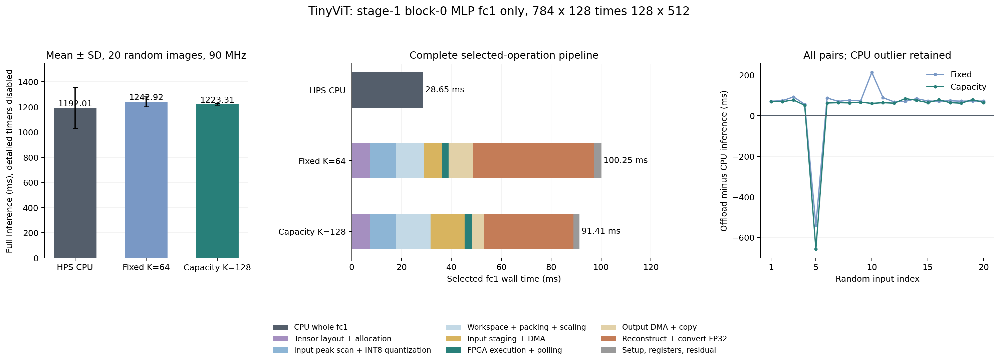

# TinyViT fc1 capacity-aware tiling: 20 random inputs at 90 MHz

Measured 2026-11-12 on the connected DE1-SoC. The driver now searches legal
tile shapes instead of assuming K=64. Only stage-1 block-0 MLP fc1 was replaced;
the first QK and every other operation ran on the two-thread HPS CPU.

**Capacity-aware fc1 offload increased full inference latency by
31.305 ms / 2.63% versus CPU.**
It reduced latency by 19.605 ms versus fixed K=64.
The tile/transport implementation works, but this is **not an accuracy-equivalent
model replacement**: the accelerator's repeated INT8 rounding causes substantial
fc1 error. Performance and numerical fidelity are separate results below.

The full-inference mean is sensitive to one CPU outlier and its 95% paired
confidence interval crosses zero. Capacity was slower in 19/20 pairs; the
median paired penalty is 64.400 ms. The selected fc1
comparison is consistent: capacity adds 62.752 ms,
95% CI [62.423, 63.254] ms.



## CPU baseline and complete inference

All times are milliseconds. Tables use mean ± sample standard deviation over
20 images. Detailed profiling is disabled for the primary inference/process
comparison. Selected-operation and phase tables come from separate paired
profiled runs, so their means should not be subtracted directly from controls.

| Mode | Full inference, mean ± SD | Median | Min–max | Selected fc1, profiled |
|---|---|---|---|---|
| HPS CPU | 1192.008 ± 163.204 | 1156.095 | 1151.880–1885.230 | 28.653 ± 0.292 |
| Fixed K=64 | 1242.918 ± 39.927 | 1228.135 | 1223.800–1369.530 | 100.252 ± 4.239 |
| Capacity-aware K=128 | 1223.313 ± 6.524 | 1220.785 | 1216.610–1237.910 | 91.405 ± 0.960 |

| Paired comparison | Added inference ms | Latency change | 95% paired bootstrap CI, added ms | Slower / 20 |
|---|---|---|---|---|
| CPU → fixed | +50.910 | +4.27% | [-17.979, 94.475] | 19 |
| CPU → capacity | +31.305 | +2.63% | [-42.833, 70.178] | 19 |
| Fixed → capacity | -19.605 | -1.58% | [-39.649, -5.151] | 3 |

Positive change means slower. Confidence intervals resample whole image pairs
20,000 times with a fixed seed. They describe this experiment, not all images
or all board operating conditions. No samples were discarded.

CPU control image 05 took 1885.230 ms, compared with its 1156.095 ms median
over all 20 images. This observation is retained. The cause was not isolated
by a scheduler trace. It makes the mean 2.63% penalty uncertain: the 95% CI
for capacity minus CPU is [-42.833, +70.178] ms. Median inference changes from
1156.095 to 1220.785 ms (+5.60% as a ratio of medians), and the median of
paired differences is 64.400 ms. These are separate statistics, not an
outlier-filtered replacement for the mean. Fixed-policy control runs on
images 05 and 10 also exceeded 1300 ms. The consistent selected-operation
slowdown and 19/20 slower pairs support an overhead problem, while the exact
mean full-model penalty remains noisy in this 20-sample experiment.

The CPU fc1 timer covers the complete native optimized MNN 1x1 convolution,
including its internal work. It is not an isolated scalar GEMM or a hardware
kernel cycle count. No new CPU kernel-only probe was added for this convolution.
Comparing its whole duration with only FPGA start-to-done gives an optimistic
compute opportunity, not an apples-to-apples kernel speedup.

Capacity reduces the complete selected fc1 by
8.847 ms
versus Fixed64 (95% paired CI for capacity minus fixed:
[-11.038, -7.385] ms).

## Selected layer and tile selection

Exact runtime name: `/layers.1/blocks.0/mlp/fc1/Add_output_0__matmul_converted`.
The model exports this linear layer as a static FP32 1x1 Convolution:
input `[784,128,1,1]`, output `[784,512,1,1]`, weight OI `[512,128]`, bias 512.
Its mathematical operation is `[784,128] × [128,512] + bias`: 51,380,224 MACs.
The full model remains FP32. Only the operands submitted to this layer's
accelerator are symmetric signed INT8 with zero point 0.

Each hardware job internally runs the 16x16 array over its programmed shape.
The host still loops over jobs for matrices larger than the physical buffers.
This change does not add a DDR matrix-job descriptor engine to the FPGA.
Both policies use the existing DMA transport and updated 16-byte-stride ABI.

Legal padded tiles satisfy:

```
tile_M × tile_K <= 16384 bytes       # first operand
tile_K × tile_N <= 16384 bytes       # second operand
tile_M × tile_N <= 65536 bytes       # INT8 results
tile_M, tile_N, tile_K: multiples of 16
tile_N <= 1008                      # 10-bit input extent cannot encode 1024
```

The planner enumerates legal shapes and minimizes a heuristic cost:
`30 ns × input bytes + 14 ns × result bytes + 20 ns × host accumulated values
+ 5000 ns × jobs`. Weights are rounded from the earlier QK profiling; this
is a traffic/host-work proxy, not a measured time prediction, exhaustive
on-board tile autotuning, or an accuracy-aware optimizer.

| fc1 plan | Fixed64 | Capacity |
|---|---|---|
| Tile M | 256 | 128 |
| Tile K | 64 | 128 |
| Tile N | 256 | 128 |
| Jobs per inference | 16 | 28 |
| Input payload bytes | 462848 | 860160 |
| Result payload bytes | 802816 | 401408 |
| Host result accumulations | 802816 | 401408 |
| Heuristic cost, ns | 41261184 | 39592672 |

The final M tail is 16 rows. Fixed64 uses four row panels × two column panels
× two K panels = 16 jobs. Capacity uses seven row panels × four column panels
× one K panel = 28 jobs. Capacity halves result traffic/host accumulation but
increases input payload from 462,848 to 860,160 bytes. It does not minimize job
count. Input/output DMA descriptor counts are 60/100 versus 108/52; both total 160.
All 65,536 weight values are prepared once in host memory; their 64 KiB INT8
representation cannot remain wholly resident in either 16 KiB operand buffer.

Physical hardware checks after restoring the 90 MHz image passed for
128x128 times 128x128 (one K=128 job), 64x256 times 256x64 (one K=256 job), and
the full fc1 geometry (28 jobs). The prepared signed-pattern smoke cases have
maximum errors below 0.000004 against their arithmetic references. This verifies
shape support; it does not establish neural-network accuracy on real weights.

## Time spent inside the replacement

The following rows are disjoint pieces of the complete selected-operation
timer. Static weight preparation is outside inference and appears later.
`completion_wait` is host start-to-done wall time including MMIO polling and
scheduling. The current ABI has no cycle counter to isolate pure fabric time.

| Disjoint phase, ms | Fixed64 mean ± SD | Capacity mean ± SD |
|---|---|---|
| Allocate host layout tensors | 0.092 ± 0.008 | 0.094 ± 0.016 |
| MNN packed input → dense FP32 | 1.140 ± 0.162 | 1.100 ± 0.025 |
| Activation peak scan | 1.913 ± 0.042 | 1.913 ± 0.051 |
| Activation FP32 → INT8 | 8.610 ± 0.126 | 8.569 ± 0.072 |
| Driver workspace/validation | 4.207 ± 0.088 | 4.194 ± 0.091 |
| Validate cached tile plan | 0.002 ± 0.000 | 0.002 ± 0.000 |
| Pack/pad tile operands | 4.672 ± 0.176 | 5.805 ± 0.116 |
| Compute safe output scale bounds | 2.153 ± 0.041 | 3.866 ± 0.065 |
| Program/check control registers | 0.064 ± 0.003 | 0.101 ± 0.002 |
| Input CPU staging + DMA | 7.340 ± 0.078 | 13.583 ± 0.086 |
| Launch accelerator | 0.025 ± 0.000 | 0.044 ± 0.001 |
| FPGA execution + polling | 2.647 ± 0.173 | 2.925 ± 0.017 |
| Output DMA + CPU staging copy | 9.878 ± 0.135 | 4.994 ± 0.056 |
| Dequantize/add K-panel results | 24.819 ± 0.425 | 12.340 ± 0.135 |
| Bias, FP32 conversion and staged result copy | 23.492 ± 0.419 | 23.384 ± 0.318 |
| Dense FP32 → MNN packed output | 6.162 ± 0.162 | 6.163 ± 0.102 |
| Unassigned adapter overhead | 1.204 ± 0.035 | 1.187 ± 0.029 |
| Device open/map/lock | 0.417 ± 0.028 | 0.405 ± 0.010 |
| Bridge remainder/logging | 0.795 ± 3.060 | 0.117 ± 0.025 |
| Callback remainder/destruction | 0.621 ± 0.021 | 0.618 ± 0.020 |
| Complete selected fc1 | 100.252 ± 4.239 | 91.405 ± 0.960 |

The phase means sum to the complete selected fc1 timer. Nested transport
subphases below are already included in upload/download; do not add them again.

| Nested transport phase, ms | Fixed64 | Capacity |
|---|---|---|
| input_stage_copy | 4.081 ± 0.075 | 7.550 ± 0.086 |
| input_dma_setup | 0.212 ± 0.001 | 0.382 ± 0.012 |
| input_dma_wait | 2.917 ± 0.013 | 5.429 ± 0.033 |
| output_dma_setup | 0.353 ± 0.012 | 0.186 ± 0.013 |
| output_dma_wait | 1.345 ± 0.007 | 0.673 ± 0.003 |
| output_stage_copy | 8.032 ± 0.122 | 4.015 ± 0.053 |

| Transport remainder, ms | Fixed64 | Capacity |
|---|---|---|
| input_transport_remainder | 0.129 ± 0.005 | 0.222 ± 0.003 |
| output_transport_remainder | 0.148 ± 0.014 | 0.120 ± 0.002 |

For capacity tiles, start-to-done is 2.925 ms,
versus CPU whole fc1 28.653 ms.
The complete replacement is 91.405 ms:
88.480 ms lies outside
start-to-done. Thus the hardware execution opportunity is overwhelmed by the
host/transfer/conversion path. Changing K does not remove those boundaries.

The two large reconstruction phases alone cost
35.723 ms;
activation scan/quantization costs
10.483 ms, and explicit
tensor layout allocation/conversion costs
7.357 ms.
Input preparation is therefore not the only overhead.

The profiled rest-of-model delta, after subtracting selected fc1, is
+0.133 ms for capacity
versus CPU. Changed values, caches, scheduling and measurement noise can affect
the remaining operators; whole-model change need not equal selected-layer change.
This experiment does not isolate those causes individually.

## Whole pipeline and one-time work

The inference timer excludes image decode/normalization, model/session creation,
input copy, static weight setup and final score saving. Complete process wall
time, measured by the Python parent, includes those costs and teardown.
Each measured run creates a fresh process/session and executes one inference.
Weights and plan are cached within a process, so a persistent application could
amortize preparation. The per-inference dynamic phases above would remain.

| Profiled pipeline section, ms | HPS CPU | Fixed K=64 | Capacity-aware K=128 |
|---|---|---|---|
| preprocess_ms | 21.365 ± 0.131 | 21.441 ± 0.309 | 21.427 ± 0.319 |
| model_load_ms | 229.751 ± 0.631 | 237.349 ± 27.454 | 230.962 ± 4.487 |
| session_ms | 128.987 ± 0.345 | 130.162 ± 3.795 | 129.584 ± 2.225 |
| input_copy_ms | 4.549 ± 0.047 | 4.580 ± 0.096 | 4.569 ± 0.066 |
| linear_setup_ms | 0.000 ± 0.000 | 10.818 ± 0.157 | 11.768 ± 0.117 |
| inference_ms | 1157.642 ± 3.942 | 1232.571 ± 11.316 | 1220.527 ± 3.806 |
| output_ms | 1.336 ± 2.505 | 2.879 ± 4.389 | 1.761 ± 3.108 |
| main_elapsed_ms | 1543.948 ± 4.532 | 1640.205 ± 39.826 | 1620.994 ± 10.332 |

The native MNN session still performs its usual CPU weight preparation; this
callback prototype does not remove that session-creation work. Additional static
FPGA preparation is nested within `linear_setup_ms`:

| Nested static setup, ms | Fixed64 | Capacity |
|---|---|---|
| weight_setup_ms | 8.644 ± 0.111 | 9.618 ± 0.090 |
| weight_peak_scan_ms | 1.252 ± 0.021 | 1.255 ± 0.028 |
| weight_quantize_ms | 7.327 ± 0.096 | 7.319 ± 0.064 |
| plan_selection_ms | 0.004 ± 0.000 | 0.984 ± 0.010 |

| Complete process controls | Baseline mean ms | Other mean ms | Added ms / % | 95% CI, added ms |
|---|---|---|---|---|
| CPU → Fixed64 | 1616.410 | 1684.744 | +68.334 / +4.23% | [-2.955, 113.487] |
| CPU → Capacity | 1616.410 | 1666.680 | +50.269 / +3.11% | [-27.461, 93.302] |
| Fixed64 → Capacity | 1684.744 | 1666.680 | -18.065 / -1.07% | [-40.865, 0.917] |

| Detailed timer impact on full inference | Profile minus control mean ms | 95% paired CI, ms |
|---|---|---|
| cpu | -34.365 | [-108.738, 4.033] |
| fixed | -10.347 | [-28.862, 3.225] |
| capacity | -2.786 | [-6.108, 0.408] |

## Numerical diagnosis: layout fixed; arithmetic still unsuitable

MNN stores these tensors as packed NC4HW4. H=W=1 and logical batch strides
equal to channel counts do **not** prove row-major storage. The final runner
uses public `copyToHostTensor`/`copyFromHostTensor` conversions with CAFFE host
tensors. A preliminary raw-buffer-view prototype was wrong; its timings and
scores are excluded. Every result in this report uses the corrected v2 runner.

An independent diagnostic on random image 01 captures the native fc1 input and
output through these conversions, computes FP32 OI GEMM with bias, then compares
ordinary quantized INT8 operands with full INT32 accumulation and with the
actual accelerator. Full fc1 hardware outputs match an independent per-band
integer arithmetic oracle exactly for both policies.

| Image 01 fc1 output comparison | Max absolute error | RMSE | Relative L2 | Mean signed error |
|---|---|---|---|---|
| Independent FP32 GEMM vs native | 2.6226e-06 | 1.69847e-07 | 1.55378e-07 | 1.31022e-10 |
| INT8 operands, full INT32 accumulation vs native | 0.0995678 | 0.0198736 | 0.0181806 | -0.000656454 |
| Fixed64 actual FPGA vs native | 2.2618 | 1.24686 | 1.14065 | -1.22065 |
| Capacity actual FPGA vs native | 4.66417 | 2.48921 | 2.27717 | -2.43352 |

The hardware floors/rescales/saturates each 16-wide reduction band to INT8,
then adds those INT8 results with saturation. It does not preserve the full
INT32 dot product until the end. The current driver chooses a conservative
output scale to avoid saturation, but repeated floor rounding then causes
large negative bias. A deeper K panel changes the scale and the error. The
capacity planner optimizes host/traffic cost, so numerical error can get worse
even when performance improves. Merely selecting an INT8 model does not repair
this reduction arithmetic.

Full-model score comparisons on all 20 random inputs:

| Score agreement with CPU FP32 | Fixed64 | Capacity |
|---|---|---|
| Top1 agrees /20 | 14 | 12 |
| Exact top5 ranking agrees /20 | 0 | 0 |
| Relative L2 mean ± SD | 0.856 ± 0.105 | 1.106 ± 0.121 |
| Cosine similarity mean ± SD | 0.779 ± 0.055 | 0.698 ± 0.057 |
| Worst absolute logit error | 3.106108 | 3.423891 |

Random RGB noise has no ground-truth class labels; these figures measure
agreement, not ImageNet accuracy. This offload must remain experimental.
The one-image diagnostic isolates the arithmetic issue; the 20-image score
checks measure its downstream effect without claiming dataset validation.

## All 20 inputs: full inference controls

| Input | CPU ms | Fixed64 ms | Capacity ms | Capacity−CPU ms |
|---|---|---|---|---|
| 1 | 1157.040 | 1228.430 | 1225.890 | +68.850 |
| 2 | 1152.140 | 1225.770 | 1221.290 | +69.150 |
| 3 | 1153.210 | 1245.940 | 1230.700 | +77.490 |
| 4 | 1167.960 | 1224.070 | 1219.190 | +51.230 |
| 5 | 1885.230 | 1344.930 | 1228.520 | -656.710 |
| 6 | 1156.870 | 1244.230 | 1219.510 | +62.640 |
| 7 | 1157.120 | 1227.840 | 1221.120 | +64.000 |
| 8 | 1156.240 | 1232.620 | 1219.350 | +63.110 |
| 9 | 1156.330 | 1228.730 | 1222.620 | +66.290 |
| 10 | 1156.320 | 1369.530 | 1217.220 | +60.900 |
| 11 | 1152.960 | 1241.710 | 1217.030 | +64.070 |
| 12 | 1156.260 | 1224.330 | 1218.130 | +61.870 |
| 13 | 1153.610 | 1224.290 | 1237.910 | +84.300 |
| 14 | 1156.260 | 1240.350 | 1232.100 | +75.840 |
| 15 | 1155.950 | 1228.540 | 1220.450 | +64.500 |
| 16 | 1153.950 | 1225.020 | 1232.230 | +78.280 |
| 17 | 1153.370 | 1226.700 | 1217.670 | +64.300 |
| 18 | 1155.400 | 1227.020 | 1217.170 | +61.770 |
| 19 | 1152.060 | 1224.510 | 1231.550 | +79.490 |
| 20 | 1151.880 | 1223.800 | 1216.610 | +64.730 |

Every individual phase for every image/policy is in
[timing-breakdown.csv](benchmarks/fc1-capacity-2026-11-12/timing-breakdown.csv). Control inference/process
columns and separate profiled phase columns are explicitly distinguished.

## Implementation, validation and reproducibility

- Planner: `sw/src/matmul_soc.cpp`, `plan_matmul_soc`, public optional plan
  on `matmul_soc_gemm_prepared`. Existing callers retain Fixed64 behavior.
- Static-weight bridge: `mnn_fpga_prepare_linear` caches transposed/quantized
  weights and one plan; `mnn_fpga_try_linear` prepares dynamic activations.
- Opt-in application flag `--fpga-linear` requires the exact fc1 name and
  `--require-fpga`. Before callback skips the native convolution; after callback
  supplies its output before downstream execution. Exactly one replacement is
  required, with no silent CPU fallback. Unsupported model parameters abort.
- Profiling separates allocation/input/output layout from nested bridge and
  adapter stages. Failed device ownership/validation is rejected before jobs.
- Host capacity, transpose, tails, full fc1 geometry, accounting, failure
  atomicity and existing fixed-policy tests passed. ARM builds passed enabled
  warnings-as-errors checks. The hardware smoke and real-weight arithmetic
  diagnostic passed their stated checks; neural numerical equivalence failed
  as documented above.
- The same saved 20 independently uniform 224x224 RGB images were reused, seeds
 2026111101–2026111120 with the earlier mean/std normalization. All 20 CPU score
  hashes match the prior CPU baseline. Each policy's control/profile scores
  also match. All 120 measured raw output hashes were verified after download.
- Six fresh-process modes per image, 120 measured full-model inferences plus
  six unmeasured warmups. Paired reversed Williams rows balance every pair's
  precedence 10/10. Twenty runs cannot perfectly balance all six positions or
  every immediate predecessor. No other benchmark ran concurrently.
- Board rebooted during interruption recovery; the canonical 90 MHz SOF was
  restored through U-Boot/JTAG before the final diagnostic/experiment, preserving
  the normal SD boot configuration. The program log and post-load hardware
  checks are included. No RTL/clock change was needed for these shapes.
- SOF SHA256: `0af66d4d24302b1ff9bb960ab189d41850603be1e8fd16edae29206fedfea058`.
- Runner SHA256: `cc7487f1b5598561f32c965cc8372f711fa5bc5dd9f057c796b211910027dbd6`.
- Model SHA256: `f7aee628e2cef2d726979cc259529b3af0778b429c52ba8b76f3c609a2996de4`.
- MNN source base: `2c3f5b21a223734e5db7da4ef7b492bc02cafcf5`, with this
  repository's CPU profiling/FPGA bridge patch. Evidence source hashes record
  the local uncommitted implementation. Board wall clock is not authoritative;
  elapsed timers use monotonic clocks.

Reproduce on the same prepared board with a new output directory:

```sh
sudo python3 benchmark_fc1_capacity.py --runner tinyvit_fc1_capacity_v2 \
  --inputs 20 --output-dir /home/ubuntu/tinyvit/NEW_RESULTS \
  --bitstream-sha256 0af66d4d24302b1ff9bb960ab189d41850603be1e8fd16edae29206fedfea058
```

On the host, run
`summarize_fc1_capacity.py RESULTS_DIR` then `plot_fc1_capacity.py RESULTS_DIR`.
The scripts and runner use the unchanged 90 MHz register/DMA integration.

Evidence: [summary](benchmarks/fc1-capacity-2026-11-12/summary.json), [raw results](benchmarks/fc1-capacity-2026-11-12/raw-results.json),
[metadata](benchmarks/fc1-capacity-2026-11-12/metadata.json), [numeric diagnostic](benchmarks/fc1-capacity-2026-11-12/numeric-check.json),
[raw logs and all scores archive](benchmarks/fc1-capacity-2026-11-12/benchmark-fc1-capacity-random-20-v2-evidence.tar.gz),
[SHA256 manifest](benchmarks/fc1-capacity-2026-11-12/SHA256SUMS). The earlier
[90 MHz timing report](matmul-soc-90mhz-verification.md) and
[shape/ABI audit](matmul-soc-shape-and-abi-review.md) describe the fitted image.

## What should change next

The capacity planner is useful infrastructure, but tiling alone does not make
this fc1 integration beneficial. First preserve wide accumulators across the
whole K reduction and round/requantize once, then validate representative
model accuracy. This addresses the measured bias and makes deeper K panels
numerically meaningful. The current narrow output arithmetic is the first
correctness obstacle.

For latency, optimize the measured host reconstruction/conversion path and
avoid repeated large FP32/INT8/layout boundaries. A persistent application can
reuse scratch buffers and static weight preparation; ARM NEON/FP32 conversion
or a quantized producer/consumer can reduce host work. Offloading an entire
compatible chain can avoid returning large intermediate tensors, but it must
be measured and accuracy-validated. DMA is already active; replacing a PIO
path is not the missing fix in this experiment.
