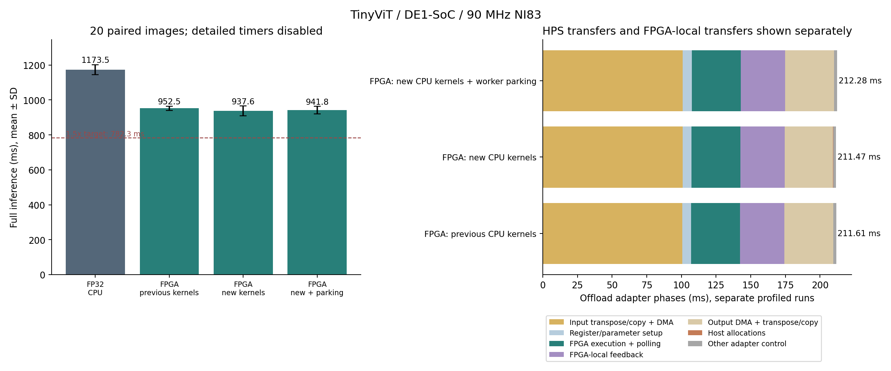

# TinyViT latency optimization on DE1-SoC

Experiment date: 2026-11-21. Cortex-A9 HPS, two CPU threads, existing
timing-qualified 90 MHz NI83 accelerator. No RTL or clock changes were made
for these experiments. The original FP32 model and validated mixed model
are preserved. Nothing was committed or pushed.

## Result and target

The selected configuration completes **the entire loaded-model inference in
937.571 ms**, versus **1173.468 ms for original FP32 CPU**: **1.2516x speedup**
and **20.10% lower latency**. All 20 paired random images were faster.
The paired-bootstrap 95% speedup interval is **[1.2292, 1.2712]**.

**The requested 1.5x inference speedup was not achieved.** That target requires
782.312 ms or less against this baseline; another **155.259 ms** must be
removed from the selected configuration. The inference interval is measured
around the full model, including CPU operators, model casts, FPGA transfers,
FPGA execution and synchronization. Model loading, session creation and
one-time native setup are outside that interval and are reported separately.

| Final paired test, 20 random RGB images | Inference mean ± SD (ms) | Speedup vs FP32 | Fresh-process wall mean (ms) |
|---|---:|---:|---:|
| Original FP32 CPU, v25 default path | 1173.468 ± 28.302 | 1.0000x | 2766.472 |
| FPGA with earlier v22 CPU kernels | 952.534 ± 12.485 | 1.2319x | 2070.537 |
| **FPGA with final v25 CPU kernels; selected** | **937.571 ± 27.809** | **1.2516x** | **1904.833** |
| Same v25 configuration, worker parking enabled | 941.811 ± 21.306 | 1.2460x | 1810.747 |

Worker parking adds 4.240 ms on average to inference; its paired difference
interval is [-6.933, 15.105] ms, so there is no demonstrated inference gain.
It remains opt-in. Its startup-inclusive wall-time point estimate is 1.5278x
versus FP32, but the 95% interval [1.4392, 1.6195] crosses 1.5x. This includes
the smaller model file, loading and filesystem-cache effects; fresh process
does **not** mean a deliberately cold disk cache. It is not evidence of 1.5x
loaded-model inference speedup. The selected configuration's corresponding
wall-time ratio is 1.4523x, interval [1.3346, 1.5842].



## Accuracy and numerical qualification

The independent labeled check uses **200 fresh Imagenette validation images**,
20 from each of ten classes, disjoint from calibration, earlier diagnostics
and the earlier holdout. ImageNet class indices are retained. Preprocessing
is RGB, direct resize to 224x224, and `(pixel/255 - mean)/std` with ImageNet
mean/std. This establishes accuracy on this subset, not full ImageNet.

| Metric | Result |
|---|---:|
| Original FP32 CPU correct | 153/200 (76.5%) |
| Qualified mixed model plus FPGA correct | 153/200 (76.5%) |
| Observed accuracy change | 0 percentage points |
| FPGA/FP32 top-1 agreement | 198/200 (99%) |
| Mean score-vector cosine vs FP32 | 0.99751683 |
| Final v25 FPGA outputs identical to qualified v22 FPGA | 200/200 |

The final v25 labeled rerun enabled worker parking. It reused the completed
200 FP32 reference runs only after validating model, input-manifest,
preprocessing and output hashes. It reran 200 FPGA inferences and 20 distributed
FP32 CPU-kernel checks. Parking and non-parking v25 outputs are byte-identical
on all 20 random timing inputs; both also match the earlier v22 FPGA outputs.
The final FP32 baseline reproduces the original FP32 scores on all 20 random
inputs. Noise-image FPGA/FP32 top-1 agreement is 19/20; that is not a labeled
accuracy measurement.

Independent tests passed: 51 host driver cases; 13 physical signed-matrix
and resident-pair cases against an INT64 oracle; 18 final attention kernel
cases on ARM; and 32 GELU cases including tails and in-place operation.
Model-level mirror checks cover all ten attention regions. Raw score hashes,
finite values and labeled accuracy were independently recomputed offline for
**1,040 unique saved inference outputs** across the four formal suites.
No timing sample or outlier was discarded.

## What executes where

The selected model uses the existing accuracy-qualified mixed policy:
37 W8A8 convolutions comprise 30 transformer static linears and seven
depthwise convolutions. The latter run on CPU. The other 31 convolutions
retain their FP32 policy. It is not an entirely W8A8 TinyViT graph.

| Static transformer operator | FPGA / model total |
|---|---:|
| MLP FC1 | 9/10 |
| MLP FC2 | 4/10 |
| Attention QKV projection | 8/10 |
| Attention output projection | 9/10 |
| Total | 30/40 |

The ten CNN pointwise operators and final classifier also remain on CPU.
The selected FPGA policy therefore offloads 30 of 51 static pointwise/linear
operators overall. Broader static policies already failed the accuracy gate;
the speed comparison does not substitute those policies.

CPU performs image preprocessing, FP32 stem/remaining convolutions,
normalization, residual operations, QK/softmax/AV attention, remaining GELU,
casts/layout changes, pooling and classification. The new attention kernels
remain FP32 CPU code. They do not offload dynamic QK or AV to the FPGA.

Static INT8 weights and coefficients are prepared once and cached in the
reserved HPS DDR region. At runtime DMA loads capacity-sized tiles into
on-chip SRAM. This avoids repeated FP32 weight quantization, but does not
make all weights permanently resident on chip.

Four MLP chains keep the FC1 hidden activation on FPGA: stage-1 block 1 and
stage-2 blocks 0, 1 and 2. FC1 accumulates full K, requantizes, applies an
exact MNN-derived 256-entry activation table, and uses local DMA to provide
FC2's input. FC2's final result returns to the CPU graph. The saved FC2 CPU
callback consumes the cached result. Consequently a paired FC1 callback's
time includes the chain; its FC2 callback is not another independent compute
measurement. Other graph boundaries transfer results back as required.

## Shapes, tiling and DMA

For `A[M,K] * B[K,N]`, signed INT8 operands feed INT32 accumulation. Full-K
accumulation precedes the Q24 multiplier/Q16 bias output conversion. K is
supported through 2048 in NI83; it is not fixed to 64. Shape tails are padded
and cropped. A has 32 KiB; B writes and C reads each address a distinct 64 KiB
bank. Native output tiles have at most 128 columns.

For an unfused tile, with byte capacities `Ac`, `Bc`, `Cc`:

```text
Kp = ceil(K / 16) * 16
Nt = min(ceil(N / 16) * 16, 128, floor(Bc / (16*Kp)) * 16)
Mt = min(floor(Ac / (16*Kp)) * 16, floor(Cc / (16*Nt)) * 16)
```

The implementation chooses a valid positive tile and handles actual tails;
resident chains impose additional hidden-buffer/scratch limits. Examples of
unfused plans, written as MxKxN:

| Operation shape | Maximum Mt x Nt | Hardware jobs |
|---|---:|---:|
| Stage-1 FC1: 784x128x512 | 256x128 | 16 |
| Stage-1 FC2: 784x512x128 | 64x128 | 13 |
| Stage-2 QKV: 196x160x480 | 192x128 | 8 |
| Stage-2 FC1: 196x160x640 | 192x128 | 10 |
| Stage-2 FC2: 196x640x160 | 48x96 | 10 |
| Stage-3 FC1: 49x320x1280 | 96x128; actual padded M=64 | 10 |

The selected resident-pair execution uses **296 hardware jobs per image**,
8,049,920 input bytes, 2,465,280 output bytes and 1,200,128 local-feedback
bytes. It avoids 1,601,536 bytes of hidden-activation HPS round trips.
Resident storage limits can require smaller tiles and extra jobs; fusion
does not simply remove transfers without changing the tiling cost.

Transfers use real DMA, with CPU-issued descriptors and CPU polling. They
are synchronous; the application does not overlap dependent model operations
with in-flight transfers. There are 3,897 input, 1,227 output and 4,688 local
descriptors per image. HPS DMA descriptors are capped at 2,048 bytes; local
feedback descriptors at 256 bytes, matching the generated IP's burst and
counter limits. Increasing software lengths alone is incorrect.

## Full inference breakdown

These are **separate instrumented runs**, averaged over the same 20 random
images. The rows are disjoint and sum to the profiled inference total.
Instrumentation adds overhead: profiled selected inference is 969.779 ms,
whereas the unprofiled headline is 937.571 ms. Do not subtract one row from
one timing regime and add it to the other.

| Full-model component (ms) | FP32 CPU | Selected FPGA + CPU kernels |
|---|---:|---:|
| Selected static-linear callbacks | 349.133 | 212.166 |
| Remaining CPU convolutions | 423.694 | 419.103 |
| QK/softmax/AV attention region | 199.148 | 147.838 |
| Remaining CPU GELU | 128.838 | 88.574 |
| Remaining activation casts | 0.000 | 23.017 |
| Remaining layout copies | 54.336 | 45.222 |
| Residual/elementwise | 15.264 | 15.079 |
| Normalization/reduction | 7.842 | 7.941 |
| Framework outside accounted kernels/callbacks | 9.167 | 10.839 |
| **Full profiled inference** | **1187.422** | **969.779** |

Attention times include the manually replaced region and its copy work,
which execute outside normal MNN operator callback timing. Their measured
time is removed from framework overhead. GELU replacements execute inside
UnaryOp callbacks. The summarizer enforces additive accounting per image.

The 212.166 ms selected-linear row expands as follows:

| Disjoint offload component | Mean ms |
|---|---:|
| Register/parameter configuration | 6.376 |
| Input staging, transpose/copy and input DMA | 100.923 |
| Launch | 0.386 |
| FPGA completion wait, including CPU polling | 34.840 |
| Output DMA and staging/copy | 34.493 |
| FPGA-local feedback | 31.942 |
| Other adapter work | 2.509 |
| Callback overhead above adapter | 0.697 |
| **Complete selected callbacks** | **212.166** |

The following are **nested diagnostics**, not additional rows to add above:
input staging copy 32.503 ms, input DMA setup 11.289 ms and DMA wait 51.814 ms;
output staging copy 24.699 ms, output DMA setup 3.543 ms and DMA wait 4.316 ms;
local DMA setup 13.519 ms and wait 13.294 ms. Remainders cover loop/control
and operations between timers.

The 34.840 ms completion timer is host-observed execution plus polling,
not a pure fabric-cycle measurement. The FPGA arithmetic advantage does
not eliminate the other 177.326 ms inside selected callbacks. In the initial
six-mode experiment, the same selected mixed-CPU linear callbacks took
236.110 ms, versus 34.809 ms FPGA completion wait: about 6.78x at those scopes.
That comparison excludes the FPGA transport/adapter cost and is not a
6.78x whole-model gain. Including the four CPU MLP middle regions, the
matched mixed-CPU region took 270.741 ms; original FP32 took 372.849 ms.

Driver-level quantize/dequantize timers are zero because operands are
already INT8 at the hook. Model activation casts still execute on CPU.
In the initial instrumented optimized experiment, FloatToInt8 callbacks
totaled 14.933 ms and Int8ToFloat callbacks 8.789 ms. Some casts fall within
the attention region above, so these totals must not be added again. QKV
INT8 dequantization can also occur inside attention packing. FPGA output
requantization and resident GELU are already inside the hardware path.

## Startup-to-output breakdown

These components come from the same final **profiled** runs, with setup
included. The main elapsed timer excludes process teardown; unprofiled
parent-observed process wall time is separately reported in the first table.

| Component (ms) | FP32 CPU | Selected FPGA configuration |
|---|---:|---:|
| Read, resize and normalize image | 32.573 | 34.868 |
| Model load | 1231.564 | 686.775 |
| Session creation | 193.372 | 220.685 |
| Initial model input copy | 4.775 | 4.680 |
| Native weight/cache/table setup | 0.000 | 89.101 |
| Full profiled model inference | 1187.422 | 969.779 |
| Output handling | 2.432 | 2.271 |
| Other setup/reporting between timers | 4.016 | 42.361 |
| **Main elapsed, same profiled runs** | **2656.154** | **2050.521** |

Keep the model/session and prepared weights alive for repeated deployment
inference to amortize startup. Startup savings from the 18,748,848-byte mixed
model versus the 26,602,144-byte FP32 model are separate from FPGA compute
speedup. The input tensor is refreshed before every repeated run, outside
the inference timer, to prevent stale/aliased inputs.

## Optimization techniques and rejected alternatives

Accepted changes:

1. Faster synchronous polling samples deadline timers every 64 unsuccessful
   polls and removes redundant native DMA CSR clears while preserving device
   barriers, status checks and one-second deadlines. Initial paired means
   improve from 1020.824 to 1001.037 ms with byte-identical scores on 20/20
   inputs. This alone is not sufficient.
2. Tiled FP32 attention streams four query rows at a time, avoiding a full
   score-matrix intermediate. ARM32 NEON microkernels process four queries by
   eight columns. MNN's existing worker pool is used. Five-head stage-2 work
   is balanced by independent, four-row-aligned query slices across two
   workers. Scale, positional bias and softmax remain FP32. The final
   attention region is 147.838 ms versus 199.148 ms original CPU.
3. NEON GELU retains MNN's polynomial/order and uses a reciprocal estimate
   with two Newton refinements instead of repeated scalar divisions. Local
   numerical and full-model checks pass. Remaining GELU is 88.574 ms versus
   128.838 ms original CPU.
4. Existing full-K, capacity-aware tiling, cached INT8 weights, FPGA epilogues
   and four resident MLP pairs are retained and qualified with these changes.
   The deployment wrapper selects the measured best non-parking variant.

Tested alternatives retained as opt-in experiments or evidence:

- Worker parking: scope-guarded suspension inside synchronous native calls,
  restored before MNN regains control. Numerically identical, no demonstrated
  inference benefit; disabled in the recommended wrapper.
- Cached streaming staging copies: numerically exact but slower in pilots;
  disabled. Blindly replacing DMA with more PIO is not an accepted change.
- More static spatial W8A8 groups: all nine tested additions failed the
  diagnostic fidelity gate. Existing all-transformer/all-static policies also
  fail labeled accuracy, as documented in the expanded-static report.
- Dynamic CPU activation quantization with INT8 weights: several policies
  passed fresh 200-image accuracy gates, including transformer-plus-stage-0
  additions at 153/200 correct, 99% agreement and 0.995672 cosine. They were
  slower on Cortex-A9; selected one-image repeated tuning observations were
  about 939 ms static versus 959 ms transformer-dynamic and 1067 ms with
  stage-0 additions. These pilots are not claimed as 20-image benchmarks.
- Interpolated GELU lookup: tiny local error (~1.5e-6) still changed downstream
  quantization decisions enough to worsen full-model fidelity. Not selected.
- One/two/four CPU thread pilots favored two threads. The headline compares
  identical two-thread settings. Runtime inspection already showed two active
  workers; no gain is attributed to fixing a nonexistent single-worker state.

## Reproduction, deployment and evidence

The ready package is `build/tinyvit-optimized-90mhz-v25.tar.gz` on the PC.
Its SHA-256 is
`bfaa20785114dc3593910f0ca66d3bcf6ce93746ae8d4b7e0df223c9ee5b4fac`.
It contains the static ARM runner, validated mixed model, wrapper, checksums,
provenance and dependency licenses. The already tested board directory is
`/home/ubuntu/tinyvit/tinyvit-optimized-90mhz-v25`:

```sh
sudo ./run_inference.sh /absolute/path/image.png --output-dir result-01
# Optional separate worker-parking experiment:
sudo ./run_inference.sh /absolute/path/image.png --park-fpga-workers --output-dir result-02
```

The matching 90 MHz NI83 image must already be programmed. The board must
reserve the DMA memory: current Linux boot uses `mem=768M`, excluding the
window beginning at `0x30000000`. The package does not reprogram FPGA or
change boot settings. Wrapper smoke testing passed and its score hash
exactly matches final random input 01, selected configuration.

Hardware image SHA-256:
`f4b4803ba459ee33a496fe6e4def06919ac06d6dce4e6be2146bca37e3951447`.
The existing Quartus report passes all 88 slack checks, minimum +0.039 ns;
core setup is +1.002 ns. M10K use is 368/397 (93%). External HPS/JTAG I/O
timing limitations remain in the earlier hardware report. Nominal MPU clock
is 925 MHz; Linux CPU-frequency sysfs was unavailable, recorded as such.
The board RTC was wrong; experiment dates are supplied by the host.

MNN is pinned to `2c3f5b21a223734e5db7da4ef7b492bc02cafcf5`; the friend SoC
checkout is `4b749cedf88742dc999267999cd234186eb26bf7`. Build uses ARM32
Cortex-A9 NEON, Release O3, static musl, MNN thread pool, ARM82/OpenMP off,
and LOW_MEMORY support compiled in. Normal deployment does not request
dynamic low-memory activation quantization. See the application README
for opt-in flags and kernel-test targets.

The [evidence directory](benchmarks/optimization-2026-11-21/README.md) includes
raw board archives, per-image timings, profiles, outputs, model/source hashes,
accuracy manifests, oracle logs, rejected trials and offline audit tooling.
The initial suite has six configurations x20 inputs xcontrol/profile =240
inferences; initial accuracy has 420; final timing has 160; final accuracy
has 220 new inferences, totaling 1,040, plus separate tuning/kernel tests.
Timing order is balanced, with separate reverse-order profile passes, one
measured inference per fresh process, no warmups and unchanged saved inputs.
Paired bootstrap intervals use 10,000 resamples. Random noise tests measure
latency; labeled images measure accuracy.

The remaining practical opportunity is substantial CPU convolution work
and native transfer/control overhead. At the final profiled scope, completely
removing completion wait alone would save only 34.840 ms. Reaching another
155 ms requires much larger savings: for example a verified batched DMA
sequencer with fewer CPU descriptors, better staging/cache ownership, larger
resident regions, or faster accuracy-preserving convolution execution.
Those require further implementation and measurement. This report does not
claim they already work, or that more quantization automatically helps.
