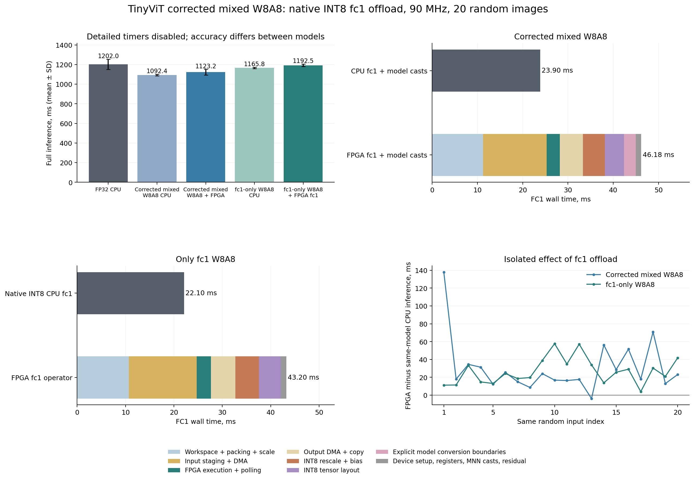

# Corrected TinyViT mixed W8A8 + FPGA FC1: 20 random inputs at 90 MHz

Measured on 2026-11-12 on the connected DE1-SoC. This repeats the previous five-configuration experiment using the corrected mixed-precision model and the compatible v5 runner. The model has **37 W8A8 convolutions and 31 FP32 convolutions**; the selected FC1 remains native W8A8. It is not the earlier inaccurate all-68-convolution quantization.

**Offloading FC1 changes same-model CPU inference by +30.796 ms / +2.82%.** The selected native CPU FC1 takes 21.357 ms; the FPGA path takes 43.589 ms before the model's surrounding conversion nodes. FPGA start-to-done with polling takes 2.922 ms, while the rest of that offload costs 40.667 ms.

Against the original FP32 CPU baseline, corrected-model FPGA inference changes latency by -6.55% (baseline/other speed ratio 1.0701x). Corrected-model CPU execution alone changes latency by -9.11%. These distinguish the model-format benefit from the incremental FPGA effect.

**The FPGA output still fails numerical equivalence.** The timing columns establish how long the prototype takes; they do not establish an accurate FPGA replacement. The quantization repair was validated separately with natural images on CPU.



## Experiment and timer boundaries

The exact same 20 independent uniform-uint8 RGB images from the preceding experiment are reused, with seeds 2026111101 through 2026111120. Each image is 224x224 RGB and normalized using the same ImageNet mean/std. No zero inputs are used. These noise images have no classification labels; output agreement below is not labeled accuracy.

There are **200 measured inferences and 10 separate warmups**: original FP32 CPU, corrected mixed W8A8 CPU, corrected mixed W8A8 + FPGA FC1, FC1-only W8A8 CPU, and FC1-only W8A8 + FPGA FC1, each with a control and a profiling mode. Every process runs one inference with two CPU threads. All modes use the same root privilege. The Williams order balances pair precedence 10/10 and places each mode in each position twice.

End-to-end model inference means `runSession`: it includes the whole TinyViT graph, all activation conversions, layout work, FPGA transfers and output rescaling performed during inference. It excludes model/session creation, image preprocessing, static FPGA weight preparation and saving outputs. Full process wall time is also reported separately.

Controls disable detailed timers and operator profiling. Separate profile runs collect driver phases and every runtime operator, including explicit FloatToInt8/Int8ToFloat nodes. Control/profile timing shifts are reported separately; they include fresh-process timing variability as well as instrumentation. Performance claims use controls. Every control/profile pair produces identical score hashes. The FP32 output hashes also match the preceding experiment.

## Whole-model performance

| Configuration | Mean inference ± SD, ms | Median inference, ms | Mean process wall ± SD, ms |
|---|---:|---:|---:|
| Original FP32 CPU | 1201.953 ± 52.140 | 1177.895 | 2812.102 ± 205.477 |
| Corrected mixed W8A8 CPU | 1092.412 ± 8.904 | 1091.510 | 2164.423 ± 347.564 |
| Corrected mixed W8A8 + FPGA FC1 | 1123.207 ± 28.861 | 1112.320 | 2213.311 ± 387.843 |
| FC1-only W8A8 CPU | 1165.791 ± 7.380 | 1165.665 | 2552.885 ± 316.824 |
| FC1-only W8A8 + FPGA FC1 | 1192.534 ± 12.218 | 1191.440 | 2539.770 ± 300.920 |

| Paired comparison | Added inference, ms | Latency change | 95% CI for added ms | Faster / slower inputs |
|---|---:|---:|---:|---:|
| Original FP32 CPU → Corrected mixed W8A8 CPU | -109.541 | -9.11% | [-132.671, -89.344] | 20 / 0 |
| Corrected mixed W8A8 CPU → Corrected mixed W8A8 + FPGA FC1 | +30.796 | +2.82% | [19.636, 45.594] | 1 / 19 |
| Original FP32 CPU → Corrected mixed W8A8 + FPGA FC1 | -78.745 | -6.55% | [-106.896, -50.746] | 19 / 1 |
| FC1-only W8A8 CPU → FC1-only W8A8 + FPGA FC1 | +26.744 | +2.29% | [20.733, 33.226] | 0 / 20 |

For corrected-model CPU → FPGA, the median paired change is +20.545 ms. Confidence intervals use 20,000 paired bootstrap resamples, seed 20261112. All timing outliers are retained.

The original FP32 baseline has mean 1201.953 ms versus median 1177.895 ms. Its slower outliers raise the mean. The ratio of median FPGA latency to median FP32 latency corresponds to 5.57% lower latency; this is descriptive context, not a substitute for the paired statistics.

The earlier approximately 850 ms broad-quantization CPU result belongs to a different, inaccurate model. It is not a performance result for this corrected model. The natural-image timing from the repair report is also a different input set; the table above is a fresh paired random-input measurement.

## FC1 size and hardware tiling

The selected operation is `/layers.1/blocks.0/mlp/fc1/Add_output_0__matmul_converted`, equivalent to **[784,128] × [128,512] → [784,512]**, or 51,380,224 multiply-accumulates. Activations and weights entering the accelerator are INT8; returned values are INT8 and undergo integer per-channel rescaling/bias/clamp.

The capacity-aware planner selects **Mtile=128, Ktile=128, Ntile=128**. There are seven M panels (six of 128 rows and one of 16), four N panels, and one K panel: **28 hardware jobs** per inference. The hardware manages its internal 16x16 tiling; the host does not submit one job for each individual 16x16 product.

Each offloaded inference transfers 860,160 operand bytes and 401,408 result bytes, using 108 input and 52 output DMA descriptors. The driver resends activation panels across output-column panels and weight panels across row panels. This is real DMA with CPU staging/copies, register programming and completion polling. Execution is synchronous; no overlap with other TinyViT operations is introduced.

## FC1 conversion boundaries and execution

| Profiled FC1 scope, ms | Corrected CPU | Corrected + FPGA |
|---|---:|---:|---:|
| Model FP32→INT8 input conversion | 0.902 ± 0.027 | 0.919 ± 0.059 |
| Native convolution / complete offload operator | 21.357 ± 0.105 | 43.589 ± 0.947 |
| Model INT8→FP32 output conversion | 1.638 ± 0.030 | 1.675 ± 0.065 |
| Complete FC1 section including those conversions | 23.897 ± 0.110 | 46.183 ± 0.956 |

For context, the original FP32 CPU FC1 operator takes 28.848 ms in this experiment. The native INT8 CPU baseline above is the fair same-model reference for isolating the effect of FPGA offload.

The native CPU operator takes 21.357 ms versus 2.922 ms for FPGA start-to-done including polling. Their ratio is 7.31x, but the scopes differ: the CPU figure is the complete native convolution operator, while the FPGA figure excludes host preparation/transfers/postprocessing. It is not a full-operation or whole-model speedup, and the arithmetic outputs differ.

The complete FPGA operator spends 40.667 ms outside execution/polling. The apparent reduction from CPU-operator time to FPGA wait time is only 18.436 ms; extra host work exceeds that reduction by 22.231 ms at the selected operator boundary.

FC1's native CPU operator is only 1.94% of the corrected model's profiled inference time. Even eliminating that operator entirely would remove only about 21.36 ms before accounting for any replacement overhead. The measured 40.67 ms of non-execution FPGA-path work is therefore too large for this one operation.

## Disjoint offload timing

The following rows sum to the selected FPGA FC1 operator. The two explicit model conversion nodes are outside this scope and are shown above. All values are host wall times; the hardware ABI has no cycle counter.

| Phase | Mean ± SD, ms |
|---|---:|
| Allocate native layout buffers | 0.656 ± 0.073 |
| Native packed INT8 input → dense INT8 | 0.567 ± 0.031 |
| Driver workspace/validation | 0.609 ± 0.237 |
| Tile packing/padding | 6.053 ± 0.270 |
| Safe hardware scale and channel gains | 4.610 ± 0.139 |
| Program/check registers | 0.100 ± 0.005 |
| Input staging + DMA | 14.028 ± 0.246 |
| Launch | 0.046 ± 0.002 |
| FPGA execution + polling | 2.922 ± 0.011 |
| Output DMA + staging copy | 5.062 ± 0.083 |
| INT8 rescale/bias/clamp/copy | 4.880 ± 0.142 |
| Dense INT8 → native packed output | 2.986 ± 0.421 |
| Unassigned adapter overhead | 0.132 ± 0.009 |
| Device open/map/lock | 0.578 ± 0.508 |
| Bridge remainder | 0.128 ± 0.090 |
| Selected framework casts | 0.000 ± 0.000 |
| Callback/executor remainder | 0.231 ± 0.031 |
| Complete selected FC1 operator | 43.589 ± 0.947 |

The nested DMA phases below are already included in upload/download. Do not add them to the preceding total.

| Nested transfer phase | Mean ± SD, ms |
|---|---:|
| input_stage_copy | 7.929 ± 0.210 |
| input_dma_setup | 0.394 ± 0.015 |
| input_dma_wait | 5.463 ± 0.060 |
| output_dma_setup | 0.186 ± 0.007 |
| output_dma_wait | 0.632 ± 0.011 |
| output_stage_copy | 4.113 ± 0.071 |

The native driver performs no FP32 activation quantization or FP32 reconstruction: its corresponding adapter timers are zero in every profile. It still packs tensors, computes safe hardware multipliers, stages DMA operands/results, and applies INT8 channel rescaling. There is no host K-panel accumulation because K=128 fits one hardware panel.

## Conversions across the entire model

| Model execution | Quantize calls | Quantize ms | Dequantize calls | Dequantize ms |
|---|---:|---:|---:|---:|
| Original FP32 CPU | 0 | 0.000 | 0 | 0.000 |
| Corrected mixed W8A8 CPU | 37 | 21.168 ± 0.516 | 37 | 14.630 ± 0.270 |
| Corrected mixed W8A8 + FPGA FC1 | 37 | 21.191 ± 0.396 | 37 | 14.588 ± 0.201 |
| FC1-only W8A8 CPU | 1 | 1.594 ± 0.184 | 1 | 2.605 ± 0.077 |
| FC1-only W8A8 + FPGA FC1 | 1 | 1.566 ± 0.087 | 1 | 2.584 ± 0.121 |

The corrected model has 37 explicit quantization/dequantization pairs, which are present in both CPU-only and FPGA modes. Those costs are already included in whole inference. The legacy CastWrapExecution counters do not include these explicit nodes; this experiment measures them using runtime operator profiling instead. Thus a zero driver quantization timer does not mean the model performs no FP32/INT8 conversion.

## Other pipeline costs and profiling overhead

| Profiled pipeline section, ms | FP32 CPU | Corrected CPU | Corrected + FPGA |
|---|---:|---:|---:|
| preprocess_ms | 29.631 ± 8.228 | 32.103 ± 15.345 | 31.337 ± 9.328 |
| model_load_ms | 1300.555 ± 179.992 | 686.978 ± 294.296 | 687.996 ± 310.118 |
| session_ms | 168.086 ± 24.326 | 210.283 ± 15.121 | 206.846 ± 10.869 |
| input_copy_ms | 4.847 ± 0.193 | 4.752 ± 0.146 | 4.763 ± 0.124 |
| linear_setup_ms | 0.000 ± 0.000 | 0.000 ± 0.000 | 5.770 ± 1.765 |
| output_ms | 2.398 ± 3.950 | 1.966 ± 3.945 | 1.284 ± 2.078 |
| inference_ms | 1182.739 ± 15.280 | 1100.374 ± 9.196 | 1122.675 ± 9.884 |
| main_elapsed_ms | 2688.608 ± 183.243 | 2036.765 ± 314.975 | 2061.854 ± 318.381 |

The driver's static weight-setup component averages 2.227 ms; weight FP32 peak scanning and FP32→INT8 quantization are zero. Planner selection takes 1.030 ms within that component. Both are nested inside the application's total linear_setup_ms (5.770 ms), which also includes model-weight decoding and validation; these setup scopes must not be added together. Static preparation is outside inference, included in the lifecycle/process measurement, and can be amortized in a persistent application.

The application prints main_elapsed_ms before serializing the detailed operator JSON. That extra profile-file serialization is included in profiled child-process wall time, but is outside inference and absent from controls. Whole-process performance claims use the control process timings.

| Configuration | Profile minus control inference, mean ms |
|---|---:|
| Original FP32 CPU | -19.214 |
| Corrected mixed W8A8 CPU | +7.962 |
| Corrected mixed W8A8 + FPGA FC1 | -0.533 |
| FC1-only W8A8 CPU | +21.137 |
| FC1-only W8A8 + FPGA FC1 | +13.125 |

After subtracting the selected FC1 operator, the remaining profiled inference changes by +0.070 ms between corrected CPU and FPGA modes. This residual includes changed downstream values, cache/scheduling effects and profiling noise; this experiment does not isolate their individual causes. The paired control comparison is the end-to-end result.

The profile runs therefore show an inference increase of 22.301 ms, close to their selected-operator increase of 22.231 ms. The controls show 30.796 ms instead. These are separate processes and timing populations: the difference must not be invented as an additional driver phase. The control median paired penalty is 20.545 ms, and its confidence interval includes the profile estimate. Negative profile-minus-control differences likewise do not imply negative profiler overhead.

## Numerical checks

Every inference returns 1000 finite scores, every FPGA run reports exactly one replacement and 28 jobs, and control/profile scores are byte-identical. Numerical equivalence across CPU and FPGA is a separate check:

| Comparison | Top1 agreement /20 | Mean logit cosine | Mean relative L2 error |
|---|---:|---:|---:|
| Corrected CPU vs FP32 CPU | 19 | 0.993669 | 0.119361 |
| Corrected FPGA vs same-model CPU | 13 | 0.755609 | 0.884818 |
| Corrected FPGA vs FP32 CPU | 14 | 0.746076 | 0.855402 |
| FC1-only CPU vs FP32 CPU | 20 | 0.999768 | 0.022303 |
| FC1-only FPGA vs same-model CPU | 14 | 0.769284 | 0.820784 |

These are agreement checks on random images, not classification accuracy. The corrected CPU model's separate natural-image holdout and the hardware's per-band rounding/saturation limitation are documented in the [quantization repair](tinyvit-quantization-accuracy-repair.md) and [earlier native INT8 diagnosis](tinyvit-w8a8-fc1-benchmark.md). No RTL arithmetic change was made for this timing experiment.

## Provenance and reproduction

- Corrected model SHA256: `f6a577a805887e486a4bc52179724e9c7c3340ec694c51532073b55beabab1cf`.
- Runner: `tinyvit_fc1_w8a8_v5`, SHA256 `79f1bf12509594bc65741d78d6b23dfbe4aa9cc987fd45d1615df58ad9419e0b`.
- Existing programmed 90 MHz SOF SHA256: `0af66d4d24302b1ff9bb960ab189d41850603be1e8fd16edae29206fedfea058`. No reset/reprogramming or Quartus rebuild was performed during this experiment.
- Models and runner are in `/home/ubuntu/tinyvit/`; the source input directory is `/home/ubuntu/tinyvit/benchmark-qk-profile-90mhz-20/`.
- Board clock dates can be wrong; the experiment date is recorded from the host. CPU cpufreq fields are recorded when exposed, without assuming a frequency from missing files.

Board command after loading the validated FPGA image:

```sh
sudo python3 benchmark_fc1_w8a8.py \
  --output-dir /home/ubuntu/tinyvit/NEW_BENCHMARK_DIRECTORY \
  --runner tinyvit_fc1_w8a8_v5 --inputs 20 \
  --full-model tiny-vit-mixed-w8a8-accuracy.mnn --operator-details \
  --bitstream-sha256 0af66d4d24302b1ff9bb960ab189d41850603be1e8fd16edae29206fedfea058
```

Analyze the downloaded evidence with `python mnn/app/summarize_fc1_w8a8.py RESULTS_DIRECTORY` and `python mnn/app/plot_fc1_w8a8.py RESULTS_DIRECTORY`. The analyzer verifies ordering, counts, phase containment and score hashes recorded by the harness. Raw output-file hashes are independently checked against the archived files.

The [evidence directory](benchmarks/mixed-w8a8-fc1-2026-11-12/) contains metadata, raw results, warmups, all phase statistics, per-input [timing CSV](benchmarks/mixed-w8a8-fc1-2026-11-12/timing-breakdown.csv), [conversion CSV](benchmarks/mixed-w8a8-fc1-2026-11-12/conversion-breakdown.csv), the raw board archive, the deployed harness, figures and [SHA256 manifest](benchmarks/mixed-w8a8-fc1-2026-11-12/SHA256SUMS). Historical experiments are preserved separately.
