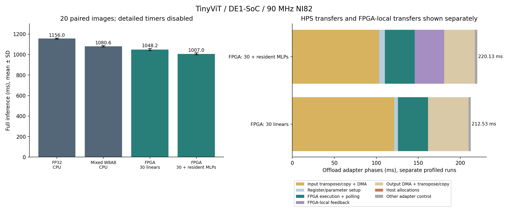
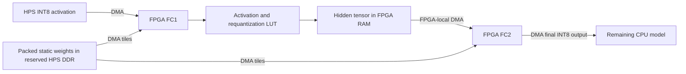

# TinyViT native INT8 and FPGA-resident MLP integration

The new path runs 30 eligible INT8 linear operations on the DE1-SoC FPGA and
keeps four FC1/activation/FC2 intermediates in FPGA RAM. On 20 random RGB images,
full inference averages **1,006.955 ms**, compared with **1,155.982 ms** for the
original FP32 CPU model and **1,080.605 ms** for the corrected mixed-precision
CPU model. These are **12.89%** and **6.82%** latency reductions, respectively
(1.148x and 1.073x speedups). This run uses the newly fitted, physically tested
90 MHz NI82 image, not the old band-rounded accelerator.

Inference excludes loading and setup. A fresh process including those costs
averages **1,522.157 ms** for resident offload versus **1,508.985 ms** for mixed
CPU and **1,624.037 ms** for FP32 CPU. Thus the all-layer configuration still
costs 0.87% more than mixed CPU for a cold invocation, despite faster inference.
Keep the model/session/weight cache alive when serving successive images.

Measurements and raw evidence are in
[the benchmark directory](benchmarks/native-resident-2026-11-14/).

## Twenty-image comparison

Two Cortex-A9 threads, 224x224 image, no all-zero inputs, no inference warmup;
the same 20 image hashes/seeds are reused from the earlier experiment. Each
configuration uses a fresh process. Balanced order rotates across images;
profiling runs occur separately in reverse order. The four configurations
therefore require 160 inferences. The primary numbers below come from runs
with detailed timing disabled. Standard deviation describes the 20 images.

| Configuration | Inference mean +/- SD (ms) | Process wall mean (ms) | FPGA jobs/image |
|---|---:|---:|---:|
| Original FP32 CPU | 1155.982 +/- 5.999 | 1624.037 | 0 |
| Corrected mixed W8A8 CPU | 1080.605 +/- 7.064 | 1508.985 | 0 |
| All 30 native FPGA linears, unfused | 1048.245 +/- 11.219 | 1560.853 | 434 |
| All 30 plus four resident MLP pairs | 1006.955 +/- 9.409 | 1522.157 | 437 |

Resident offload beats mixed CPU on all 20 inputs. Its paired mean saving is
73.650 ms, with a bootstrap 95% interval of 69.093..78.179 ms. Against FP32 the
saving is 149.027 ms, interval 145.440..152.718 ms. Resident fusion saves a
further 41.289 ms over offloading the same 30 operations individually. These
intervals resample the 20 paired images; they do not characterize every board,
temperature or workload. Random-image prediction agreement is not accuracy.



## Where time goes

The separate profiled runs measure the following adapter phases. These are
disjoint outer phases; the indented concepts in their descriptions are nested
timers and must not be added again. Phase totals are not subtracted from the
unprofiled inference measurements to invent a CPU remainder.
Mean profiled whole-inference times are 1093.496 ms for mixed CPU, 1076.033 ms
for unfused FPGA and 1051.247 ms for resident FPGA. They exceed their controls
by 12.891, 27.789 and 44.292 ms. Instrumentation and run variation therefore
affect the FPGA paths more; the headline gain uses the unprofiled controls.

| Adapter phase, ms/image | Unfused 30 | Resident 30 |
|---|---:|---:|
| Input layout/copy, weight DMA and input DMA | 121.394 | 103.554 |
| Registers, coefficients and activation-table writes | 4.480 | 6.743 |
| Launch plus FPGA completion polling | 35.708 | 35.556 |
| FPGA-local hidden feedback | 0 | 34.959 |
| Output DMA and NC4 copy, including pending FC2 copy | 48.142 | 36.536 |
| Host allocations | 0 | 0.066 |
| Remaining adapter checks/control | 2.801 | 2.717 |
| **Complete adapter** | **212.525** | **220.130** |

For resident execution, input staging alone is 30.716 ms, input DMA setup
14.086 ms and input DMA completion polling 53.502 ms; these are inside upload.
Output staging is 24.399 ms, output DMA setup 4.453 ms and completion polling
5.141 ms; these are inside download. Local DMA setup is 16.549 ms and polling
13.245 ms, inside the 34.959 ms feedback phase. Polling includes hardware
execution and host observation latency; no hardware cycle counter separates
them in this experiment.

The 30 CPU INT8 convolution scopes take 234.286 ms. FPGA execution plus launch
and polling takes 35.556 ms, a 6.59x ratio, **before transfers and control**.
The complete FPGA adapter is 220.130 ms. This is why a roughly sixfold compute
ratio does not produce a sixfold full-model speedup.

Fusion also removes CPU work: the complete four MLP regions take 126.555 ms
on mixed CPU, 112.585 ms with unfused FPGA operations and 86.420 ms with
resident pairs in profiled runs. Across all 30 operations plus those four
intermediate regions, scopes total 268.613 / 247.540 / 220.789 ms for CPU /
unfused / resident. Fusion makes the adapter slightly slower but eliminates
the intervening CPU conversions/activation/layout work and changes cache and
scheduling costs. The measured whole-inference comparison determines the gain.

The mixed model still spends substantial CPU time in FP32 convolutions
(374.232 ms), unary operations (124.794 ms), raster/layout (113.057 ms),
control-flow regions (84.290 ms), and softmax (28.852 ms). These profiled scopes
explain why accelerating pointwise matmuls leaves most inference on HPS.
Operator scopes can nest: the `While` interval includes child operations.
These category figures must not be summed into a disjoint full-model total.

## Selection experiment and labeled images

`select_native_policy.py` groups each resident pair as one decision and keeps
only groups with at least 0.2 ms mean profiled gain and a positive bootstrap
95% lower bound. It selected 22/30 operations: nine FC1, four FC2, seven QKV
and two projections. The six stage-2 projections, stage-3 projection and
stage-3 QKV remain on CPU. This policy is specific to this model and hardware;
it is not a general cost model. The policy and every layer/group timing are
preserved in `random-all/native-policy.csv` and `native-layers.csv`.

A further 20-random-image run (120 control/profile inferences) averages
1164.711 ms FP32, 1086.312 ms mixed CPU and 1014.593 ms selected resident FPGA.
The selected result includes a 1120.930 ms sample; none were removed. Setup
averages 77.378 ms, versus 86.131 ms for all-resident in the primary run.
This does not establish an additional end-to-end gain over the all-30 path.
The recorded three-configuration experiment uses cyclic ordering and does
not fully balance preceding-model effects. Do not use its process-wall
comparison to rank startup performance. The reusable harness now also uses
reversed rows for odd numbers of configurations; predecessor balance was
checked for both three and four configurations. The exact older script is
retained as `benchmark_native_int8_recorded.py` in the evidence directory.

The next experiment uses the existing 20 labeled natural images from the
earlier HPS accuracy check, four balanced configurations and 160 additional
control/profile inferences:

| Natural-image configuration | Inference mean +/- SD (ms) | Fresh-process wall (ms) | Correct top-1 |
|---|---:|---:|---:|
| Original FP32 CPU | 1167.530 +/- 9.851 | 2613.673 | 16/20 |
| Corrected mixed CPU | 1090.452 +/- 36.399 | 1862.141 | 16/20 |
| All 30 + resident pairs | 1011.565 +/- 12.855 | 1695.851 | 16/20 |
| Selected 22 + resident pairs | 1019.075 +/- 37.115 | 1658.242 | 16/20 |

All four configurations predict the same top-1 on every natural image. The
all-30 resident path cuts inference by 13.36% versus FP32 and 7.23% versus
mixed CPU on this set. The selected policy has several slower samples and
does not improve the mean. Use **all 30 plus resident pairs** as the measured
inference recommendation; the allowlist remains available for experiments.
The natural-set paired mean saving versus mixed CPU is 78.886 ms, bootstrap
95% interval 66.373..98.257 ms. Native-vs-FP32 logit cosine averages 0.997815;
native-vs-mixed-CPU cosine averages 0.997478. Outputs are not bit-identical
to CPU, even though all top-1 predictions agree.

These 20 images cover ten Imagenette classes, not full ImageNet. They are
reused qualification images, not a newly independent accuracy holdout.
16/20 is a sample result, not an 80% model accuracy claim. Prediction
agreement does not mean logit equality; all native hardware output hashes
and score comparisons are retained.

The main random experiment, selection experiment and natural check total
**440 measured inferences**, excluding initial smoke checks and the earlier
CPU-only baseline. Process wall includes model loading, session/cache/table
preparation, image preprocessing and output writing. It varies strongly
between experiments. Filesystem caches were not flushed or controlled, so
these are fresh-process measurements, not controlled cold-SD/boot timings.
In particular, the three mixed-model configurations share a model file while
FP32 uses a different file. Do not generalize the large natural-set startup
difference to application deployment; retain a session to remove that cost.

## Session reuse fix in the delivered runner

The 440 timing inferences above use `tinyvit_native_v10`, one inference per
process and no warmup. A subsequent repeated-session check found that the
existing runner copied the image into the session only once. This graph can
reuse that input allocation, so the final output after three CPU invocations
changed even when the supplied image did not. That negative check is retained
in `session-reuse-evidence.tar.gz`.

The delivered `tinyvit_native_v11` restores input from the preserved host tensor
before each subsequent invocation, outside the inference timer. Its profile
adds `repeat_input_copy_ms` for that work. Six physical cases, CPU and resident
FPGA with independent runs=1/2/3 sessions, pass: every final output is
byte-identical to the corresponding saved fresh-process v10 reference. The
FPGA sessions submit 437/874/1311 jobs and finish 4/8/12 resident pairs with
no pending output. This is twelve additional correctness inferences, not a
replacement 20-image performance experiment. The first invocation's code path
and the qualified FPGA image are unchanged. The application saves the final
iteration only; the test therefore uses separate counts to observe each.

## Implemented path

The new `NI82` ABI preserves INT32 partial sums across the entire reduction and
requantizes once, using per-output-channel Q24 coefficients and Q16 bias. This
replaces the legacy bitstream's lossy per-K16-band INT8 rounding and saturation.
The old driver and bitstream remain separate; the new driver rejects their ABI.

The corrected model has 30 supported static W8A8 pointwise linear operations:
9 FC1, 4 FC2, 8 QKV and 9 attention projections. The seven quantized depthwise
convolutions and the model's FP32 operations continue on CPU. No additional
accuracy-sensitive layers have been quantized.

Four verified MLP chains can run as resident pairs: stage 1 block 1 and stage 2
blocks 0, 1 and 2. Each chain has a single data consumer; shape/rank queries may
remain on CPU because they do not read activation values. A 256-entry table,
evaluated with the model's actual MNN activation and quantization operations,
maps FC1 INT8 output directly to FC2 INT8 input. The CPU dequantization,
activation, raster and quantization operations inside that chain are skipped.



The 16x16 array still performs internal tiling. A host job uses the full padded
K reduction, with M/N selected from operand capacity. No K-panel results are
rounded or accumulated on HPS. Packed static weight tiles are prepared once.
Unfused linear execution loads one weight-column tile, then reuses it across
all row tiles. Direct NEON layout copies avoid whole-matrix intermediate host
arrays. Fused execution keeps up to 61,440 hidden bytes in output RAM and uses
the remaining 4,096 bytes as FC2 output scratch space.

Static weights cached in reserved HPS DDR still require FPGA DMA reads. Only
the hidden activation is retained wholly on FPGA between the two matmuls.
The 30 logical weight matrices contain 2,633,728 INT8 bytes, far beyond the
64 KB B bank; keeping all of them in that bank is not possible.
CPU normalization, attention softmax and other intervening operations prevent
the entire model from becoming one upload and one download.

No new FP32-to-INT8 adapter is inserted for these matmuls. They consume and
produce the corrected model's existing INT8 tensors. The remaining explicit
model casts still run on CPU, except for the four verified fused chains.
The dynamic QK and attention-value products remain FP32 CPU operations; QKV
projection here means the static-weight projection, not QK attention itself.
The implementation is synchronous DMA plus polling. It does not yet overlap
HPS computation with FPGA jobs or use interrupt-driven completion.

## Capacity-aware scheduling and traffic

For padded K, select N in multiples of 16 with N <= 128 and K*N <= B capacity;
then select M in multiples of 16 with M*K <= 16 KB and M*N <= 64 KB. This
avoids assuming K=64. K is accumulated in full on FPGA, up to 1024. A logical
matmul can exceed the tile dimensions and is split over M/N; the hardware
sequences its 16x16 array within each submitted tile. NC4 input/output tails
are copied with bounds checks and zero padding.

| Operation shape | Ordinary M/K/N tile | Resident schedule |
|---|---|---|
| Stage 1 FC1: 784x128 times 128x512 | 128/128/128 | FC1 row blocks of 112 |
| Stage 1 FC2: 784x512 times 512x128 | 32/512/128 | Subtiles of at most 32 rows |
| Stage 2 FC1: 196x160 times 160x640 | 96/160/128 | FC1 row blocks of 96 |
| Stage 2 FC2: 196x640 times 640x160 | 16/640/96, final N=64 | Subtiles of 16 rows |
| Stage 3 QKV: 49x320 times 320x960 | 48/320/128 | Unfused |

For resident pairs the hidden canvas, not just input capacity, limits the FC1
row block. Each block finishes FC1, applies the activation table, then feeds
FC2 through local DMA before the canvas is reused. Stage 1 uses 56 jobs for
the pair; each of the three stage 2 pairs uses 41. Fusion adds three total
jobs compared with unfused execution because of row-tail fragmentation.

| Per-image measured traffic/counters | Unfused 30 | Resident 30 |
|---|---:|---:|
| Host upload, including coefficients/table | 7,865,088 B | 8,049,920 B |
| Host output DMA payload | 3,266,048 B | 2,465,280 B |
| Host upload + output | 11,131,136 B | 10,515,200 B |
| FPGA-local feedback | 0 | 1,200,128 B |
| Input DMA descriptors | 3,934 | 3,969 |
| Output DMA descriptors | 1,644 | 1,253 |
| Local DMA descriptors | 0 | 4,688 |
| Skipped intermediate runtime operations | 0 | 16 |

The logical hidden upload/download avoided is 1,601,536 B. That is **not**
the net bus saving: resident row blocks reload weight tiles more often. Net
host payload falls by 615,936 B (5.53%), while upload increases by 184,832 B.
Host activation staging falls by 1,900,544 B; output staging falls by
800,768 B. Static packed weights live in reserved HPS DDR, and their tile
loads are included in the upload time and payload above. Parameters/table
are programmed with PIO; operand/output payload uses real DMA.

The 4,688 short local descriptors are a remaining bottleneck. A later
hardware revision could increase local DMA burst/FIFO capacity to reduce
register programming, then must pass fitting, timing and physical tests
again. This report measures the current qualified 256-byte local descriptors.

## Memory and control ABI

| Item | Value |
|---|---|
| Capability register | `0x90 = 0x4e493832` (`NI82`) |
| Format/capacity register | `0xa0 = 0x01181080`; bit 24 selects the 64 KB B bank |
| Mode register | `0xb0`; bit 0 enables LUT, bit 1 selects FC2 output scratch |
| A operand | 16 KB, writes at `0x1000` |
| B operand | 64 KB, writes at `0x5000` |
| Output canvas | 64 KB, reads at `0x9000` |
| Per-column coefficients/bias | 1,024 bytes, writes at `0x19000` |
| Activation table | 256 bytes, writes at `0x19400` |
| FC2 output scratch | reads at `0x18000` |
| Local DMA CSRs | lightweight bridge offset `0x40` |

The B write aperture intentionally overlaps the read-only output aperture.
They access different physical RAMs through separate read/write decoders.
The expanded B depth fills previously unused depth in the existing wide RAM
blocks. The 128-bit B write port and its read latency are unchanged.

The initial resident design synthesized but required 507 M10K blocks on a
397-block device. The revised project reduces each HPS DMA FIFO from 4,096 to
256 entries, with 128-beat bursts. This DMA IP emits one burst per descriptor,
so native HPS descriptors are capped at 2,048 bytes. The separate 64-entry local
DMA uses 16-beat bursts and 256-byte descriptors. It copies output to input
without passing through HPS memory. The legacy image retains 8,192-byte
descriptors. The initial physical check caught the burst-count wrap caused by
using that legacy size with the narrower native DMA; the driver was corrected
before running inference benchmarks.

Linux must exclude the DMA/cache window. The driver checks `/proc/iomem` before
mapping 16 MB at `0x30000000`; weights occupy an immutable arena after staging
buffers. The experimental board boot uses temporary `mem=768M`, without
changing the saved boot environment or SD-card FPGA image.

## Validation and 90 MHz qualification

- Actual output-stage RTL translated with Yosys CXXRTL: 126 cases, 99,974 checked
  outputs; reductions up to K=1024, signed cancellation, tails, bias, rounding,
  saturation, output coverage and LUT enabled/disabled.
- Host driver oracle: 44 matrix/pair cases across 16 KB and 64 KB B banks,
  K=17..1024, bank-address remapping, weight reuse, FPGA-local feedback, tails
  and rejection of the legacy ABI. Dimensions must be programmed before upload.
  This includes M=1105/K=16/output-capacity checks and both actual TinyViT MLP
  shapes, with checked job counts and HPS/local payload byte counts.
- NC4/DMA layout: 72 cases pass on both host scalar code and actual AArch32
  NEON on the board, including nonzero offsets and row/channel tails.
- Board graph planning: all 30 candidates and four activation tables validate.
- Physical FPGA oracle: ten cases, 221,760 checked output elements, signed
  operands, K=32..1024, M/N tails, full output capacity and both resident
  TinyViT pair shapes; all agree with an independent INT64 software oracle.
- Full inference: control/profile raw outputs agree byte for byte for every
  configuration/image. Resident and unfused FPGA outputs are byte-identical
  on all 20 random images. Both FPGA variants agree with mixed CPU top-1 on
  20/20; mean logit cosine is 0.997552 and relative L2 is 0.070329. They are
  not bit-identical to MNN CPU: Q24 arithmetic and MNN kernel rounding differ.
  Mixed CPU agrees with original FP32 top-1 on 19/20 random inputs. The model
  itself and its earlier labeled quantization validation are unchanged.

Quartus compilation, fitting and all 88 evaluated timing checks pass. Minimum
reported slack across those checks is +0.077 ns; slow-85C core setup slack is
+1.165 ns. Fitted use is 22,686/32,070 ALMs (71%), 367/397 M10K blocks (92%),
29,958 registers and 35/87 DSP blocks. There are no illegal or unconstrained
clocks. Twelve input and thirteen output HPS/peripheral/reserved-JTAG ports
remain without external I/O constraints; this is not a claim that every board
interface has externally constrained timing. The accelerator clock is 90 MHz.
No new false paths were added to hide the resident datapath.

JTAG programming succeeded and the above matrix and inference tests ran on
that image. Linux reports the temporary 768 MB memory reservation; the boot
log records a 925 MHz MPU and 400 MHz DDR configuration. No saved boot
environment, DDR geometry, or SD-card bitstream was changed. The earlier CPU
baseline collected before this boot is retained separately and is not used
as the denominator for the final FPGA speedups.

## Next optimizations worth measuring

1. Keep the session, activation tables and packed weight cache alive across
   images. All-resident registration/setup is 86.131 ms in the primary profile;
   it belongs outside the image loop. `--runs` already reuses one session.
2. Reduce the local-DMA descriptor count in a new hardware revision. Current
   feedback costs 34.959 ms, including 16.549 ms in descriptor programming.
   A larger supported burst could reduce that overhead. Increasing only the
   software descriptor size is invalid and previously caused a physical DMA
   timeout; FIFO/burst-counter hardware and driver limits must change together.
3. Measure cache-managed kernel DMA buffers against the present uncached
   `/dev/mem` staging window. Input and output layout copies together cost
   55.115 ms in the resident profile. Do not simply map the current window
   cacheable without a coherence/cache-maintenance contract.
4. Target the remaining CPU regions using their operator profiles. FP32
   convolutions alone consume about 374 ms. Further quantization needs labeled
   accuracy validation; the earlier broad all-layer quantization failed it.

CPU/FPGA pipelining remains a possible later experiment, rather than a measured
gain here. An activation cannot be prepared before its producer runs; static
weight packing is already moved out of inference. Overlapping weight DMA or
independent graph branches needs asynchronous control and additional buffering.
The device is already at 92% of M10K blocks, so extra buffers can force smaller
tiles and more jobs. The current measured changes prioritize native INT8 I/O,
full reductions, weight reuse, direct NEON copies and four resident chains.

## Reproduction

Create a new isolated project; the preparation tool refuses existing outputs:

```sh
python platform/prepare_matmul_soc_native.py --friend-root build/matmul-soc --output NEW_PROJECT
python platform/build_matmul_soc.py --friend-root NEW_PROJECT --native-hps-launcher
```

The build tool requires final timing checks to pass. The qualified project is
`build/matmul-soc-native-resident-v4-90`, derived from the pinned upstream SoC
checkout `4b749cedf88742dc999267999cd234186eb26bf7`. Preparation fails on
unrecognized source patterns instead of silently patching a different design.
Program only the qualified SOF, boot Linux with the reserved DMA memory, and
run `native_int8_smoke_v10` before running the full model. Use v11 for session
reuse. On the current board
these artifacts are installed in `/home/ubuntu/tinyvit`; the FPGA is already
programmed. A normal board reboot can restore the SD-card FPGA image, so this
temporary boot/programming procedure must be repeated after a power cycle.

```sh
sudo env MNN_MATMUL_SOC_DEVMEM=1 MNN_MATMUL_SOC_DMA=1 ./tinyvit_native_v11 \
  --model tiny-vit-mixed-w8a8-accuracy.mnn --height 224 --width 224 \
  --image IMAGE.ppm --mean 0.485,0.456,0.406 --std 0.229,0.224,0.225 \
  --threads 2 --fpga-native-int8 --fpga-native-pairs --require-fpga --profile
```

For repeated inference reuse one session (`--runs COUNT` repeats the supplied
image); production code should keep that session alive across different images.
Detailed profiling is optional and should be disabled for primary timings.

```sh
sudo python3 benchmark_native_int8.py --runner tinyvit_native_v11 \
  --output-dir /home/ubuntu/tinyvit/NEW_RESULTS --inputs 20 --experiment-date 2026-11-14 \
  --bitstream-sha256 ff58e98c77d5471a02939c27d8cf1a044f25414a1c4190ee0fedef9d6019c5ad
python mnn/app/summarize_native_int8.py EXTRACTED_RESULTS
python mnn/app/select_native_policy.py EXTRACTED_RESULTS
python mnn/app/plot_native_int8.py EXTRACTED_RESULTS
```

For the repeat-session regression check on HPS:

```sh
sudo python3 check_native_session_reuse.py --runner tinyvit_native_v11 \
  --reference-results benchmark-native-v4-v10-random-20 --output-dir NEW_REUSE_CHECK
```

| Qualified artifact | SHA256 |
|---|---|
| `build/matmul-soc-deploy/matmul-soc-native-v4-90mhz.sof` | `ff58e98c77d5471a02939c27d8cf1a044f25414a1c4190ee0fedef9d6019c5ad` |
| `build/matmul-soc-deploy/tinyvit_native_v10` | `1e031cdc6a66df9f1be9d120268478e81dcf8d7c3ff2ad4046680bd5206de9b0` |
| `build/matmul-soc-deploy/tinyvit_native_v11` (delivered session fix) | `e7c9044798c66681ebcc06f7ecca6591493b9751f0d133abb29d52fa46075cf7` |
| `build/matmul-soc-deploy/native_int8_smoke_v10_stripped` | `c3593b68531914ad15711453c4b93695cb978fb91ad61d4c38a2c3a0109fdbd5` |
| Corrected `tiny-vit-mixed-w8a8-accuracy.mnn` | `f6a577a805887e486a4bc52179724e9c7c3340ec694c51532073b55beabab1cf` |
| Original `tiny-vit.mnn` | `f7aee628e2cef2d726979cc259529b3af0778b429c52ba8b76f3c609a2996de4` |

The hardware manifest records generated source/Qsys/QSF hashes and DMA limits.
The benchmark metadata records model, runner and declared programmed SOF hashes.
JTAG programming logs and physical ABI/oracle checks connect that declaration
to the image actually used; Linux does not independently hash FPGA configuration.

`--native-allowlist FILE` selects a measured subset. `--native-plan` validates
the model and activation tables without opening hardware. The benchmark harness
uses the earlier 20 random images, checks their hashes, alternates execution
order, saves raw outputs, separates profiling from control runs, and requires
fused/unfused native outputs to agree byte for byte. Reported inference time
excludes model/session/cache preparation; process wall time and preparation
are also retained to expose cold-start cost.

The native MNN hook requires actual INT8, pack4, H=W=1, symmetric zero points,
and channel counts divisible by four. Full K is limited to 1024 by the A bank;
larger/unsupported operations remain on CPU when omitted from selection.
Resident fusion additionally validates canvas placement and scratch pitch;
it supports the four verified chains above rather than arbitrary graph fusion.
