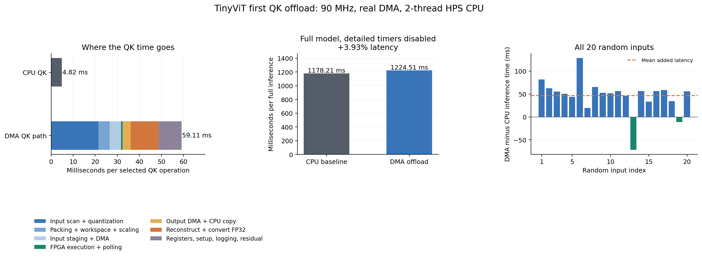

# TinyViT first-QK DMA offload: timing diagnosis at 90 MHz

Measured on the connected DE1-SoC on **2026-11-11**. The accelerator's execution
phase is faster than the CPU matrix kernels, but the complete offload loses
time in FP32/INT8 conversion, memory handling, transport, and submission overhead.
On **20 random images**, detailed-timer-disabled full inference increased from
**1178.207 to 1224.513 ms: +46.306 ms
(+3.93%)**. The complete selected QK operation took
59.108 ms with offload versus 4.822 ms on CPU.

The measured FPGA start-to-done phase, including host polling, was only
**0.657 ms**. CPU packed-kernel wall time in a separate follow-up was
**4.194 ms**, a measured phase ratio of
**6.38x**. The FPGA path spends
**58.451 ms outside that execution phase (98.89% of QK offload time)**.

These are different numeric paths: the CPU baseline executes FP32; the FPGA
uses signed INT8 operands, internal integer partial sums, rescaled INT8 output,
and FP32 reconstruction. This is a useful runtime comparison, not an exact
FP32 arithmetic-equivalence or fabric-cycle benchmark.



## Experiment and evidence

- 20 distinct, reproducible 224x224 RGB images, independently uniform uint8
  channels from 0 through 255. Seeds 2026111101 through 2026111120. No zero-input runs.
- Normalization: `(pixel/255 - mean)/std`, mean 0.485,0.456,0.406,
  std 0.229,0.224,0.225; input NCHW FP32, batch one.
- Two MNN CPU threads, high precision, same model and preprocessing in all modes.
- Main experiment: four fresh processes per image, CPU control, DMA control,
  CPU profile, DMA profile: **80 measured inferences**, plus four unmeasured
  fresh-process warmups. Every mode occupied each ordinal position five times.
  Cyclic order does not balance every predecessor or every pair's relative
  order: CPU control preceded DMA control on 15 inputs and followed it on five.
  This is a limitation for noisy process-level/cache comparisons.
- CPU kernel follow-up: control/profile in alternating order, **40 measured
  CPU inferences**, plus two unmeasured warmups, using the exact same 20 images.
  Total: **120 measured inferences on 20 random inputs**. A preceding development
  smoke test is excluded from all statistics.
- Fresh processes, `--runs 1 --warmup 0`, avoid the previously observed model
  output changes with session reuse. Timed inference excludes model loading,
  preprocessing and output copying/saving. Child-process wall time includes them.
- Current validated 90 MHz FPGA image retained throughout; no hardware changes
  or FPGA reprogramming during this experiment. See [90 MHz verification](matmul-soc-90mhz-verification.md).
- CPU frequency was not pinned; live cpufreq/governor telemetry was unavailable.
  Boot configuration reports nominal 925 MHz Cortex-A9. All durations use monotonic
  clocks; the board's incorrect calendar clock is not used for elapsed timing.
- Main runner `tinyvit_offload_profile`, SHA-256
  `f63e46066913df315fc7fe4c1fabf7b079b8b0e24e9047a18d9924c468321fbd`.
- CPU kernel runner `tinyvit_cpu_compute_profile`, SHA-256
  `8b786537139d779fca0e05773060b148668403e794a5aebc5af7fa52ee629cce`.
- FPGA SOF SHA-256
  `0af66d4d24302b1ff9bb960ab189d41850603be1e8fd16edae29206fedfea058`.
- Model SHA-256
  `f7aee628e2cef2d726979cc259529b3af0778b429c52ba8b76f3c609a2996de4`.
  The model is FP32, with no quantized weight/operator/tensor records in the
  prior model inspection. Q and K are dynamic activations, not cached learned weights.

Tracked evidence: [all timing rows, CSV](benchmarks/qk-dma-90mhz-2026-11-11/timing-breakdown.csv),
[main raw records](benchmarks/qk-dma-90mhz-2026-11-11/raw-results.json), [main summary](benchmarks/qk-dma-90mhz-2026-11-11/summary.json),
[CPU kernel rows](benchmarks/qk-dma-90mhz-2026-11-11/cpu-kernel-baseline.csv),
[CPU kernel raw records](benchmarks/qk-dma-90mhz-2026-11-11/cpu-kernel-raw-results.json),
[CPU kernel summary](benchmarks/qk-dma-90mhz-2026-11-11/cpu-kernel-summary.json),
[metadata](benchmarks/qk-dma-90mhz-2026-11-11/metadata.json), [CPU kernel metadata](benchmarks/qk-dma-90mhz-2026-11-11/cpu-kernel-metadata.json),
[full phase statistics](benchmarks/qk-dma-90mhz-2026-11-11/phase-statistics.md), [SVG figure](benchmarks/qk-dma-90mhz-2026-11-11/timing-diagnosis.svg).
Raw archives: [main run logs and outputs](benchmarks/qk-dma-90mhz-2026-11-11/benchmark-qk-profile-90mhz-20-evidence.tar.gz),
[CPU kernel run logs and outputs](benchmarks/qk-dma-90mhz-2026-11-11/benchmark-qk-cpu-kernels-20-evidence.tar.gz).
Full run logs and 1000-score outputs are also retained on the board under
`/home/ubuntu/tinyvit/benchmark-qk-profile-90mhz-20` and
`/home/ubuntu/tinyvit/benchmark-qk-cpu-kernels-20`, and in the local
`build/benchmark-qk-*-evidence.tar.gz` archives.

## Matrix shape, padding and tiling

The selected operation is `/layers.1/blocks.0/attn/MatMul_output_0`:
Q `[16,4,49,32]` multiplied by K-transpose `[16,4,32,49]`.
It consists of **64 independent 49x32 times 32x49 products**. The CPU baseline
executes those 64 products on two threads. This is a much smaller workload per
submission than a dense 256x256 benchmark.

Each FPGA submission pads this to **64x32 times 32x64**, producing a 64x64
INT8 canvas. The physical array is 16x16; hardware manages 16 output tiles and
two 16-wide reduction bands per head. Thus there are **64 host submissions**,
with **2,048 internal 16x16x16 microproducts**, rather than 2,048 host submissions.
The general driver supports output panels up to 256x256 and reduction panels
up to 64; this QK shape uses only a portion of that capacity.

| Quantity per full selected QK operation | Count |
|---|---:|
| Logical useful MACs | 4,917,248 |
| Padded MACs | 8,388,608 |
| Logical / padded work | 58.62% |
| FP32 values scanned and quantized | 200,704 |
| Logical output values reconstructed | 153,664 |
| INT8 operand bytes sent | 262,144 (256 KiB) |
| INT8 output bytes returned | 262,144 (256 KiB) |
| Input DMA descriptors | 128, each 2,048 bytes |
| Output DMA descriptors | 64, each 4,096 bytes |
| FPGA jobs per inference | 64 |

All 40 measured FPGA inferences completed exactly 64 jobs each: **2,560 measured
FPGA jobs**. All profiled runs verified the expected byte, descriptor and
quantization counts. These jobs are serialized through one accelerator.

## Full-model CPU versus offload

The primary comparison uses controls with detailed phase timers disabled.

| Metric, ms | CPU mean | DMA mean | CPU median | DMA median | CPU SD | DMA SD |
|---|---:|---:|---:|---:|---:|---:|
| Inference | 1178.207 | 1224.513 | 1166.925 | 1220.170 | 30.626 | 17.750 |
| Whole child process | 1949.377 | 2167.664 | 1846.362 | 2109.954 | 219.909 | 242.062 |

Inference added latency: **46.306 ms**, paired-bootstrap
95% interval **28.968 to
61.296 ms**, corresponding to
**+2.43% to
+5.24%**. Offload was slower on
18/20 inputs and faster on 2/20.
The selected QK itself was slower with offload on every profiled input.
All outliers are retained: CPU inference ranged from 1156.81
to 1289.20 ms; DMA from 1207.16
to 1288.06 ms. The two faster whole-inference samples do
not demonstrate input-dependent acceleration of QK; unrelated CPU work varied.

For the **entire fresh process**, this batch measured
**+218.287 ms (+11.20%)**, with a
paired-bootstrap interval of 66.674 to
374.893 ms. That is separate from the
3.93% inference penalty. Process time is highly variable and includes loading,
session creation, file output, startup and destruction. The previous batched
DMA experiment measured only +1.40% process time; this new process-level result
should not be presented as a stable DMA cost. The extra
171.981 ms outside inference is
not accounted for by accelerator execution/transport timers. Mode order,
allocation, filesystem/cache behavior and scheduling remain possible contributors;
this experiment does not establish which caused that outside-inference difference.

Bootstrap: 20,000 resampled input pairs, seed 20261111, empirical percentile
intervals. They summarize this batch and do not remove order or system-state bias.

## CPU baseline: computation isolated from packing

The main CPU QK callback wall time was **4.821847 ms**
(median 4.830945, SD 0.061149). It includes the
whole selected operation, including CPU packing, kernels, result handling and
thread coordination. Its 64 execute scopes summed to 8.855684
**CPU thread-ms**; they overlap across two threads and must not be used as wall time.

The follow-up places timers immediately around `MNNPackedMatMul` and
`MNNPackedMatMulRemain`, excluding their surrounding operand packing and output
unpacking. There are **320 packed-kernel calls per QK**, five per head. Every
interval is captured; sorted interval unions remove overlap between the two
CPU threads. No timing-record overflow occurred.

| CPU follow-up phase, ms | Mean | Median | SD | Min | Max |
|---|---:|---:|---:|---:|---:|
| Whole QK, with kernel probes | 5.358357 | 5.277780 | 0.217561 | 5.197840 | 6.054720 |
| Union of 64 CPU execute intervals | 5.299335 | 5.224315 | 0.206030 | 5.140790 | 5.978980 |
| Union of packed-kernel intervals | 4.193598 | 4.165135 | 0.146489 | 4.069730 | 4.742900 |
| Sum of packed-kernel thread times | 5.859967 | 5.813075 | 0.187909 | 5.751360 | 6.626930 |
| Sum of execute thread times | 9.842738 | 9.785045 | 0.233829 | 9.642290 | 10.627700 |

The follow-up's whole-QK time is 0.537 ms
higher than the main CPU profile; the extra probes and separate run conditions
matter at this small scale. The measured **4.194 / 0.657 = 6.38x** comparison is
between instrumented packed-kernel occupancy and FPGA completion wall time.
It demonstrates a substantial execution-phase advantage here, but is not an
exact cycle-level speedup: both timers include host scheduling effects and
the CPU kernel timer has nonzero overhead. The hardware ABI exposes no fabric
cycle counter, so pure systolic-array compute cannot be separated exactly from
host completion polling in this build. No estimated cycle count is presented
as a measurement. The two paths also use different precision as described above.

## Complete offload: disjoint stages

All values below are milliseconds **per inference, summed over all 64 QK
products**. The rows are disjoint and add to the complete selected operation.
Parent upload/download totals include their nested DMA phases shown later.

| Stage | Mean ms | Median ms | What it includes |
|---|---:|---:|---|
| Input scan | 4.193819 | 4.127855 | Finite checks, absolute maximum, operand scale |
| FP32 to INT8 | 17.220095 | 17.057360 | Allocation, per-value division and round, optional transpose |
| Result workspace | 2.171632 | 2.140535 | Prepared-argument validation, double accumulation allocation/zero |
| Pack and pad | 1.822571 | 1.772520 | Operand/output byte-image allocations, copies and zero padding |
| Output scale selection | 1.208864 | 1.203505 | L1 and peak scans to avoid INT8 band saturation |
| Accelerator configuration | 1.930047 | 0.211985 | Busy read and seven MMIO register writes |
| Send operands, total | 5.098111 | 5.073400 | CPU copy into excluded DDR, two DMA descriptors per head |
| Launch | 0.103080 | 0.102595 | Status clear and start write |
| FPGA execution + polling | 0.657222 | 0.652135 | Start-to-done host interval, MMIO polling and scheduling |
| Receive results, total | 3.653083 | 3.648420 | Output DMA and DDR-to-host CPU copy |
| Dequantize / accumulate | 2.865300 | 2.835065 | INT8 to double scaling and logical output accumulation |
| Final FP32 output | 9.823528 | 9.606990 | Allocate staging, bias/checks, double to float, transpose/store and final copy |
| Adapter remainder | 1.912044 | 1.890355 | Bookkeeping, returns, cleanup and timer gaps |
| One-time device setup | 1.038190 | 0.502720 | Open, exclusive lock, mmap and DDR resource validation |
| Bridge remainder | 4.519089 | 3.282080 | Per-head diagnostic file writes, cleanup and bookkeeping |
| MNN / hook remainder | 0.891369 | 0.853430 | Selected-operation wall time outside serialized bridge intervals |
| **Complete FPGA QK** | **59.108044** | **55.873845** | Full selected-operation callback interval |

Input scan + quantization totals **21.414 ms**. Result dequantization and
FP32 reconstruction total **12.689 ms**. Together these conversions consume
**34.103 ms (57.7% of offloaded QK)**.
They are larger than the measured computation interval. The floating-point
adapter scans each operand for finite values and a peak, then uses double
scales and `std::round` to construct INT8 operands. The output path creates a
double accumulation buffer, checks the reconstructed values, converts to FP32,
and copies a staged result. These are real current integration costs.

The FPGA computation/polling interval is only **1.11%**
of complete offloaded QK. Raising clock frequency alone therefore has little
scope to repair the current full-model regression.

Wall-clock outliers must not be mistaken for hardware-cycle changes.
Configuration's median was 0.212 ms but
its maximum was 22.384 ms; device setup's
median was 0.503 ms and maximum
5.366 ms. Bridge remainder reached
16.207 ms.
These host scopes include descheduling or blocking if it occurs. No OS scheduler
trace was collected, so the individual pauses cannot be attributed more precisely.
In contrast, FPGA completion remained 0.644
to 0.722 ms.

## DMA transfer detail

This is real hardware DMA between excluded DDR and FPGA buffers. It also uses
CPU staging copies; it is not zero-copy from MNN tensors. Each inference moves
0.25 MiB in each direction. The following rows are **nested inside** send/receive
totals above and must not be added to the top-level rows again.

| Direction / subphase | Mean ms |
|---|---:|
| Input: CPU host buffer to DDR staging | 2.461732 |
| Input: DMA CSR programming/start | 0.472081 |
| Input: DMA completion wait and stop | 1.778361 |
| Input: transport remainder | 0.385937 |
| **Input total** | 5.098111 |
| Output: DMA CSR programming/start | 0.235694 |
| Output: DMA completion wait and stop | 0.452365 |
| Output: DDR staging to host buffer | 2.739888 |
| Output: transport remainder | 0.225136 |
| **Output total** | 3.653083 |

Total send + receive is **8.751 ms**, already greater than the complete
CPU QK baseline (4.822 ms), before counting quantization,
reconstruction or computation. CPU staging copies alone cost
**5.202 ms**.
DMA CSR setup plus completion costs total
**2.939 ms**.
Effective throughput including the full host-side transfer path is
**49.04 MiB/s input** and
**68.44 MiB/s output**. These are achieved application
rates, not isolated DMA bus bandwidth.

## Accounting for the slowdown and profiling effects

Within the profiled runs, the timing equation closes:

| Component | CPU ms | FPGA ms | FPGA minus CPU ms |
|---|---:|---:|---:|
| Selected QK | 4.821847 | 59.108044 | 54.286197 |
| Rest of inference | 1165.904087 | 1168.080559 | 2.176472 |
| Full inference, profiled | 1170.725935 | 1227.188604 | 56.462669 |

The selected operation explains the profiled inference regression; the rest of
the model differs by just 2.176 ms on average.
The profiled regression is not forced to equal the control-run +46.307 ms:
the modes are different fresh-process observations, with timer overhead and
system noise. Main CPU profiling versus its control averaged
-7.481 ms, with 95% interval
-22.338 to
+4.215 ms.
DMA profiling versus its control averaged
+2.676 ms, interval
-7.675 to
+13.995 ms.
Both intervals contain zero: these comparisons cannot resolve a precise timer
tax. A negative sample mean is noise, not evidence that timers accelerate CPU.
All end-to-end performance claims above therefore use the controls.

The CPU kernel follow-up has more probes. Its full-inference profile-minus-control
mean was +17.008 ms, with interval
-1.610 to
+39.607 ms,
also too noisy to isolate exact instrumentation cost. It is used for internal
CPU kernel diagnosis, not to replace the primary full-model baseline.

## Whole workflow phases

These are mean times from the **profiled** runs. They explain the broader
workflow but must not be mixed with control process means as one additive trace.

| Phase, ms | CPU profile | DMA profile |
|---|---:|---:|
| Image load/decode/normalization | 21.986 | 22.548 |
| Read and construct MNN model | 655.459 | 593.440 |
| Create/resize/prepare session | 153.454 | 151.951 |
| Prepare/copy model input | 4.734 | 4.768 |
| Run whole inference | 1170.726 | 1227.189 |
| Copy/validate/save outputs | 3.711 | 3.823 |
| Main elapsed to profile emission | 2010.363 | 2004.001 |

`main_elapsed_ms` also contains intervening runner work/printing. It excludes
remaining JSON emission, object destruction and process teardown. External
process timing includes those and OS process startup. In the profiled modes,
model loading alone varied by hundreds of milliseconds, illustrating why a
single invocation's process-wall difference is a poor proxy for DMA overhead.

## Numerical checks

All control/profile output hashes matched for their respective paths on every
image. All CPU outputs also matched the preceding batched-DMA experiment's CPU
outputs, and all FPGA outputs matched that experiment's FPGA outputs. Profiling
did not change the numerical result. All outputs contained 1,000 finite FP32
scores. CPU/FPGA top-1 indices agreed on **20/20** random images; exact top-5
ranking agreed on **18/20**; maximum absolute score difference was
**0.0151660442**. This checks reproducibility and numerical deviation on random
inputs, not validation-set classification accuracy.

## What to change next

1. **Reduce the conversion boundary first.** Input scan/quantization and output
   reconstruction consume about 34.1 ms. Profile optimized FP32/INT8 conversion
   and avoid unnecessary double work, repeated allocations and result copies.
   Any such change needs output-error checks because per-head scales, floor,
   saturation and rounding are part of the current numerical behavior.
   Q/K are produced dynamically; treating the operand named `WBUF` as a static
   prequantized model weight would be incorrect. The prepared-INT8 driver API
   already exists, but MNN currently provides FP32 Q/K, so that boundary remains.
2. **Remove staging copies and amortize submissions.** The existing CPU copies
   plus DMA path take about 8.75 ms. A proper DMA allocation/mapping interface
   and contiguous batch/job descriptor format could reduce copies and per-head
   CSR traffic. This requires hardware/runtime changes; simply calling the same
   64-job path “DMA” does not make it zero-copy. The current 16x16 internal tiling
   is already managed by hardware; host-side job count is 64, not 2,048.
3. **Reduce diagnostic writes and reuse workspace/device state.** There are
   64 diagnostic lines in the current offload path, plus temporary buffers and
   first-use mapping/validation. Measure a quiet, preallocated path separately.
   This report includes those costs to represent the integration as it runs now.
4. **Keep expectations proportional to the selected operation.** The first QK
   is only about 0.41% of full CPU inference. Even deleting it entirely would
   save about 4.82 ms, or 0.41% of model latency. Keeping only the measured 0.657 ms
   FPGA execution would save about 4.165 ms, or **0.35% of model latency**.
   This is an optimistic estimate with every host overhead removed, not a
   measured full-model speedup. Larger, more compute-intensive operators or
   adjacent fused INT8 operations provide a larger budget for useful offload.

The break-even condition for this QK is **complete offload under about 4.82 ms**.
The current measured 59.11 ms requires eliminating about **54.29 ms**, roughly
93% of its non-compute overhead, to reach that condition. Even deleting all
quantization and reconstruction costs would leave the current transport path
too expensive on its own. A faster array clock cannot solve this integration
cost by itself.

## All 20 control measurements and selected-operation profiles

Control columns measure detailed-timer-disabled full inference. QK columns and
FPGA completion come from separate, profiled fresh processes on the same image.
Positive delta means slower with offload. No samples were removed.

| Input | CPU inference ms | DMA inference ms | Added ms | Increase % | CPU QK ms | DMA QK ms | FPGA + poll ms |
|---:|---:|---:|---:|---:|---:|---:|---:|
| 1 | 1160.91 | 1242.70 | +81.79 | +7.05 | 4.966 | 57.016 | 0.659 |
| 2 | 1168.40 | 1230.88 | +62.48 | +5.35 | 4.866 | 54.743 | 0.652 |
| 3 | 1160.68 | 1215.80 | +55.12 | +4.75 | 4.865 | 54.757 | 0.647 |
| 4 | 1156.81 | 1207.16 | +50.35 | +4.35 | 4.807 | 70.790 | 0.678 |
| 5 | 1175.77 | 1219.84 | +44.07 | +3.75 | 4.829 | 54.715 | 0.647 |
| 6 | 1159.59 | 1288.06 | +128.47 | +11.08 | 4.804 | 55.174 | 0.662 |
| 7 | 1189.98 | 1209.45 | +19.47 | +1.64 | 4.757 | 55.285 | 0.658 |
| 8 | 1181.00 | 1246.22 | +65.22 | +5.52 | 4.734 | 54.794 | 0.722 |
| 9 | 1164.90 | 1217.56 | +52.66 | +4.52 | 4.841 | 54.744 | 0.648 |
| 10 | 1165.42 | 1217.00 | +51.58 | +4.43 | 4.836 | 58.985 | 0.664 |
| 11 | 1164.90 | 1221.19 | +56.29 | +4.83 | 4.860 | 60.035 | 0.658 |
| 12 | 1170.57 | 1216.46 | +45.89 | +3.92 | 4.792 | 54.810 | 0.653 |
| 13 | 1289.20 | 1217.50 | -71.70 | -5.56 | 4.754 | 56.462 | 0.644 |
| 14 | 1166.27 | 1222.96 | +56.69 | +4.86 | 4.885 | 55.016 | 0.649 |
| 15 | 1178.35 | 1211.60 | +33.25 | +2.82 | 4.731 | 81.536 | 0.650 |
| 16 | 1164.05 | 1220.50 | +56.45 | +4.85 | 4.833 | 67.087 | 0.652 |
| 17 | 1164.41 | 1223.30 | +58.89 | +5.06 | 4.879 | 60.920 | 0.647 |
| 18 | 1186.64 | 1221.00 | +34.36 | +2.90 | 4.786 | 59.432 | 0.652 |
| 19 | 1228.70 | 1217.42 | -11.28 | -0.92 | 4.871 | 54.792 | 0.647 |
| 20 | 1167.58 | 1223.66 | +56.08 | +4.80 | 4.738 | 61.067 | 0.655 |

## Implementation and rerun

Instrumentation is optional and has no detailed clock reads in the driver when
disabled. Driver checkpoints are in `sw/src/matmul_soc.cpp`; nested DMA/staging
checkpoints are in `sw/src/matmul_soc_uio.cpp`. Bridge aggregation and CPU
interval union are in `mnn/fpga_bridge.cpp`. The MNN patch times execute and
packed-kernel scopes. Runner callbacks measure the full selected operation;
the JSON snapshot is emitted after measured inference and output saving.
Transfers are sequential, so nested input/output phases do not overlap.
The CPU interval union explicitly handles concurrent CPU kernels.

Rebuild the patched static MNN library before linking the runner. On the board,
after loading the verified 90 MHz image and deploying the runner/scripts:

```sh
sudo python3 benchmark_qk_profile.py \
  --runner tinyvit_offload_profile \
  --output-dir /home/ubuntu/tinyvit/NEW-qk-profile \
  --bitstream-sha256 0af66d4d24302b1ff9bb960ab189d41850603be1e8fd16edae29206fedfea058

sudo python3 benchmark_qk_cpu_kernels.py \
  --runner tinyvit_cpu_compute_profile \
  --source-results /home/ubuntu/tinyvit/NEW-qk-profile \
  --output-dir /home/ubuntu/tinyvit/NEW-cpu-kernels
```

Use a new output directory for each experiment. The latest source runner contains
both stage and CPU kernel probes; the two historical binaries above preserve
the exact builds used for these measurements. A rerun with the latest source
may therefore show extra CPU profiling overhead relative to the main experiment.
Keep the control modes for the performance claim.

On the host, after downloading the result directories:

```sh
python mnn/app/summarize_qk_profile.py RESULTS_DIR
python mnn/app/summarize_qk_cpu_kernels.py CPU_RESULTS_DIR --dma-results RESULTS_DIR
python mnn/app/plot_qk_profile.py RESULTS_DIR
```

Validation completed: host tiling/numerical/failure tests including profiling
output identity and timing-accounting counters; ARM static builds; reverse-patch
applicability check; Python syntax checks; verified serial transfer hashes;
120 measured board inferences with expected jobs, descriptor counts, finite
outputs and matching within-path hashes. No FPGA arithmetic or clock constraints
were modified for this experiment. No performance optimization has been applied
to conceal the diagnosed overhead.
