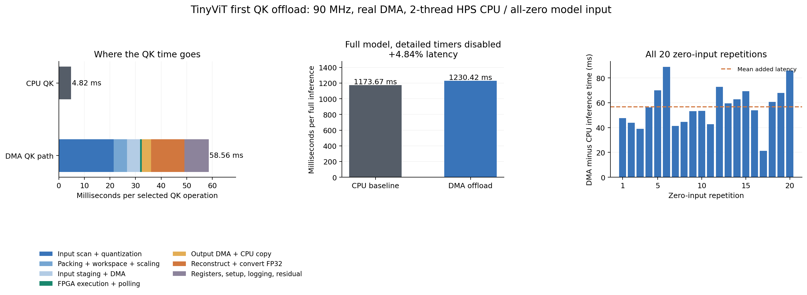

# All-zero TinyViT input: first-QK DMA diagnosis at 90 MHz

Measured on the DE1-SoC on **2026-11-11**, using the same model, FPGA image and
runner binaries as the [random-input diagnosis](tinyvit-qk-dma-timing-diagnosis.md).
This is **20 repeated measurements of one identical all-zero model input**,
not 20 distinct images. All 150,528 NCHW FP32 elements are exactly zero.
The runner uses `--zeros`, with no image decoding or normalization. A normalized
black RGB image would be a different input and was not used here.

Mean CPU inference: **1173.671 ms**. Mean DMA-offloaded inference:
**1230.423 ms**. Offload added **56.752 ms
(+4.84%)**. The previous 5.74% zero-input improvement
**did not reproduce for this integration**. The selected QK operation took
4.820 ms on CPU and 58.561 ms with complete FPGA
offload. FPGA execution plus polling was 0.659 ms; conversions,
transfers and host handling consumed the rest.



## Protocol and verified configuration

- First QK: `/layers.1/blocks.0/attn/MatMul_output_0`, 64 independent
  49x32 times 32x49 products, padded to 64x32 times 32x64.
- Current validated **90 MHz** accelerator image retained throughout; no reset,
  reprogramming, RTL change, driver change or new executable build for this test.
- Real DMA, excluded-DDR staging, 64 accelerator jobs, 128 input DMA descriptors
  and 64 output descriptors per FPGA inference. Input/output traffic each
  262,144 bytes; 200,704 values quantized per selected QK.
- Two CPU threads. Main experiment: four modes per repetition, CPU/DMA control
  and CPU/DMA profile: **80 measured inferences plus four fresh-process warmups**.
- Williams order design: every mode occurs in every position five times;
  CPU/DMA precedence is balanced 10/10, and each directed immediate-predecessor
  combination occurs five times. All repetitions use fresh processes,
  `--runs 1 --warmup 0`, avoiding the known session-reuse issue.
- CPU kernel follow-up: **40 measured CPU inferences plus two warmups**,
  alternating control/profile order, on the same zero input. Total:
  **120 measured inferences**, including **2,560 measured FPGA submissions**.
- Inference performance claims use controls with detailed phase timers disabled.
  Phase timing uses separate profiled processes. Start-to-done FPGA time includes
  MMIO polling and scheduling; there is no hardware fabric cycle counter.
- CPU packed-kernel time is the union of overlapping intervals across both
  CPU threads, excluding surrounding packing and unpacking. Summed thread-time
  is recorded separately and is not treated as wall time.
- No CPU governor/frequency pinning was available; nominal Cortex-A9 boot
  frequency is 925 MHz. Durations are monotonic, independent of the wrong board RTC.

| Artifact | SHA-256 |
|---|---|
| Main profiling runner | `f63e46066913df315fc7fe4c1fabf7b079b8b0e24e9047a18d9924c468321fbd` |
| CPU kernel runner | `8b786537139d779fca0e05773060b148668403e794a5aebc5af7fa52ee629cce` |
| Model | `f7aee628e2cef2d726979cc259529b3af0778b429c52ba8b76f3c609a2996de4` |
| Validated 90 MHz SOF | `0af66d4d24302b1ff9bb960ab189d41850603be1e8fd16edae29206fedfea058` |
| Zero FP32 input, 602,112 bytes | `ad8c5f4d30e45b2a50f7f4d1f347f64d613c6fbcd92c54ca746ab077f402d8cc` |

## Full inference and whole-process results

| Metric, ms | CPU mean | DMA mean | CPU median | DMA median | CPU SD | DMA SD |
|---|---:|---:|---:|---:|---:|---:|
| Inference | 1173.671 | 1230.423 | 1172.580 | 1227.845 | 8.350 | 16.236 |
| Whole child process | 1756.166 | 1772.138 | 1653.475 | 1709.647 | 163.791 | 162.349 |

Inference added latency: 56.752 ms, paired-bootstrap 95%
interval **49.772 to
63.819 ms**, or
**+4.23% to
+5.44%**. DMA was slower in
20/20 control pairs and faster in 0/20.
All outliers are retained. This interval describes repeated execution of this
one tensor and does not establish performance across a distribution of images.
Bootstrap uses 20,000 resamples of complete repetition pairs, seed 20261111.

Whole-process added time was 15.972 ms
(+0.91%), interval
-54.575 to
+86.731 ms. Whole-process timing
includes startup, model loading, session preparation, output files and teardown.
It is distinct from inference. Large changes outside inference must not be
attributed to FPGA compute or DMA without additional evidence.

## CPU computation baseline and complete FPGA operation

| Measurement | Mean ms | Median ms | SD ms |
|---|---:|---:|---:|
| CPU full selected QK, main profile | 4.819618 | 4.787465 | 0.084744 |
| CPU packed-kernel wall interval union, follow-up | 4.157768 | 4.151350 | 0.038607 |
| CPU full QK with additional kernel probes | 5.865187 | 5.276970 | 2.606323 |
| FPGA execution + polling | 0.658521 | 0.650135 | 0.031922 |
| Complete selected FPGA QK | 58.560946 | 55.693380 | 4.331967 |

The instrumented CPU packed-kernel/FPGA completion ratio is
**6.31x**. CPU executes FP32;
the accelerator uses approximate INT8 arithmetic and returns rescaled INT8
values. The CPU probes have nonzero overhead; the FPGA timer includes polling.
This is a comparison of measured execution phases, not an exact cycle-level
speedup or precision-equivalent comparison. Every CPU kernel profile contained
64 execute calls and 320 packed-kernel calls, with no interval-buffer overflow.

## Offload breakdown, all 64 products combined

The rows below are disjoint and add to complete FPGA QK wall time. Upload and
download are parent totals; their detailed subphases are nested in those totals.

| Phase | Mean ms | Median ms | SD ms |
|---|---:|---:|---:|
| Finite/peak input scan | 4.231314 | 4.141825 | 0.247855 |
| FP32 to INT8, allocation and transpose | 17.209964 | 16.988905 | 0.484860 |
| Validation and double result workspace | 2.175038 | 2.139515 | 0.093861 |
| Byte-image allocation, packing and padding | 1.780026 | 1.765790 | 0.049324 |
| Output scale bound scan | 1.214211 | 1.210940 | 0.018159 |
| Accelerator MMIO configuration | 0.212986 | 0.211860 | 0.008985 |
| Input staging and DMA, total | 5.147497 | 5.091785 | 0.159967 |
| Clear/start accelerator | 0.101335 | 0.100090 | 0.002640 |
| FPGA execution plus polling | 0.658521 | 0.650135 | 0.031922 |
| Output DMA and staging copy, total | 3.646815 | 3.646375 | 0.034792 |
| INT8 dequantization and accumulation | 2.881817 | 2.871855 | 0.072755 |
| FP32 conversion, checks and final copy | 10.099953 | 9.670855 | 1.703504 |
| Adapter remainder | 1.938613 | 1.911245 | 0.075785 |
| First-use device setup | 0.778730 | 0.453385 | 1.242609 |
| Bridge logging, cleanup and bookkeeping | 5.581152 | 3.400860 | 3.696575 |
| MNN / hook remainder | 0.902973 | 0.884195 | 0.060736 |
| **Complete offloaded QK** | **58.560946** | **55.693380** | **4.331967** |

Combined input scan/quantization: **21.441 ms**. Combined result
reconstruction/conversion: **12.982 ms**. Combined send/receive:
**8.794 ms**. The complete offload spends
**57.902 ms outside FPGA execution**, versus a CPU
complete-operation budget of only 4.820 ms.

| Nested DMA subphase | Mean ms |
|---|---:|
| Host to DDR staging copy | 2.480392 |
| Input DMA CSR setup | 0.476714 |
| Input DMA completion/stop | 1.789342 |
| Input transport remainder | 0.401049 |
| Output DMA CSR setup | 0.236585 |
| Output DMA completion/stop | 0.450229 |
| DDR staging to host copy | 2.734128 |
| Output transport remainder | 0.225873 |

The zero input does not remove the fixed matrix shapes, job submissions,
DMA byte counts, buffer allocation, padding, or output conversion loops. There
is no driver fast path that skips a matrix because the model input is zero.
Zero model input also does not guarantee every intermediate Q/K activation is
zero; activation values were not separately captured in this experiment.

## Accounting and the rest of TinyViT

| Profiled inference component | CPU ms | DMA ms | Added ms |
|---|---:|---:|---:|
| Selected QK | 4.819618 | 58.560946 | 53.741327 |
| All other model work | 1182.706299 | 1174.852150 | -7.854148 |
| Full inference | 1187.525917 | 1233.413096 | 45.887179 |

The approximately 1,200 ms inference contains the selected QK plus all remaining
CPU model operations; 55-60 ms of offload is a subset of that duration. The
profiled QK difference explains the model regression. Profiled and control
means are separate observations; their differences must not be forced to match.

Profiling perturbation (profile minus control inference): CPU mean
+13.853 ms, interval
+0.467 to
+32.546 ms;
DMA mean +2.990 ms, interval
-8.883 to
+16.665 ms.
No noisy negative difference is treated as a negative timer cost.

| Broader workflow phase, profiled mean ms | CPU | DMA |
|---|---:|---:|
| Prepare zero input / validate | 3.035 | 3.004 |
| Load/construct model | 378.380 | 310.426 |
| Create/resize session | 142.548 | 145.240 |
| Copy model input | 4.823 | 4.860 |
| Run inference | 1187.526 | 1233.413 |
| Copy/check/save outputs | 3.153 | 3.439 |
| Main elapsed before final JSON/teardown | 1719.745 | 1700.953 |

## Comparison with random input and the old 5.74% observation

| Input / configuration | CPU inference ms | Offload inference ms | Added latency % |
|---|---:|---:|---:|
| Current first QK, random RGB, 90 MHz DMA | 1178.207 | 1224.513 | +3.93% |
| Current first QK, zero FP32 input, 90 MHz DMA | 1173.671 | 1230.423 | +4.84% |
| Historical different QK, zero input, 80 MHz PIO, single observation | 1265.170 | 1192.560 | -5.74% |

The historical test offloaded **`/layers.3/blocks.1/attn/MatMul_output_0`**, not
the first QK. It used the older 80 MHz image, a different driver/tiling path and
one timing observation per mode. Its [report](tinyvit-fpga-integration-report.md)
already states that the evidence does not establish a reliable speedup. It
cannot be extrapolated to this first-QK DMA integration.

Random and zero tests also ran in separate benchmark sessions. Their absolute
time difference is descriptive, not a controlled causal measurement of input
values alone: scheduling, memory/cache and other system state can differ.
Both current datasets demonstrate a complete-offload cost far above the CPU
QK budget. Zero input did not make conversion/transfer overhead disappear.

| Selected-operation phase, ms | Random input | Zero input |
|---|---:|---:|
| CPU full QK | 4.822 | 4.820 |
| Input scan + quantization | 21.414 | 21.441 |
| Send + receive | 8.751 | 8.794 |
| FPGA execution + polling | 0.657 | 0.659 |
| Result reconstruction + FP32 conversion | 12.689 | 12.982 |
| Complete FPGA QK | 59.108 | 58.561 |

## Numerical checks and all 20 control repetitions

Every repetition produced the same CPU score hash within its execution path
and the same FPGA score hash within its path. Every control/profile hash
matched; all CPU kernel follow-up outputs matched the corresponding CPU
baseline. All outputs contained 1,000 finite FP32 scores. CPU/FPGA top-1
agreement: **20/20**, exact top-5 ranking agreement:
**0/20**, maximum absolute score error:
**0.025943160**. These are repeated numerical checks on
one synthetic input, not 20 independent accuracy samples or validation-set accuracy.

The deterministic top-5 lists were CPU `[674, 593, 749, 872, 836]` and
FPGA `[674, 593, 749, 872, 644]`: the first four indices agree and the
fifth differs. Score RMSE was 0.008358384, relative L2
error 0.022497, and cosine similarity
0.999761523. The accelerator result is an
approximation, not a bit-exact FP32 match.

| Repetition | CPU inference ms | DMA inference ms | Added ms | Added % | CPU QK ms | FPGA QK ms | FPGA execution + poll ms |
|---:|---:|---:|---:|---:|---:|---:|---:|
| 1 | 1171.00 | 1218.74 | +47.74 | +4.08 | 4.823 | 54.862 | 0.648 |
| 2 | 1168.34 | 1212.28 | +43.94 | +3.76 | 4.735 | 54.875 | 0.656 |
| 3 | 1173.81 | 1212.78 | +38.97 | +3.32 | 4.833 | 65.923 | 0.661 |
| 4 | 1177.86 | 1234.13 | +56.27 | +4.78 | 4.772 | 55.361 | 0.647 |
| 5 | 1176.80 | 1246.75 | +69.95 | +5.94 | 4.750 | 59.118 | 0.655 |
| 6 | 1166.74 | 1255.66 | +88.92 | +7.62 | 4.884 | 55.092 | 0.648 |
| 7 | 1172.42 | 1213.78 | +41.36 | +3.53 | 4.766 | 63.455 | 0.649 |
| 8 | 1177.51 | 1222.11 | +44.60 | +3.79 | 4.849 | 61.144 | 0.645 |
| 9 | 1172.23 | 1225.47 | +53.24 | +4.54 | 4.814 | 54.975 | 0.653 |
| 10 | 1162.71 | 1216.08 | +53.37 | +4.59 | 4.912 | 61.753 | 0.647 |
| 11 | 1163.35 | 1206.03 | +42.68 | +3.67 | 4.766 | 54.914 | 0.649 |
| 12 | 1179.91 | 1252.66 | +72.75 | +6.17 | 4.794 | 54.847 | 0.651 |
| 13 | 1174.11 | 1233.67 | +59.56 | +5.07 | 4.761 | 55.083 | 0.793 |
| 14 | 1181.69 | 1244.38 | +62.69 | +5.31 | 4.779 | 63.217 | 0.648 |
| 15 | 1170.53 | 1239.75 | +69.22 | +5.91 | 4.781 | 65.388 | 0.657 |
| 16 | 1172.74 | 1226.65 | +53.91 | +4.60 | 5.069 | 55.093 | 0.656 |
| 17 | 1199.23 | 1220.55 | +21.32 | +1.78 | 4.930 | 66.274 | 0.652 |
| 18 | 1171.64 | 1232.33 | +60.69 | +5.18 | 4.903 | 56.025 | 0.659 |
| 19 | 1161.03 | 1229.04 | +68.01 | +5.86 | 4.738 | 54.917 | 0.648 |
| 20 | 1179.78 | 1265.62 | +85.84 | +7.28 | 4.734 | 58.903 | 0.649 |

## Evidence and reproduction

[Timing CSV](benchmarks/qk-zeros-dma-90mhz-2026-11-11/timing-breakdown.csv), [all main raw records](benchmarks/qk-zeros-dma-90mhz-2026-11-11/raw-results.json),
[summary and bootstrap statistics](benchmarks/qk-zeros-dma-90mhz-2026-11-11/summary.json), [full stage statistics](benchmarks/qk-zeros-dma-90mhz-2026-11-11/phase-statistics.md),
[main metadata](benchmarks/qk-zeros-dma-90mhz-2026-11-11/metadata.json), [CPU kernel CSV](benchmarks/qk-zeros-dma-90mhz-2026-11-11/cpu-kernel-baseline.csv),
[CPU kernel raw records](benchmarks/qk-zeros-dma-90mhz-2026-11-11/cpu-kernel-raw-results.json), [CPU kernel summary](benchmarks/qk-zeros-dma-90mhz-2026-11-11/cpu-kernel-summary.json),
[CPU kernel metadata](benchmarks/qk-zeros-dma-90mhz-2026-11-11/cpu-kernel-metadata.json), [SVG figure](benchmarks/qk-zeros-dma-90mhz-2026-11-11/timing-diagnosis.svg),
[raw main logs/outputs](benchmarks/qk-zeros-dma-90mhz-2026-11-11/benchmark-qk-zeros-90mhz-20-evidence.tar.gz),
[raw CPU kernel logs/outputs](benchmarks/qk-zeros-dma-90mhz-2026-11-11/benchmark-qk-zeros-cpu-kernels-20-evidence.tar.gz),
[artifact checksums](benchmarks/qk-zeros-dma-90mhz-2026-11-11/SHA256SUMS).
The main raw archive contains the exact zero input bytes as well as logs and scores.

Board results are preserved in `/home/ubuntu/tinyvit/benchmark-qk-zeros-90mhz-20` and
`/home/ubuntu/tinyvit/benchmark-qk-zeros-cpu-kernels-20`. On the board, rerun with a new directory:

```sh
sudo python3 benchmark_qk_profile.py --zeros --order-design williams \
  --runner tinyvit_offload_profile --inputs 20 \
  --output-dir /home/ubuntu/tinyvit/NEW-zeros \
  --bitstream-sha256 0af66d4d24302b1ff9bb960ab189d41850603be1e8fd16edae29206fedfea058
sudo python3 benchmark_qk_cpu_kernels.py \
  --source-results /home/ubuntu/tinyvit/NEW-zeros \
  --output-dir /home/ubuntu/tinyvit/NEW-zeros-cpu-kernels
```

The board script copies used here are `benchmark_qk_profile_zeros.py` and
`benchmark_qk_cpu_kernels_zeros.py`, preserving the earlier random-test scripts.
They match the tracked benchmark scripts' zero-input support. Host analysis
uses `summarize_qk_profile.py`, `summarize_qk_cpu_kernels.py`, and
`plot_qk_profile.py`. All expected counters, timing accounting and raw output
hashes were checked. No FPGA arithmetic, clock constraints or driver behavior
was modified for this experiment.
