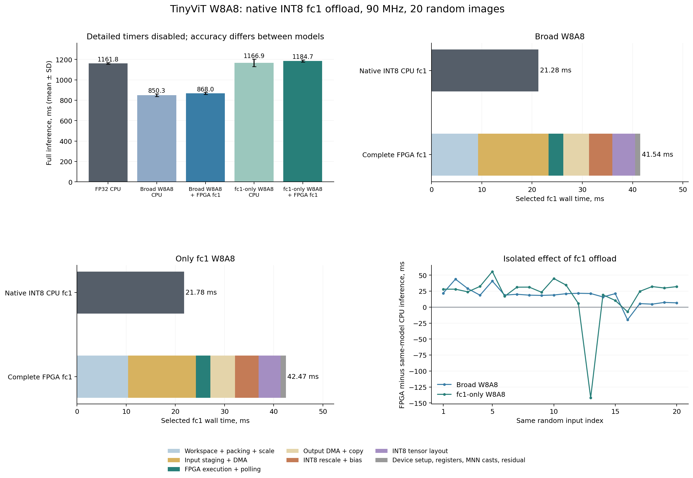

# TinyViT W8A8 and native INT8 fc1 offload: 20 random images at 90 MHz

**Accuracy follow-up:** the original broad model below is retained as failed
experimental evidence. Use the separately generated mixed-precision model in
the [quantization accuracy repair report](tinyvit-quantization-accuracy-repair.md).
Its validation and timings are separate from this historical experiment.

Measured 2026-11-12 on the connected DE1-SoC. The original board model was
retrieved and SHA-verified, calibrated with MNN 3.6.2, and saved under new names.
The gated CoreEpoch package was not used. The FPGA remains the previously
validated 90 MHz image; no RTL or bitstream change was made.

**Native INT8 integration removes the driver's FP32 activation quantization
and FP32 output reconstruction. It substantially reduces offload overhead,
but fc1 offload still adds latency compared with the same model on the HPS CPU.**

- Broadly quantized model: FPGA adds **17.700 ms /
  2.08%** mean full-inference latency versus its CPU baseline.
- fc1-only quantized model: FPGA adds **17.753 ms /
  1.52%** versus its CPU baseline.
- The broadly quantized model failed the preliminary real-image agreement
  check: **3/20** top1 matches with FP32. The fc1-only
  CPU model matched on **20/20**. This is host
  agreement on a small sample, not full ImageNet accuracy validation.
- FPGA banded rounding remains a numerical correctness limitation. The
  transport/layout/requantization implementation matches an independent oracle;
  the hardware result does not match full INT32 accumulation.

The broad-model offload penalty has a 95% paired CI of
[11.833, 23.287] ms and is slower in 19/20 pairs.
The fc1-only mean penalty is less certain: 95% CI
[-2.075, 30.500] ms, slower in 18/20,
median paired penalty 28.070 ms. A retained 1318.020 ms
fc1-only CPU run on image 13 pulls up that baseline mean. The selected fc1
offload is consistently slower than native INT8 CPU execution in both models.



## Models generated

| Model | Bytes | Quantized convolution weights | Activation metadata |
|---|---|---|---|
| Original `tiny-vit.mnn` | 26602144 | 0 / 68 | 0 quantized tensor records |
| `tiny-vit-w8a8-kl.mnn` | 10686388 | 68 / 68 | 351 quantized tensor records |
| `tiny-vit-fc1-w8a8.mnn` | 26399956 | Only selected fc1 | Only its input/output records |

The broad model has W8A8 convolutions with per-output-channel INT8 weights and
calibrated INT8 activation scales. Attention MatMul and other unsupported
operators may remain FP32. It is not an all-integer graph. Biases/scales and
1,219,709 floating constant elements remain floating point. Quantized weights
are stored in MNN's compressed IDST buffer, which is why the inspection tool's
uncompressed `int8_weight_elements` count is zero despite 68 encoded layers.

The fc1-only model is an accuracy/control alternative: copy the calibrated
fc1 convolution and its two tensor quantization records into the original graph.
All other weights, constants, operators and tensor names retain their original
values. The graph still has 1463 model operations and 68 convolutions.

Both artifacts are generated on the PC in `build/mnn-w8a8-tools/` and deployed
in `/home/ubuntu/tinyvit/` under the names above. The original model was kept.
Generated model binaries are not checked into Git. Their hashes are below.

## Calibration and numerical checks

MNN's KL post-training calibration used 128 real Imagenette training images,
selected deterministically across its 10 classes, seed 20261112. Another 20
validation images, two per class, were kept disjoint. They are separate from
the 20 saved random RGB images used for timing. Imagenette is a 10-class subset
of ImageNet, so the calibration does not establish coverage of all 1000 classes.
See the [Imagenette source](https://github.com/fastai/imagenette) and
[MNN quantization guide](https://github.com/alibaba/MNN/blob/master/tools/quantization/README_EN.md).

Images were converted to RGB and resized directly to 224x224 using PIL bilinear.
The quantization configuration matches our existing runner normalization:

```json
{
  "format": "RGB",
  "mean": [123.675, 116.28, 103.53],
  "normal": [0.017124753831663668, 0.01750700280112045, 0.017429193899782137],
  "width": 224, "height": 224,
  "used_image_num": 128,
  "feature_quantize_method": "KL",
  "weight_quantize_method": "MAX_ABS",
  "quant_bits": 8,
  "feature_clamp_value": 127, "weight_clamp_value": 127
}
```

The broad conversion took 128.021 seconds on the PC. Its model is 10,686,388
bytes versus 26,602,144 originally (2.489x smaller). The fc1-only alternative
is 26,399,956 bytes. The 20-real-image host check is agreement with the original
FP32 output, not measured ImageNet classification accuracy; no ground-truth
accuracy claim is made. It used the Windows MNN 3.6.2 runtime, not Cortex-A9
timing. Broad quantization failed that check and is not a validated deployment
model. The fc1-only result supports isolating this layer; it is not proof that
all other layers can be quantized with the same accuracy.

An additional board diagnostic captures actual native INT8 fc1 inputs/outputs
inside the convolution executor, after any runtime casts, on random image 01.
It independently computes the full INT32 dot product and models the FPGA's
per-band arithmetic plus the driver's Q16 per-channel output scaling.

| Image 01 fc1 output check | Broad W8A8 | fc1-only W8A8 |
|---|---|---|
| CPU/FPGA native inputs identical | True | True |
| INT32 oracle vs MNN: max INT8 code error | 1.0 | 0.0 |
| INT32 oracle vs MNN: exact values /401408 | 401405 | 401408 |
| FPGA matches independent banded oracle | True | True |
| FPGA vs MNN: max INT8 code error | 56.0 | 59.0 |
| FPGA vs MNN: relative L2 | 1.013286 | 1.010855 |
| FPGA vs MNN: mean signed INT8 code error | -14.084209 | -14.466229 |

The three one-code differences in the broad CPU oracle are rounding-level
differences; 401405/401408 values match exactly. All 401408 values match for the
fc1-only CPU model. All FPGA output values match the banded arithmetic oracle.
This distinguishes integration/layout/scale bugs from the actual RTL behavior.
The large FPGA discrepancy remains caused by flooring/requantizing each 16-wide
K band before saturated INT8 accumulation, rather than preserving the full
INT32 sum and requantizing once. Changing the model's format did not fix it.

## Full-model performance: use the same-model CPU baseline

The primary comparison uses detailed-timer-disabled controls. All times below
are milliseconds, mean ± sample SD over 20 random images. Selected fc1 times
come from separate paired profiled runs. A faster broadly quantized model
compared with FP32 must not be credited to the FPGA, particularly while its
accuracy is unacceptable.

| Mode | Full inference mean ± SD | Median | Min–max | Selected fc1, profiled |
|---|---|---|---|---|
| Original FP32 CPU | 1161.753 ± 7.110 | 1159.430 | 1154.630–1184.290 | 28.774 ± 0.787 |
| Broad W8A8 CPU | 850.314 ± 12.595 | 843.407 | 840.330–881.712 | 21.284 ± 0.109 |
| Broad W8A8 + FPGA fc1 | 868.014 ± 9.625 | 862.116 | 859.214–888.794 | 41.538 ± 1.565 |
| fc1-only W8A8 CPU | 1166.908 ± 36.561 | 1155.940 | 1148.500–1318.020 | 21.784 ± 1.404 |
| fc1-only W8A8 + FPGA fc1 | 1184.660 ± 11.324 | 1183.010 | 1171.730–1210.890 | 42.470 ± 0.870 |

| Paired comparison | Added mean ms | Change | Median paired ms | 95% CI, mean added ms | Slower /20 |
|---|---|---|---|---|---|
| FP32 CPU → broad W8A8 CPU | -311.439 | -26.81% | -315.692 | [-317.212, -304.723] | 0 |
| Broad CPU → FPGA fc1 | +17.700 | +2.08% | +18.830 | [11.833, 23.287] | 19 |
| FP32 CPU → fc1-only W8A8 CPU | +5.155 | +0.44% | -1.165 | [-6.739, 23.709] | 8 |
| fc1-only CPU → FPGA fc1 | +17.753 | +1.52% | +28.070 | [-2.075, 30.500] | 18 |
| FP32 CPU → broad W8A8+FPGA | -293.739 | -25.28% | -295.047 | [-297.612, -289.467] | 0 |
| FP32 CPU → fc1-only W8A8+FPGA | +22.907 | +1.97% | +24.910 | [18.051, 27.834] | 20 |

Positive changes mean slower. Confidence intervals resample whole image pairs
20,000 times with NumPy seed 20261112; they describe this experiment. Every run
is retained, including outliers. The table shows medians and ranges so one
slow CPU run cannot silently determine the conclusion. The CSV contains all
individual observations; a confidence interval crossing zero means the mean
effect is uncertain in this sample.

| Selected fc1 comparison | Mean added ms | 95% paired CI, ms |
|---|---|---|
| Broad W8A8 CPU → FPGA | +20.253 | [19.667, 21.005] |
| fc1-only W8A8 CPU → FPGA | +20.687 | [19.831, 21.381] |

## What conversion work disappeared, and what remains

The application now uses `--fpga-linear-int8`. Its callback selects the exact
fc1 operation but lets MNN's quantized execution machinery run. A narrow hook
inside `DenseConvInt8TiledExecutor::onExecute` replaces only the arithmetic,
after any MNN runtime casts. This avoids re-quantizing already-INT8 activations
and uses the model's original per-channel INT8 weights. Input/output must be
real one-byte NC4HW4 tensors, pack 4, symmetric zero point 0 and the validated
784x128 → 784x512 shape. Unsupported contracts fail; exactly one replacement
and 28 completed jobs are required.

Weights are decoded, transposed and cached once before inference. No FP32
weight quantization occurs in the new bridge. The capacity plan remains
128x128x128, seven row panels×four column panels, one K panel each. Every
inference still transfers 860160 input bytes and 401408 result bytes in 108/52
DMA descriptors. The operands/result buffers and loaded 90 MHz image are the
same as in the earlier experiment. Host code still submits 28 jobs; the FPGA
handles its 16x16 internal tiling within each.

The FPGA has one Q16 output multiplier per job, while MNN weights have 512
different channel scales. Therefore its returned INT8 codes still need a
per-channel rescale and bias/clamp into MNN's output quantization. This uses
bounded Q16 integer arithmetic and ARMv7 NEON, not a FP32 output tensor.
Because K fits in one panel, output is finalized in one pass without a large
INT64 accumulation workspace. A safe scalar/INT64 fallback remains for shapes
or coefficients that do not satisfy the narrow arithmetic bounds.

The ARM test compared NEON and scalar results with an independent INT64 oracle
for all 256 INT8 codes, signed half-way rounding, clamps, non-multiple-of-eight
tails and the 401408-value fc1 extent. They match byte for byte. Each measured
FPGA profile reports 401408 vectorized output values, proving the fast path ran.

| Per-fc1 phase, ms | Earlier FP32 adapter | Broad native W8A8 | fc1-only native W8A8 |
|---|---|---|---|
| Activation scan+FP32→INT8 | 10.483 | 0.000 | 0.000 |
| FP32 reconstruction/conversion | 35.723 | 0.000 | 0.000 |
| INT8 output rescale/bias | — | 4.677 | 4.797 |
| Layout allocation/conversion | 7.357 | 4.534 | 4.446 |
| Input/output staging+DMA | 18.577 | 19.090 | 18.815 |
| Execution+polling | 2.925 | 2.932 | 2.923 |
| Complete selected fc1 | 91.405 | 41.538 ± 1.565 | 42.470 ± 0.870 |

The earlier FP32-adapter column is historical context from a separate session,
with different quantization/scales and host postprocessing. It is not a paired
measurement isolating only the model format. The new zero-valued adapter phases
are directly checked in every profile. Native INT8 avoids those specific
boundaries; it does not imply zero conversion cost across the whole model.

MNN's `CastWrapExecution` is now instrumented separately for all inference
FP32↔INT8 casts, including casts outside the selected fc1 callback:

| Framework casts over whole inference | Quantize ms | Dequantize ms | Quantize calls | Dequantize calls |
|---|---|---|---|---|
| Original FP32 CPU | 0.000 ± 0.000 | 0.000 ± 0.000 | 0 | 0 |
| Broad W8A8 CPU | 59.397 ± 1.480 | 21.979 ± 0.646 | 33 | 43 |
| Broad W8A8 + FPGA fc1 | 59.061 ± 1.150 | 21.843 ± 0.478 | 33 | 43 |
| fc1-only W8A8 CPU | 1.516 ± 0.079 | 2.528 ± 0.077 | 1 | 1 |
| fc1-only W8A8 + FPGA fc1 | 1.500 ± 0.051 | 2.497 ± 0.053 | 1 | 1 |

These are observed graph/runtime cast scopes, not an assertion that all integer
kernel arithmetic or layer-normalization internals are separately classified.
The casts are already included in full inference; do not add them to the
inference total again. Selected cast subsets, if any, appear in the table below.

For the fc1-only model, MNN still quantizes 100352 activations in about 1.5 ms
and dequantizes 401408 outputs in about 2.5 ms, outside the selected convolution
callback. The native FPGA hook reuses the INT8 tensors between those casts.
Their cost remains in both CPU and FPGA full-inference measurements. The broad
model has 33 quantize and 43 dequantize scopes, about 81 ms combined. Thus W8A8
removes duplicate driver conversions, not every FP32/INT8 boundary in TinyViT.

## Disjoint selected-operation timing

All phase times are host wall times. Start-to-done includes MMIO polling and
scheduling; the hardware ABI provides no cycle counter. These rows sum to the
selected fc1 timer. Static preparation is excluded and shown later.

| Disjoint phase, ms | Broad W8A8 mean ± SD | fc1-only W8A8 mean ± SD |
|---|---|---|
| Allocate native tensor layout buffers | 0.671 ± 0.020 | 0.723 ± 0.025 |
| Packed INT8 input → dense INT8 | 0.553 ± 0.018 | 0.539 ± 0.034 |
| Driver workspace/validation | 0.546 ± 0.034 | 0.539 ± 0.029 |
| Tile-plan bookkeeping | 0.000 ± 0.000 | 0.000 ± 0.000 |
| Pack/pad operands | 4.169 ± 0.227 | 5.301 ± 0.218 |
| Safe hardware scale + channel gains | 4.577 ± 0.251 | 4.555 ± 0.134 |
| Program/check registers | 0.095 ± 0.006 | 0.097 ± 0.006 |
| Input staging+DMA | 13.983 ± 0.701 | 13.788 ± 0.201 |
| Launch | 0.045 ± 0.003 | 0.044 ± 0.001 |
| FPGA execution+polling | 2.932 ± 0.035 | 2.923 ± 0.026 |
| Output DMA+staging copy | 5.106 ± 0.279 | 5.027 ± 0.098 |
| Host K-panel accumulation | 0.000 ± 0.000 | 0.000 ± 0.000 |
| INT8 output rescale/bias/clamp/copy | 4.677 ± 0.201 | 4.797 ± 0.115 |
| Dense INT8 → native packed output | 3.311 ± 0.402 | 3.184 ± 0.259 |
| Unassigned adapter overhead | 0.132 ± 0.008 | 0.132 ± 0.010 |
| Device open/map/lock | 0.439 ± 0.031 | 0.482 ± 0.035 |
| Bridge remainder/logging | 0.103 ± 0.010 | 0.106 ± 0.011 |
| MNN casts inside selected operation | 0.000 ± 0.000 | 0.000 ± 0.000 |
| Callback/executor remainder | 0.199 ± 0.039 | 0.233 ± 0.016 |
| Complete selected fc1 | 41.538 ± 1.565 | 42.470 ± 0.870 |

Nested transport phases below are already included in upload/download:

| Nested phase, ms | Broad W8A8 | fc1-only W8A8 |
|---|---|---|
| input_stage_copy | 7.944 ± 0.678 | 7.763 ± 0.202 |
| input_dma_setup | 0.390 ± 0.027 | 0.384 ± 0.008 |
| input_dma_wait | 5.422 ± 0.047 | 5.414 ± 0.031 |
| output_dma_setup | 0.194 ± 0.035 | 0.183 ± 0.002 |
| output_dma_wait | 0.676 ± 0.017 | 0.671 ± 0.019 |
| output_stage_copy | 4.108 ± 0.239 | 4.049 ± 0.088 |

The remaining inference after subtracting fc1 changes by -4.198 ms for broad W8A8, -4.746 ms for fc1-only W8A8 compared with each same-model CPU profile.
Different values, cache state, callback overhead, scheduling and noise can affect
the rest of the model; this experiment does not isolate those causes.

## Complete pipeline and one-time setup

Each measured run is a fresh process with one inference. The inference timer
excludes preprocessing, model loading, session creation, input copy, FPGA weight
decode/transpose/plan setup and output saving. Process wall time includes those
steps and teardown. A persistent application could amortize static setup; the
per-inference DMA/layout/packing/output phases above remain.

| Profiled pipeline section, ms | Original FP32 CPU | Broad W8A8 CPU | Broad W8A8 + FPGA fc1 | fc1-only W8A8 CPU | fc1-only W8A8 + FPGA fc1 |
|---|---|---|---|---|---|
| preprocess_ms | 23.889 ± 3.720 | 23.175 ± 3.342 | 24.537 ± 4.035 | 23.120 ± 3.414 | 24.387 ± 3.910 |
| model_load_ms | 1144.976 ± 260.050 | 359.829 ± 255.572 | 356.744 ± 217.079 | 768.535 ± 330.043 | 865.677 ± 309.835 |
| session_ms | 158.831 ± 33.677 | 250.570 ± 10.790 | 248.322 ± 10.609 | 174.350 ± 47.331 | 147.848 ± 26.435 |
| input_copy_ms | 4.729 ± 0.166 | 4.679 ± 0.319 | 4.697 ± 0.401 | 4.728 ± 0.165 | 4.658 ± 0.157 |
| linear_setup_ms | 0.000 ± 0.000 | 0.000 ± 0.000 | 5.277 ± 0.167 | 0.000 ± 0.000 | 4.983 ± 0.119 |
| inference_ms | 1184.198 ± 46.990 | 852.458 ± 11.912 | 868.514 ± 8.055 | 1169.296 ± 24.528 | 1185.237 ± 10.249 |
| output_ms | 3.064 ± 4.550 | 0.747 ± 0.032 | 1.794 ± 3.041 | 3.333 ± 4.437 | 0.875 ± 0.150 |
| main_elapsed_ms | 2519.994 ± 228.837 | 1491.776 ± 265.599 | 1510.275 ± 218.312 | 2143.705 ± 332.422 | 2234.144 ± 307.557 |

| Static FPGA setup nested inside `linear_setup_ms` | Broad W8A8 | fc1-only W8A8 |
|---|---|---|
| weight_setup_ms | 2.150 ± 0.048 | 2.172 ± 0.053 |
| weight_peak_scan_ms | 0.000 ± 0.000 | 0.000 ± 0.000 |
| weight_quantize_ms | 0.000 ± 0.000 | 0.000 ± 0.000 |
| plan_selection_ms | 0.999 ± 0.024 | 1.004 ± 0.022 |

Zero weight scan/quantization does not mean zero preparation: MNN's compressed
INT8 weights must be decoded and transposed, channel coefficients validated,
and a tile plan selected. The native CPU session also prepares its usual
weights before inference; this hook does not remove that session-creation work.

| Complete process controls, ms | Mean±SD | Median |
|---|---|---|
| Original FP32 CPU | 2581.795 ± 247.419 | 2678.650 |
| Broad W8A8 CPU | 1498.340 ± 225.990 | 1663.045 |
| Broad W8A8 + FPGA fc1 | 1548.395 ± 220.857 | 1701.941 |
| fc1-only W8A8 CPU | 2250.820 ± 297.016 | 2243.233 |
| fc1-only W8A8 + FPGA fc1 | 2332.266 ± 339.784 | 2321.692 |

| Paired complete process comparison | Mean added ms | Change | 95% CI, added ms |
|---|---|---|---|
| FP32 CPU → broad W8A8 CPU | -1083.456 | -41.97% | [-1248.091, -905.649] |
| Broad CPU → FPGA fc1 | +50.055 | +3.34% | [-60.341, 164.911] |
| FP32 CPU → fc1-only W8A8 CPU | -330.976 | -12.82% | [-466.840, -199.401] |
| fc1-only CPU → FPGA fc1 | +81.446 | +3.62% | [-112.490, 249.074] |
| FP32 CPU → broad W8A8+FPGA | -1033.400 | -40.03% | [-1188.468, -865.564] |
| FP32 CPU → fc1-only W8A8+FPGA | -249.530 | -9.66% | [-421.508, -75.185] |

Complete-process results include large, variable loading/session costs and
different model files. In particular, a process-time change is not evidence
that the small fc1 computation itself became faster. No storage/cache trace
was captured to isolate those loading differences. Use the same-model
inference and selected-operation comparisons to assess FPGA offload.

| Detailed timer effect on full inference | Profile minus control mean ms | 95% paired CI |
|---|---|---|
| Original FP32 CPU | +22.444 | [6.385, 44.093] |
| Broad W8A8 CPU | +2.144 | [-5.596, 9.961] |
| Broad W8A8 + FPGA fc1 | +0.499 | [-3.860, 4.589] |
| fc1-only W8A8 CPU | +2.387 | [-20.429, 20.811] |
| fc1-only W8A8 + FPGA fc1 | +0.577 | [-3.797, 4.791] |

## Score agreement on the 20 timed random inputs

Random RGB images have no ground-truth labels. These are numerical agreement
checks, not classification accuracy. CPU quantization error and the additional
FPGA error are reported separately.

| Comparison | Top1 agrees /20 | Exact top5 ranking /20 | Relative L2 mean ± SD | Worst absolute logit error |
|---|---|---|---|---|
| full_fpga_vs_fp32 | 0 | 0 | 2.090 ± 0.189 | 5.408110 |
| hybrid_cpu_vs_fp32 | 20 | 13 | 0.022 ± 0.004 | 0.130688 |
| hybrid_fpga_vs_fp32 | 14 | 0 | 0.820 ± 0.091 | 3.572405 |
| hybrid_fpga_vs_hybrid_cpu | 14 | 0 | 0.821 ± 0.093 | 3.500403 |
| full_fpga_vs_full_cpu | 3 | 0 | 0.767 ± 0.028 | 5.072433 |
| full_cpu_vs_fp32 | 0 | 0 | 2.169 ± 0.189 | 6.161280 |

## All 20 random-image inference controls

| Input | Original FP32 CPU ms | Broad W8A8 CPU ms | Broad W8A8 + FPGA fc1 ms | fc1-only W8A8 CPU ms | fc1-only W8A8 + FPGA fc1 ms |
|---|---|---|---|---|---|
| 1 | 1163.470 | 855.201 | 877.065 | 1161.990 | 1190.050 |
| 2 | 1164.170 | 845.035 | 888.794 | 1163.320 | 1191.400 |
| 3 | 1168.630 | 848.412 | 877.429 | 1151.740 | 1175.620 |
| 4 | 1156.840 | 843.524 | 862.144 | 1148.500 | 1180.960 |
| 5 | 1164.400 | 840.417 | 881.167 | 1155.180 | 1210.890 |
| 6 | 1156.810 | 842.668 | 861.398 | 1155.960 | 1172.820 |
| 7 | 1158.920 | 840.965 | 861.058 | 1153.100 | 1184.310 |
| 8 | 1157.900 | 841.904 | 860.622 | 1155.590 | 1186.890 |
| 9 | 1156.450 | 842.902 | 861.203 | 1161.650 | 1184.930 |
| 10 | 1184.290 | 858.577 | 877.507 | 1153.530 | 1198.320 |
| 11 | 1159.940 | 841.095 | 862.088 | 1153.950 | 1188.390 |
| 12 | 1163.690 | 840.330 | 861.991 | 1166.280 | 1171.950 |
| 13 | 1161.330 | 842.239 | 863.513 | 1318.020 | 1176.230 |
| 14 | 1171.590 | 843.289 | 859.214 | 1152.560 | 1171.740 |
| 15 | 1156.900 | 841.513 | 862.590 | 1161.330 | 1171.730 |
| 16 | 1156.290 | 881.712 | 861.883 | 1182.080 | 1174.810 |
| 17 | 1155.650 | 855.331 | 860.803 | 1155.920 | 1180.620 |
| 18 | 1156.860 | 855.793 | 860.435 | 1149.560 | 1181.710 |
| 19 | 1166.300 | 867.397 | 874.741 | 1176.300 | 1206.170 |
| 20 | 1154.630 | 877.977 | 884.638 | 1161.600 | 1193.670 |

All 100 image/model rows and every phase, workflow section, framework cast and
process observation are in [timing-breakdown.csv](benchmarks/w8a8-fc1-2026-11-12/timing-breakdown.csv).
Control columns and separate profiled columns are explicitly named.

## Validation and reproducibility

- 20 distinct saved random 224x224 RGB images, seeds 2026111101–2026111120,
  with the same ImageNet mean/std as the preceding experiments. Calibration
  images and the 20 real-image agreement checks are separate.
- Ten modes per image: five configurations, each control/profile; 200 measured
  complete inferences and 10 unmeasured fresh-process warmups. Cyclic Williams
  rows paired with reversals balance every pair's precedence 10/10 and every
  mode's position twice across 20 images. No samples discarded.
- Same two Cortex-A9 CPU threads, root privilege, runner and 90 MHz FPGA image
  in all measured modes. No other benchmark or file transfer ran concurrently.
  CPU/model state is captured in metadata; the board wall clock is not trusted.
  Elapsed times use monotonic clocks.
- Every control/profile pair produces identical scores. All 20 FP32 control
  outputs match the earlier FP32 baseline hashes. Every FPGA inference reports
  one native INT8 fc1 replacement,28 jobs, the expected DMA bytes/descriptors,
  zero FP32 adapter phases and 401408 NEON-processed output values.
- Host tiling/per-channel/tail/failure-atomicity tests and scalar rounding tests
  pass. The ARM NEON test passes against scalar and independent INT64 references.
  The real-weight board diagnostic passes CPU/full-INT32 and FPGA/banded-oracle
  checks. All 200 downloaded raw score hashes/log records are verified.
- Native-tensor diagnostic captures used runner v2 with the same integer
  arithmetic; measured runner v4 adds profiling counters/framework-cast timers.
  All four final image01 CPU/FPGA score hashes match the diagnostic outputs.
  Both runner hashes are recorded in build provenance.
- ARM application builds passed enabled warnings-as-errors checks. MNN core
  compilation emitted an existing `%lu`/`size_t` debug-print warning on ARM32;
  it did not prevent the build. No RTL change or new Quartus build was required.
- Numerical equivalence to FP32/full-INT32 does **not** pass for the broadly
  quantized model or FPGA banded arithmetic. They remain experimental despite
  successful execution/transport tests. The fc1-only CPU model passed the
  stated small host agreement check, not a full deployment accuracy evaluation.

MNN runtime source base: `2c3f5b21a223734e5db7da4ef7b492bc02cafcf5` with
the existing FPGA/profile patch and new `mnn/patches/0002-native-int8-fc1.patch`.
Quantization used the Windows MNN 3.6.2 wheel. Builds use static ARMv7 hard-float
Zig 0.13.0, Cortex-A9, Release `-O3`, MNN thread pool enabled, ARM82 disabled.
The feature supports the validated symmetric fc1 contract; it is not a generic
quantized-convolution backend.

| Artifact | SHA256 |
|---|---|
| Original model | `f7aee628e2cef2d726979cc259529b3af0778b429c52ba8b76f3c609a2996de4` |
| Broad W8A8 model | `d4d6bb729e25cd56d9ea5546a2b3a737af0678e497ffd8ae57c12b4377ef0277` |
| fc1-only W8A8 model | `5da72376879416206ccf736fb0c75545c83d721dec3a5e8d0fb789eccddaaa27` |
| Tested runner | `233af95ef5de385b0f694273a69e78b9340ad36b3031924b452b2cf0b561e151` |
| Loaded90 MHz SOF | `0af66d4d24302b1ff9bb960ab189d41850603be1e8fd16edae29206fedfea058` |

Reproduce model calibration with the provided scripts and a new output path:

```sh
python mnn/app/prepare_tinyvit_calibration.py --archive imagenette2-160.tgz \
  --output-dir build/calibration
python mnn/app/quantize_tinyvit_w8a8.py --model ORIGINAL.mnn \
  --output build/models/tiny-vit-w8a8-kl.mnn \
  --calibration-dir build/calibration/calibration-128 --images 128
```

Use a tested MNN 3.6.2 Python installation; `--python-path DIRECTORY` supports an
isolated installation. The script calls the native quantizer with an argv list
to avoid the packaged wrapper's argument-signature mismatch. Compile
`create_fc1_quantized_model.cpp` against the pinned generated schema and
FlatBuffers headers, then pass FP32 model, calibrated model and new output path
to generate the fc1-only alternative. It refuses to overwrite an existing file.

Apply both MNN patches and build the runner. On the prepared board, deploy
the three models and tested runner, then use a new results directory:

```sh
sudo python3 benchmark_fc1_w8a8.py --runner tinyvit_fc1_w8a8_v4 \
  --inputs 20 --output-dir /home/ubuntu/tinyvit/NEW_RESULTS \
  --bitstream-sha256 0af66d4d24302b1ff9bb960ab189d41850603be1e8fd16edae29206fedfea058
```

On the host, run `summarize_fc1_w8a8.py RESULTS_DIR` and
`plot_fc1_w8a8.py RESULTS_DIR`. Detailed tracing with `MNN_INT8_TRACE=PREFIX`
is only for diagnostics: it writes native tensors/parameters and perturbs
timing. The timed benchmark removes that environment variable.

Evidence: [summary](benchmarks/w8a8-fc1-2026-11-12/summary.json), [raw results](benchmarks/w8a8-fc1-2026-11-12/raw-results.json),
[metadata](benchmarks/w8a8-fc1-2026-11-12/metadata.json), [calibration config](benchmarks/w8a8-fc1-2026-11-12/quantization.json),
[calibration image manifest](benchmarks/w8a8-fc1-2026-11-12/calibration-manifest.json),
[real-image host check](benchmarks/w8a8-fc1-2026-11-12/host-real-image-agreement-three-models.json),
[numeric diagnostic](benchmarks/w8a8-fc1-2026-11-12/numeric-summary.json),
[all 200 raw logs/scores](benchmarks/w8a8-fc1-2026-11-12/benchmark-fc1-w8a8-random-20-evidence.tar.gz),
[native tensors/parameters](benchmarks/w8a8-fc1-2026-11-12/w8a8-numeric-evidence.tar.gz),
[build provenance](benchmarks/w8a8-fc1-2026-11-12/build-provenance.json), [hash manifest](benchmarks/w8a8-fc1-2026-11-12/SHA256SUMS).

## Interpretation and next step

The user's expected savings are real at the driver boundary: activation and
weight quantization and large FP32 output reconstruction are avoided. Some
cost remains as integer per-channel rescaling/bias, layout conversion, DMA,
packing, bounds and submission work. Native INT8 CPU fc1 also becomes faster,
so the target for an FPGA win is its new CPU baseline, not the old FP32 time.

For correctness, preserve wide INT32 partial sums across the whole K reduction
and requantize once into the calibrated output scale. The existing global
hardware scale also limits direct support for per-channel weight scales;
the CPU rescale bridges that mismatch today. The broad model's own conversion
quality needs layer-by-layer quantization analysis or selective quantization
before deployment. These are separate problems.

For latency, the largest remaining host/transfer phases above should guide
the next change. Cache static packed weight tiles and avoid redundant uploads
where hardware buffer ownership permits; reduce staging copies and use a
larger compatible INT8 operator chain to avoid intermediate boundaries. Such
changes need fresh numerical and timing checks. DMA is already active, and
the FPGA's roughly 3 ms execution alone does not determine total latency.
